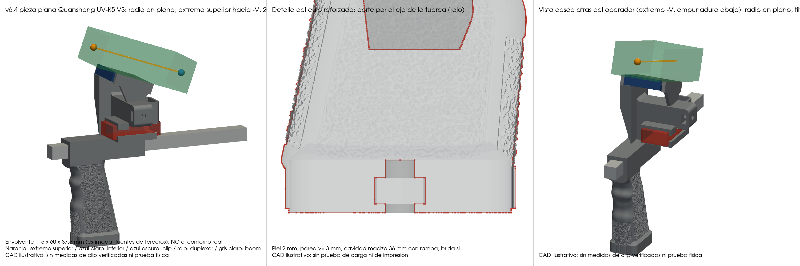
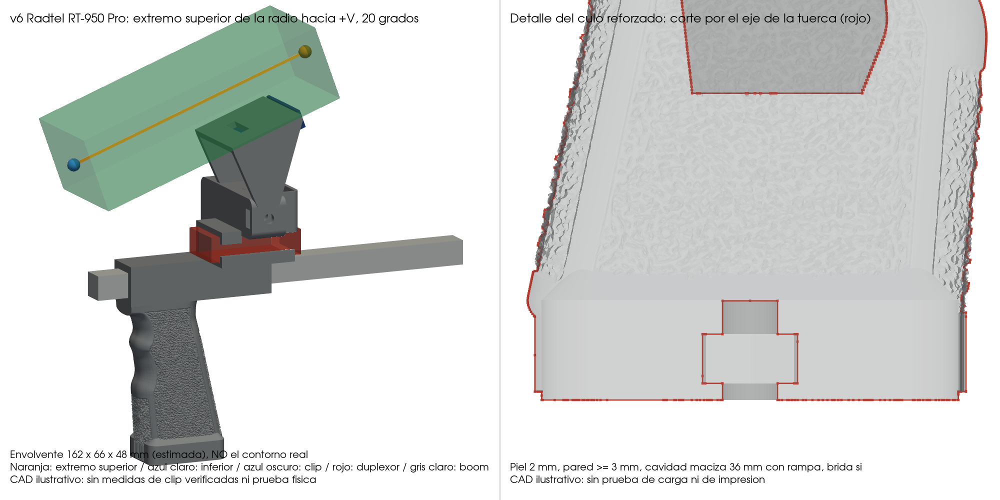
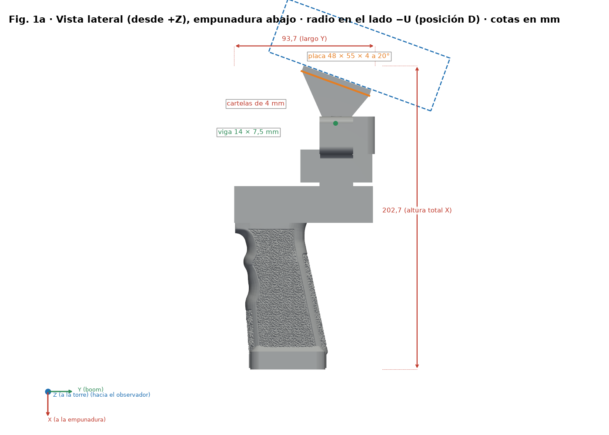
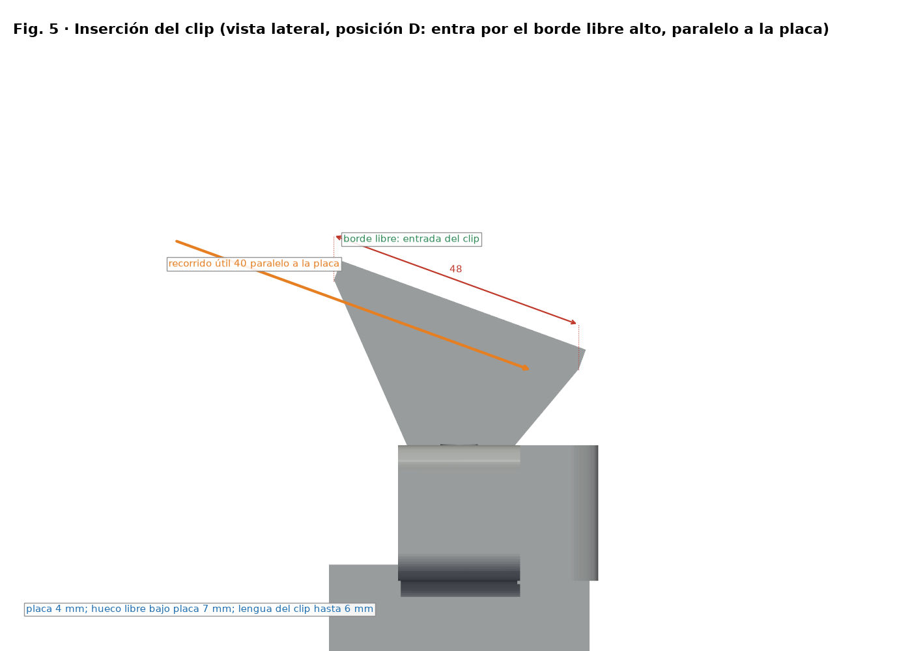

<p align="center">
  
</p>

# Mango SpaceQuad con trípode, soporte de walki por clip y duplexor

Mango imprimible en 3D para la antena de satélites **BIG SIGNAL SpaceQuad** (VHF/UHF, boom cuadrado de 15 mm).
Se puede llevar en la mano o montar en un trípode de fotografía. Lleva una **lengüeta ancha para el clip de cinturón del walki**
en la torre y una funda para el duplexor.

> **Ayuda y navegación:** [guía completa de uso, instalación y scripts](docs/AYUDA.md) ·
> [montaje](docs/MONTAJE.md) · [materiales](docs/MATERIALES.md) · [cambios](CHANGELOG.md).

<p align="center">
  
  
</p>

## Novedades de la v6.2 (posición D) — pieza recomendada

La **v6.2** es la pieza recomendada. Con la empuñadura en la mano, la **radio queda en el lado del boom opuesto a la torre y al duplexor
(lado −U), inclinada 20° hacia el operador** (posición D). Una viga de 14 × 7.5 mm une las dos cartelas con la torre y se empotra en ella.
La zona de la tuerca de trípode está reforzada.

| Variante | STL |
|---|---|
| UV-K5 V3 (115 × 60 × 37,5 mm, estimada) | `stl/v6/mango_spacequad_v6_uvk5v3.stl` |
| RT-950 Pro (162 × 66 × 48 mm, estimada) | `stl/v6/mango_spacequad_v6_rt950pro.stl` |

- **Inserción del clip**: el clip entra **paralelo a la placa por su borde libre alto** y avanza hacia el fondo del hueco (recorrido útil de 40 mm);
  la lengua queda debajo de la placa y la radio, en el lado −U.
- **Tuerca de trípode reforzada**: piel de **2,0 mm** en la cara, paredes de al menos 3 mm, labios de retención (apertura 10,6 mm) y cavidad de la empuñadura
  rellena 36 mm con transición cónica; brida opcional en el culo. La tuerca **entra a presión**, pasando los labios; un tornillo de **6 mm o más engrana unos 4 mm**.
- **Impresión**: soportes bajo la placa y bajo la viga; relleno alto o paredes extra en la viga y en la zona del trípode; **prueba de carga antes de fiarse de la pieza**.
- Las medidas del clip y de las radios son **estimaciones de fuentes de terceros**: ninguna está medida físicamente.
- Detalles en [docs/VARIANTES_V6.md](docs/VARIANTES_V6.md) y resultados en [docs/cad_checks_v6.json](docs/cad_checks_v6.json).

<p align="center">
  
</p>
<p align="center">
  
  
</p>

## Características

- **Encaja en el boom de la SpaceQuad**: túnel de 15,5 × 15,5 mm para el boom cuadrado de 15 mm (0,5 mm de holgura).
- **Rosca de trípode reforzada en el culo de la empuñadura**: **una** tuerca 1/4"-20 que entra a presión, con piel de 2,0 mm.
  La rosca engranada está limitada por el grosor real de la tuerca (5,6 mm nominal).
  La empuñadura queda hacia abajo y el boom horizontal, igual que al llevarla en la mano.
- **Soporte del clip en posición D**: placa de 55 × 48 × 4 mm a 20° en el lado −U, 47 mm de ancho libre y 40 mm de inserción,
  dos cartelas y viga de 14 × 7.5 mm empotrada en la torre.
- **Funda para el duplexor** VHF/UHF entre la torre y el boom: 16 × 32 mm por dentro, 48 mm de largo, abierta por los extremos.
- **Paramétrico**: todo se genera con scripts de Python (trimesh + manifold3d), así que las medidas se pueden adaptar.

## Contenido del repositorio

```
stl/    Piezas listas para imprimir (ya orientadas)
  v6/mango_spacequad_v6_uvk5v3.stl     Mango v6.2 para UV-K5 V3 (recomendado)
  v6/mango_spacequad_v6_rt950pro.stl   Mango v6.2 para RT-950 Pro (recomendado)
  mango_spacequad_tripode.stl          Mango v1 (se conserva sin cambios: es la entrada de mango_v6.py)
src/    Scripts paramétricos que generan las piezas
docs/   Imágenes, montaje y lista de materiales
  mango_spacequad_v3.stl               Mango v3 (referencia base del Anytone)
  mango_spacequad_anytone_generico.stl Anytone genérico ajustable (con anytone_calzos/ y calibracion/)
```

## Materiales

Lista completa en [docs/MATERIALES.md](docs/MATERIALES.md). En resumen:

| Cantidad | Pieza |
|---|---|
| 1 | Tuerca hexagonal 1/4"-20 UNC (11,1 mm entre caras) para el trípode (opcional) |

El walki se sujeta con su propio clip de cinturón: no hace falta tornillería.

## Impresión

| Pieza | Material | Orientación | Soportes |
|---|---|---|---|
| Mango v6.2 | PETG o ASA (exterior, al sol) | La del STL | Sí: desde la cama, **bajo la placa y bajo la viga** |

0,2 mm de capa, 4 perímetros o más y relleno alto (60–100 %) o paredes extra en la viga y en la zona del trípode.
**Haz una prueba de carga antes de fiarte de la pieza** (no se ha hecho ninguna).

## Montaje

Pasos detallados en [docs/MONTAJE.md](docs/MONTAJE.md).

1. Mete la tuerca 1/4"-20 **a presión** por el canal lateral del culo de la empuñadura, hasta pasar los labios de retención.
2. Pasa el boom de la SpaceQuad por el túnel del mango y mete el duplexor en su funda.
3. Abre el clip y deslízalo por el **borde libre alto de la placa**, paralelo a ella; la lengua queda debajo y el walki encima, en el lado opuesto a la torre (−U).
## Compatibilidad del clip (estimada)

| Dato | Valor (estimación de diseño, no medida) |
|---|---|
| Ancho de la lengua del clip | de 25 a 45 mm; 47 mm libres entre cartelas |
| Grosor de la lengua | hasta 6 mm (holgura mínima del canal 7 mm) |
| Recorrido útil | 40 mm; barrido continuo de lengua de 45 × 6 mm |
| Clips estrechos | quedan holgados en el ancho; el muelle del clip los sujeta, sin centrado |
| Ventana de 22 × 6 mm | retención opcional; no engancha todos los clips |

Familias pensadas: clips de cinturón de Baofeng, Radtel, Anytone, Quansheng y Retevis RT3S (sin atornillar al mango).
**No se ha medido ninguno**; solo está verificada en [retevis.com](https://www.retevis.com/products/belt-clip-for-tyt-tytera-md-380-retevis-rt3-radio) la separación de 26 mm entre tornillos del clip del MD-380/RT3.
No se garantiza ajuste universal: comprueba el clip de tu walki. Las medidas se cambian en `src/mango_v6.py`.

## Regenerar las piezas

```bash
python -m pip install -r src/requirements.txt
python src/mango_v6.py stl/mango_spacequad_tripode.stl stl/v6 todas
python src/verificar_v6.py stl/v6 docs/cad_checks_v6.json
python src/render_v6.py stl docs/img
python src/render_guia.py stl/v6/mango_spacequad_v6_uvk5v3.stl docs/img/guia/v6
python src/gen_docs_i18n.py
```

`mango_v6.py` parte del STL v1 incluido en el repositorio. `build_mango.py` (v1) parte del **STL original del mango**,
que no está incluido (ver *Créditos*) y necesita además `cadquery`.
Consulta las opciones y advertencias antes de regenerar en [docs/AYUDA.md](docs/AYUDA.md); las medidas se cambian en la sección `PARAMETROS` de cada script.

## Estado

Resultados en [docs/cad_checks_v6.json](docs/cad_checks_v6.json) (se generan con `verificar_v6.py`). **Solo CAD**: la comprobación geométrica
no demuestra ajuste físico ni resistencia. Las envolventes de las radios (UV-K5 V3 115 × 60 × 37,5 mm; RT-950 Pro 162 × 66 × 48 mm) son estimaciones de fuentes de terceros.
**Ningún clip real ha sido medido ni probado, no se ha hecho ninguna prueba de carga (tuerca de trípode y viga incluidas) y el modelo no está probado impreso.**

## Versiones anteriores

Solo siguen en el repositorio **v1** (entrada de `mango_v6.py`), **v3** (generador base y referencia del Anytone, `stl/mango_spacequad_v3.stl`) y el
**Anytone genérico ajustable** (`stl/mango_spacequad_anytone_generico.stl` y calzos).
v2, v4 y v5 se eliminaron; se pueden recuperar del historial de git (commit anterior a esta limpieza).

## Créditos y licencia

- Mango original de la SpaceQuad: **[AUTOR ORIGINAL — completar con nombre y enlace]**.
  Este proyecto es una modificación de su diseño y respeta su licencia original.
- Modificaciones, soporte de walki y scripts: **Bricohams**.
- BIG SIGNAL y SpaceQuad son marcas de sus respectivos propietarios. Este proyecto no está afiliado a ellos.

Licencia: [CC BY-SA 4.0](LICENSE) para los modelos y la documentación. Los scripts de `src/` también se
publican bajo CC BY-SA 4.0. Si la licencia del diseño original es distinta, **manda la del original**.

73 y buenas pasadas.
