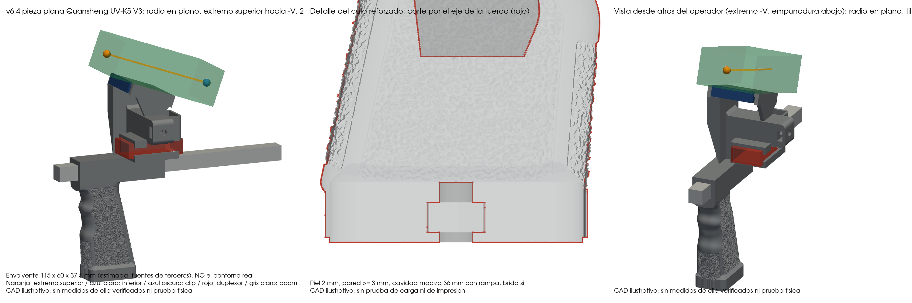
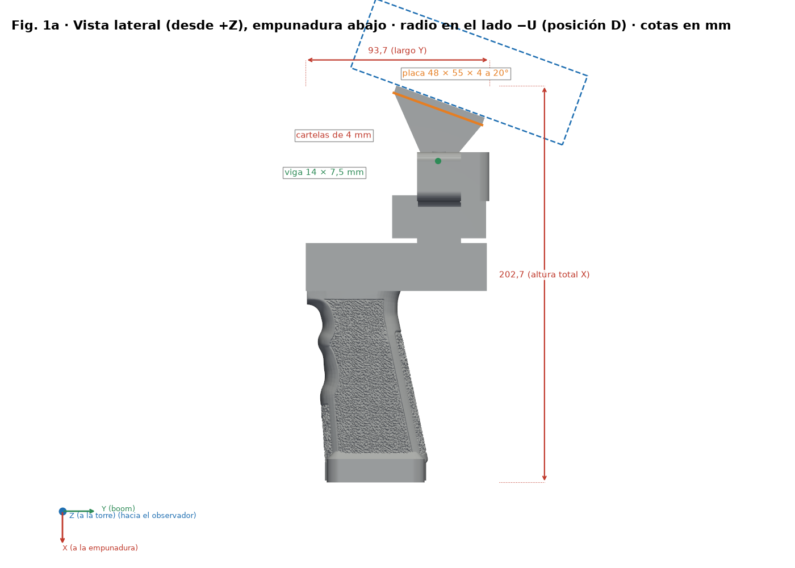
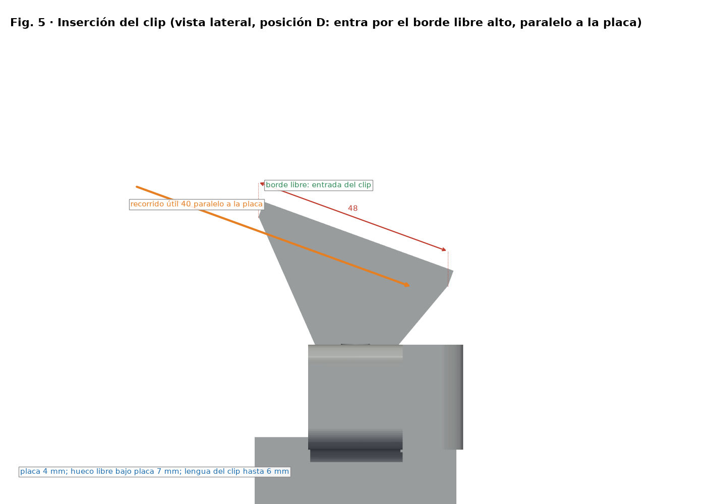
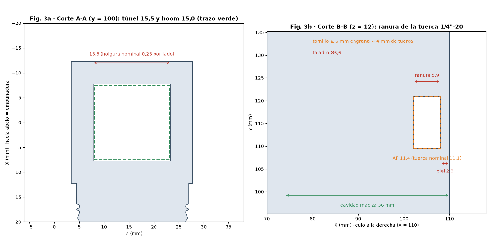

# Ayuda del proyecto

Guía de entrada para elegir el archivo imprimible, preparar Python, usar los comandos y entender qué está comprobado. El modelo recomendado es la **v6.2 (posición D)**: **`stl/v6/mango_spacequad_v6_uvk5v3.stl`** y **`stl/v6/mango_spacequad_v6_rt950pro.stl`**; los demás diseños y generadores son versiones anteriores.

**Navegación:** [README](../README.md) · [montaje](MONTAJE.md) · [materiales](MATERIALES.md) · [variantes v6](VARIANTES_V6.md) · [cambios](../CHANGELOG.md).

## Qué archivo usar

- Imprime el STL de v6.2 que corresponda a tu radio, ya orientado: `stl/v6/mango_spacequad_v6_uvk5v3.stl` (UV-K5 V3) o `stl/v6/mango_spacequad_v6_rt950pro.stl` (RT-950 Pro). No los confundas con `stl/mango_spacequad_tripode.stl`: este último es la base v1 que consume el generador, no el modelo final.
- **Posición D:** con la empuñadura en la mano, la radio queda en el lado del boom opuesto a la torre y al duplexor (lado −U), inclinada 20° hacia el operador.
- Los diseños anteriores se eliminaron salvo v1, v3 y Anytone; ver [Versiones anteriores](#versiones-anteriores).
- Ver [materiales](MATERIALES.md) y [montaje](MONTAJE.md) para hardware y pasos de montaje.

## Preparación

Se necesita Python con `pip` y Git (el verificador consulta una revisión del repositorio). Desde la raíz del clon, crea y activa un entorno virtual e instala las dependencias:

**Windows PowerShell**

```powershell
py -3 -m venv .venv
.\.venv\Scripts\Activate.ps1
python -m pip install -r src/requirements.txt
```

**Linux/macOS (bash)**

```bash
python3 -m venv .venv
source .venv/bin/activate
python -m pip install -r src/requirements.txt
```

Las dependencias comunes son NumPy, trimesh, manifold3d y Shapely; el render usa además PyVista. CadQuery se requiere únicamente para el generador v1, y no para los comandos de la v6.2. No hace falta instalar nada para consultar la ayuda de los scripts.

## Comandos actuales

Ejecuta desde la raíz del repositorio. `-h` y `--help` describen los argumentos y terminan sin cargar las bibliotecas CAD ni escribir archivos:

```powershell
python src/mango_v6.py --help
python src/verificar_v6.py --help
python src/render_v6.py --help
python src/render_guia.py --help
```

```bash
python src/mango_v6.py --help
python src/verificar_v6.py --help
python src/render_v6.py --help
python src/render_guia.py --help
```

Regenera los STL v6.2, verifica los sólidos y actualiza el JSON de comprobaciones y las imágenes, en este orden (sobrescribe los PNG correspondientes):

```text
python src/mango_v6.py stl/mango_spacequad_tripode.stl stl/v6 todas
python src/verificar_v6.py stl/v6 docs/cad_checks_v6.json
python src/render_v6.py stl docs/img
```

Genera las figuras de la guía (en `docs/img/guia/v6/`, una carpeta por idioma) y las guías multilingües (`docs/i18n/{es,en,de,fr,it}`):

```text
python src/render_guia.py stl/v6/mango_spacequad_v6_uvk5v3.stl docs/img/guia/v6
python src/gen_docs_i18n.py
```

`mango_v6.py` necesita el STL v1 de entrada del repositorio y escribe en `stl/v6`. `render_v6.py` necesita los STL v6.2 y PyVista. `render_guia.py` acepta opcionalmente `--radio {uvk5v3,rt950pro}` (se detecta por el nombre del STL) y `--langs`. Los argumentos desconocidos, faltantes o rutas inválidas se rechazan antes de escribir.

## Interpretar las comprobaciones CAD

El informe [docs/cad_checks_v6.json](cad_checks_v6.json) lo genera `verificar_v6.py`. `passed` es el booleano global; cada entrada de `checks` contiene `name`, `passed` y campos con valores específicos (por ejemplo, `collision_mm3`); `limitations` enumera las salvedades. Si alguna comprobación falla, el verificador devuelve código distinto de 0 (un error de argumentos devuelve 2): revisa el nombre y los valores de las entradas con `passed: false`, corrige la causa y vuelve a verificar antes de publicar. Sin ruta de informe, solo se muestran resultados en consola. El resultado **no certifica** el ajuste físico de radios o duplexores, ni resistencia, ni impresión.

## Otros puntos de entrada Python

Todos los scripts ejecutables ofrecen `-h`/`--help` incluso sin dependencias opcionales:

| Script | Uso / condición |
|---|---|
| `src/build_mango.py` | Generador histórico v1. Necesita un STL original externo no incluido y CadQuery. |
| `src/geom.py` | Biblioteca geométrica importable, no un comando generador. |

## Geometría y límites de compatibilidad

La placa de la v6.2 mide **55 × 48 × 4 mm**, está **inclinada 20° hacia −V**, centrada en U = −20,4 mm (lado −U del boom) y tiene dos cartelas laterales de 4 mm. El espacio libre entre ellas es **47 mm**, el recorrido modelado para la lengua del clip es **40 mm** y el espacio bajo la placa es **7 mm**. Una **viga de 14 × 7,5 mm** une las dos cartelas con la torre y se empotra en ella (la profundidad exacta está en `EMBED_U` de `src/mango_v6.py`).

El clip **entra paralelo a la placa por su borde libre alto** y avanza hacia el fondo del hueco, donde está la ventana de retención; la lengua queda debajo de la placa y la radio encima, en el lado −U.

**Tuerca de trípode reforzada:** piel de **2,0 mm** en la cara, paredes de al menos 3 mm, labios de retención (apertura 10,6 mm frente a 11,1 mm de la tuerca; interferencia teórica), cavidad de la empuñadura rellena 36 mm con transición cónica y brida opcional en el culo. La tuerca se mete **a presión**, pasando los labios; un tornillo de **6 mm o más** engrana unos 4 mm de la tuerca (5,6 mm nominal).

Cada radio tiene su propia envolvente, **estimada de fuentes de terceros y no medida**: UV-K5 V3 115 × 60 × 37,5 mm y RT-950 Pro 162 × 66 × 48 mm. Las dimensiones de lengua de **25–45 mm de ancho y hasta 6 mm de grosor son estimaciones de diseño**, no medidas de una familia de radios ni una garantía de ajuste. **Ningún clip ha sido medido físicamente.** Los clips estrechos pueden quedar holgados lateralmente; la ventana es opcional y no engancha todos los modelos. El barrido CAD de inserción no es una prueba con un clip real. La única referencia pública indicada en el proyecto es la separación de 26 mm entre tornillos del clip Retevis/TYT MD-380.

La funda se diseñó para una sección de duplexor de hasta 16 × 32 mm y 48 mm de largo; las cajas de prueba del verificador son envolventes supuestas, no medidas. **Solo CAD**: no se han documentado pruebas físicas de impresión, carga (tuerca de trípode y viga incluidas) ni compatibilidad de clips, y la conectividad geométrica no certifica resistencia.

## Vistas de ayuda



Montaje v6.2 con la radio estimada en el lado −U, inclinada hacia el operador. Son envolventes CAD, no piezas medidas ni pruebas de montaje.



Vista lateral con la placa, las cartelas y la viga anotadas en posición D.



Dirección de inserción del clip: paralelo a la placa, por su borde libre alto. El recorrido CAD de 40 mm no certifica compatibilidad ni resistencia.



Cortes con la piel de 2 mm de la tuerca de trípode reforzada.

## Impresión, orientación y montaje

- Usa PETG o ASA; los STL v6.2 están orientados para imprimir.
- Ajuste de partida: capa de 0,2 mm, 4 perímetros o más; **relleno alto (60–100 %) o paredes extra en la viga y en la zona del trípode**.
- Usa soportes desde la cama **bajo la placa y bajo la viga** (y bajo la empuñadura/torre según el laminador). Retíralos del paso del clip y no rellenes el hueco entre cartelas.
- **Haz una prueba de carga antes de fiarte de la pieza**, sobre todo de la tuerca de trípode y de la viga, y usa retención secundaria; no hay certificación estructural.
- Revisa el laminado y la holgura real del clip.
- El mango se instala sobre el boom cuadrado nominal de 15 mm; comprueba las dimensiones reales del duplexor antes del montaje.

Los pasos y advertencias ampliados están en [Montaje](MONTAJE.md).

## Parámetros y mapa de archivos

- `src/mango_v6.py`: generador v6.2 (placa, cartelas, viga, tuerca reforzada); `configuracion("uvk5v3" | "rt950pro")` da el marco de la placa de cada radio.
- `src/verificar_v6.py`: criterios de comprobación y escritura de `docs/cad_checks_v6.json`.
- `src/render_v6.py`: imágenes principales (`docs/img/v6_*`).
- `src/render_guia.py`: figuras de la guía en `docs/img/guia/v6/<idioma>/`.
- `src/i18n_figuras.py` y `src/gen_docs_i18n.py`: textos de las figuras y guías en es, en, de, fr, it (`docs/i18n/`).
- `src/geom.py`: primitivas geométricas compartidas.
- `src/build_mango.py`: parámetros del generador v1 histórico.
- `stl/`: STL v1 de entrada y `stl/v6/` (v6.2 actual). `docs/`: esta guía, montaje, materiales, imágenes y resultados CAD. `CHANGELOG.md`: historial.

## Versiones anteriores

Solo siguen v1 (entrada), v3 (generador base `src/mango_v3.py` y referencia del Anytone, `stl/mango_spacequad_v3.stl`) y el Anytone genérico ajustable (`src/verificar_anytone.py`, figuras en `docs/img/guia/anytone/`). v2, v4 y v5 se eliminaron; se recuperan del historial de git (commit anterior a la limpieza). La pieza recomendada es la v6.2.

## Problemas habituales

- **El verificador no encuentra una revisión Git:** ejecútalo desde un clon Git completo, no desde una copia suelta de los archivos.
- **Falta `manifold3d`, `trimesh`, etc.:** activa `.venv` y vuelve a instalar `src/requirements.txt`.
- **Falla el render por PyVista:** revisa la instalación de esa dependencia, incluida en `requirements.txt`.
- **No aparece el archivo de entrada:** ejecuta desde la raíz y respeta las rutas relativas de los ejemplos; comprueba que la entrada existe antes de regenerar.
- **El soporte no se ajusta o el laminado muestra interferencia:** revisa y mide tu clip/duplexor real. Las cotas del soporte de radio son estimaciones, no una promesa de compatibilidad.
