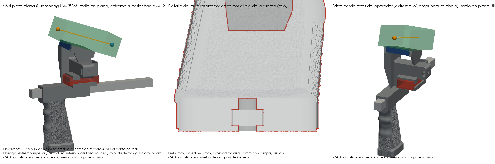
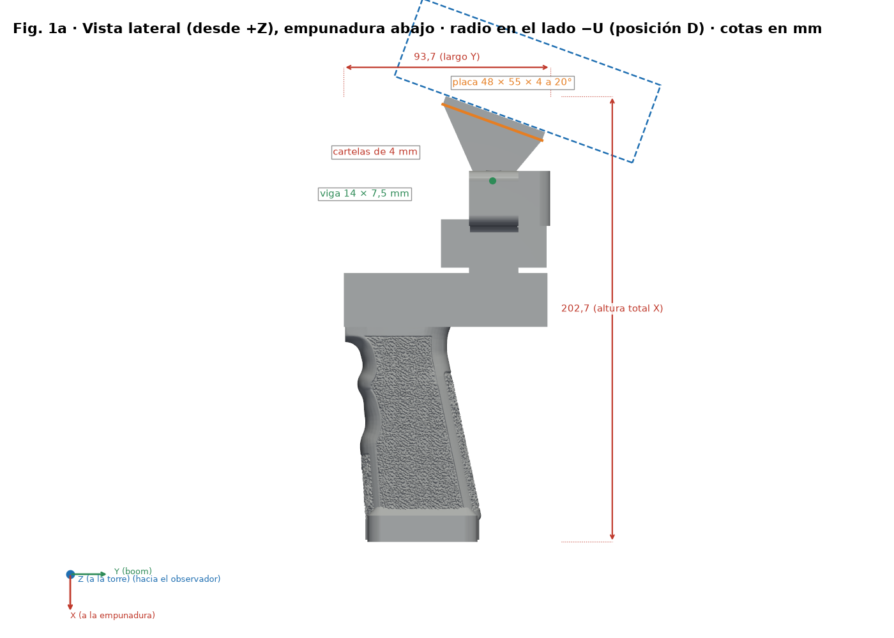
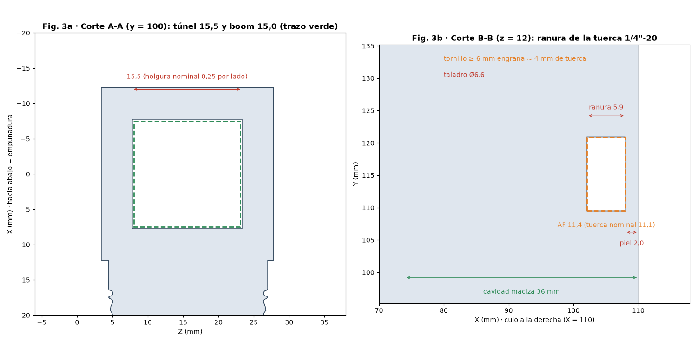
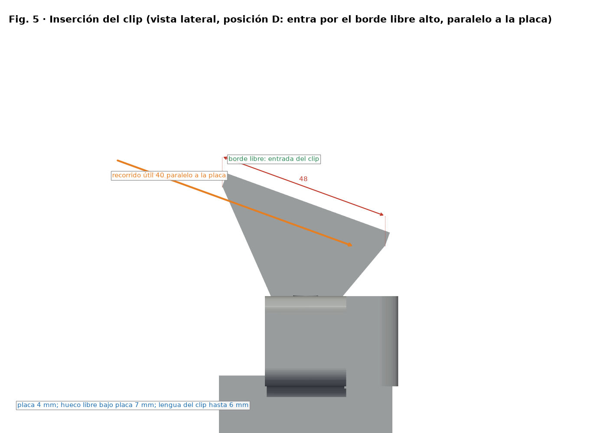

# Montaje

**Ayuda:** [guía del proyecto](AYUDA.md) · [materiales](MATERIALES.md) · [README](../README.md).

> Pieza recomendada: **v6.2 (posición D)**, STL `stl/v6/mango_spacequad_v6_uvk5v3.stl` (UV-K5 V3) o `stl/v6/mango_spacequad_v6_rt950pro.stl` (RT-950 Pro).
> Con la empuñadura en la mano, la radio queda en el lado del boom opuesto a la torre y al duplexor (lado −U), inclinada 20° hacia el operador.
> **Solo CAD:** los clips no están medidos y no se ha hecho ninguna prueba de carga.

## 1. Preparar el mango

1. Quita los soportes (bajo la placa y bajo la viga) y limpia el túnel del boom. El boom de 15 mm tiene que deslizar sin forzar.
2. Repasa el hueco de la placa del clip: la lengua del clip (estimada hasta 45 × 6 mm) tiene que deslizar sin enganchones.
3. Mete la **tuerca 1/4"-20** del trípode **a presión** por el canal lateral del culo de la empuñadura, hasta que pase los labios de retención
   (apertura 10,6 mm frente a 11,1 mm de la tuerca). Queda detrás de una piel de **2 mm**; un tornillo de **6 mm o más** engrana unos 4 mm de la tuerca (5,6 mm nominal).
   No fuerces con una herramienta que pueda romper los labios.

## 2. Montaje en la antena

1. Pasa el boom de la SpaceQuad por el túnel del mango y colócalo en el punto de equilibrio.
2. Mete el **duplexor** en su funda por uno de sus extremos y conecta las bajadas de VHF y UHF.

## 3. Enganchar el walki

1. Con la empuñadura en la mano, la placa queda en el lado −U del boom (opuesto a la torre y al duplexor) e inclinada 20° hacia el operador.
2. Abre el clip y desliza su lengua **por el borde libre alto de la placa, paralela a ella y por debajo**. El walki queda encima, en el lado −U.
3. Puede entrar 40 mm hacia el fondo del hueco. El muelle del clip aprieta la lengua contra la placa. La ventana de retención es opcional: solo engancha si el saliente del clip coincide con ella.
4. Los clips estrechos (25–30 mm) quedan holgados lateralmente: se sujetan solo por el muelle del clip, sin centrado.
5. Para sacarlo, abre el clip y deslízalo hacia el borde libre alto, paralelo a la placa.

Las medidas (25–45 mm × 6 mm) y las envolventes de las radios (UV-K5 V3 115 × 60 × 37,5 mm; RT-950 Pro 162 × 66 × 48 mm) son estimaciones de terceros, no medidas verificadas: prueba el clip de tu walki antes de fiarte.

## 4. En trípode

1. Saca la placa rápida de la rótula y enróscala en el culo de la empuñadura.
2. Encaja la placa en la rótula. La empuñadura queda hacia abajo y el boom horizontal.
3. Con el walki puesto, comprueba que su base no toque la rótula.
4. **No hay prueba de carga de la tuerca reforzada**: ensáyala con lastre antes de colgar la antena y usa retención secundaria.

## Consejos

- **Impresión:** soportes bajo la placa y bajo la viga; relleno alto (60–100 %) o paredes extra en la viga y en la zona del trípode.
- La viga de 14 × 7,5 mm une las cartelas con la torre y está empotrada en ella, pero no hay certificación de carga: **haz una prueba de carga antes de fiarte de la pieza**.
- La radio de los renders es una envolvente estimada solidaria con el clip; queda inclinada sobre la placa, no vertical.
- No rellenes el espacio abierto entre las cartelas y comprueba los 7 mm libres bajo la placa tras quitar los soportes.
- Comprueba que el walki no quede a la altura de ningún elemento de la antena, sobre todo de los cuadros de VHF.
  Si hace falta, desplaza el mango por el boom.
- Si el clip de tu walki queda flojo, pega una tira fina de goma EVA en la cara exterior de la lengüeta.

## Versiones anteriores

Solo siguen v1 (entrada), v3 (generador base y referencia del Anytone) y el Anytone genérico ajustable (figuras en `docs/img/guia/anytone/`). v2, v4 y v5 se eliminaron; se recuperan del historial de git (commit anterior a la limpieza).
En ellas la tuerca va en una ranura lateral a 1,2 mm de la cara y el clip entra según su propia orientación; sigue sus guías originales si las usas.
