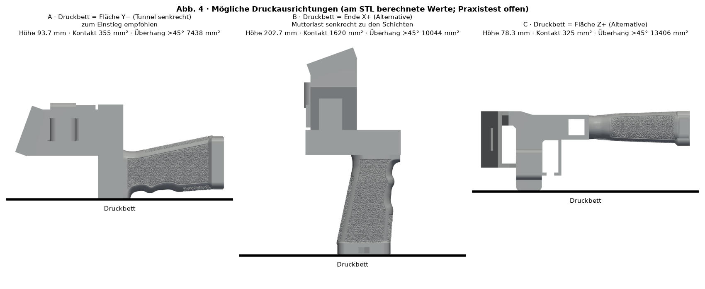

# Material und Ausrichtung — SpaceQuad v6.2

[Español](../es/README.md) · [English](../en/README.md) · **Deutsch** · [Français](../fr/README.md) · [Italiano](../it/README.md)

> ⚠ PHYSISCHE PRÜFUNG AUSSTEHEND

## Material und Ausrichtung

| Option | Wann | Status |
|---|---|---|
| PETG (empfohlen) | Allgemein, zäh; gute Schichthaftung | Startwert, Test ausstehend |
| ASA | Längerer Außeneinsatz/UV; Belüftung und Einhausung nötig | Startwert, Test ausstehend |
| PLA | Nicht empfohlen: Kriechen/Verformung bei Wärme | — |

| Bettfläche | Höhe | Kontakt | Überhang >45° | Kommentar |
|---|---|---|---|---|
| Y− | 93.7 mm | 355 mm² | 7438 mm² | Empfohlen: Tunnel vertikal; Schichten als Ringe um den Ausleger; Mutterlast in Schichtebene; Brim nutzen |
| X+ | 202.7 mm | 1620 mm² | 10044 mm² | Vertikale Mutterachse: Zug quer zu den Schichten (schwach) |
| Z+ | 78.3 mm | 325 mm² | 13406 mm² | Alternative |

## Anfängliche Profile

| Parameter | Startwert |
|---|---|
| Schichthöhe | 0.20 mm |
| Perimeter | 4 |
| Füllung | Gyroid 40 % (60–100 % oder zusätzliche Wände im Träger und im Stativbereich) |
| Brim | 5 mm (Option A) |
| Stützen | unter Platte und Träger |
| Maßkorrektur | 0 bis zur Messung des Prüfkörpers |

Alles sind Startwerte, **physische Prüfung ausstehend**; keine universellen Parameter: den auf der Spule angegebenen Temperaturbereich verwenden.

## Druckhinweise

- Stützen unter der Platte und unter dem Träger.
- Hohe Füllung (60–100 %) oder zusätzliche Wände im Träger und im Stativbereich.
- Vor dem Vertrauen in das Teil einen Belastungstest durchführen (siehe Abschnitt Festigkeitsprüfung).

- https://wiki.bambulab.com/en/filament/petg
