# SpaceQuad-Griff v5 — Bebilderte Montageanleitung

[Español](../es/README.md) · [English](../en/README.md) · **Deutsch** · [Français](../fr/README.md) · [Italiano](../it/README.md)

> Basiert auf der endgültigen Geometrie in main (v5, v5+Verstärkung und Anytone). Bei Geometrieänderung mit `src/render_guia.py` neu erzeugen. Die Clip-Maße sind geschätzt, nicht gemessen.

## Varianten (endgültige Geometrie)

| Variante | STL-Datei | Hüllmaß (mm) | Volumen (mm³) |
|---|---|---|---|
| v5 (UV-K5 V3 / RT-950 Pro, identisch) | `stl/v5/*uvk5v3.stl, *rt950pro.stl` | 195.2 × 95.6 × 79.0 | 191951 |
| v5 + verstärkte Basis (UV-K5 V3 / RT-950 Pro) | `stl/refuerzo/*_v5_*_refuerzo.stl` | 195.2 × 95.6 × 79.0 | 205173 |
| Anytone generisch einstellbar (Basis bereits verstärkt; optionale Keile) | `stl/mango_spacequad_anytone_generico.stl + stl/anytone_calzos/*.stl` | 195.2 × 93.7 × 79.0 | 213099 |

## Grafiken

### v5 (UV-K5 V3 / RT-950 Pro, identisch)

*Seitenansicht mit Maßen (X zeigt zum Griff)*

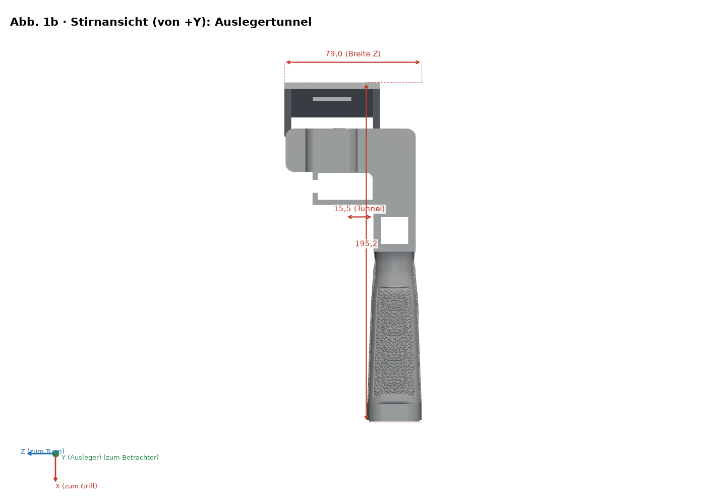
*Stirnansicht (Griffende)*

*Draufsicht der Clip-Platte: 55 × 48 × 4 mm bei 20°*

*Explosionsansicht und nummerierte Schritte ①–④ (Mutter von Z− einsetzen)*

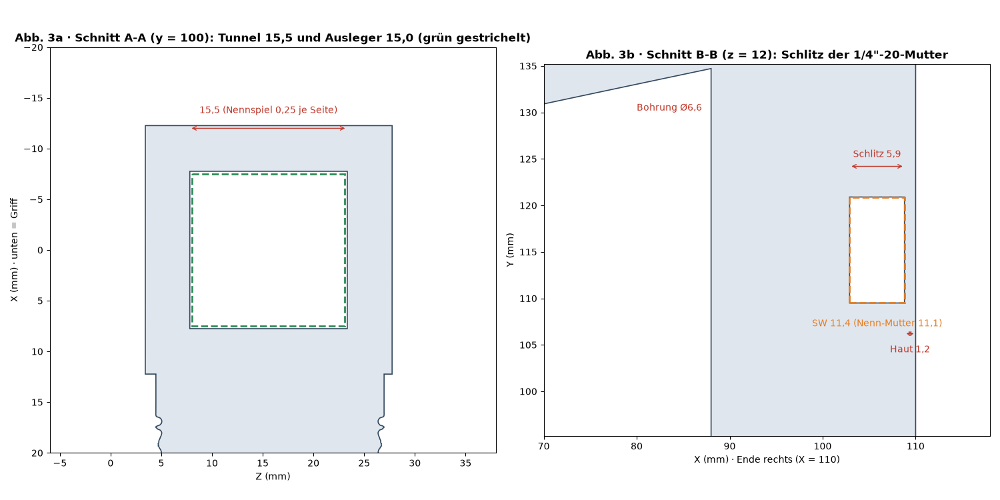
*Schnitte A-A (Tunnel) und B-B (Mutterntasche)*

*Druckausrichtungen im Vergleich*

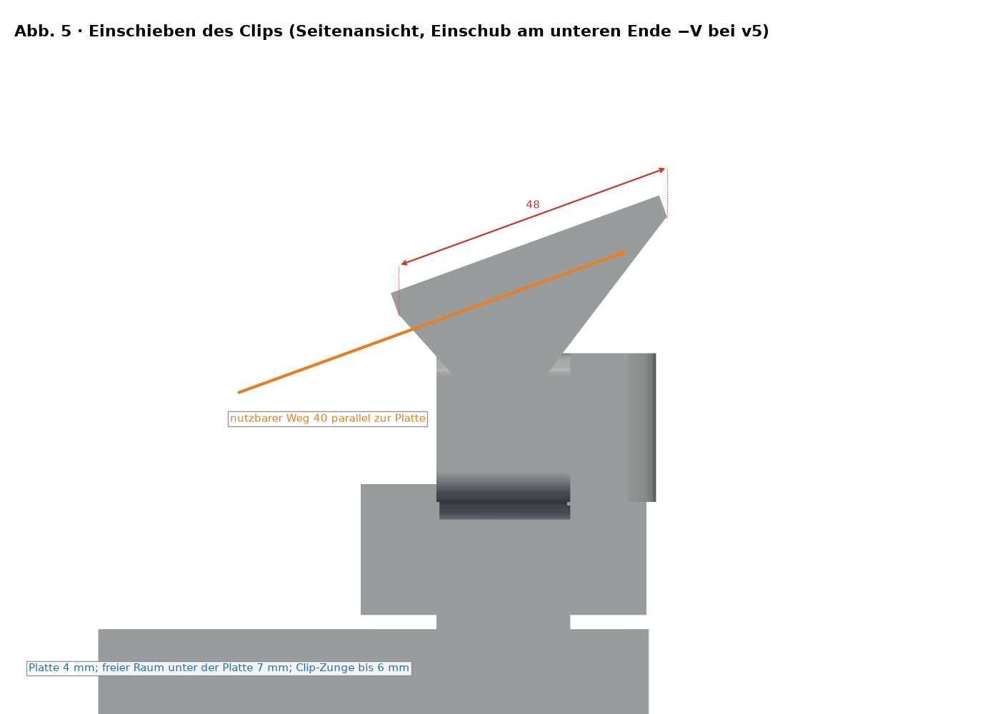
*Clip-Einschub (v3 von +V; v5 von −V)*

### v5 + verstärkte Basis (UV-K5 V3 / RT-950 Pro)

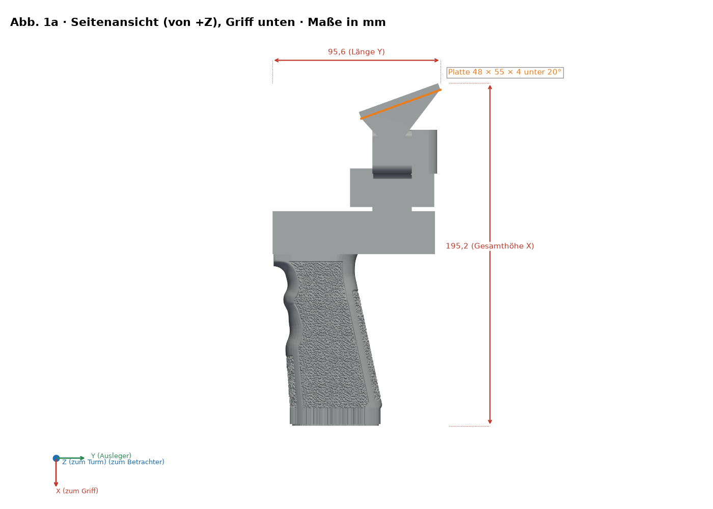
*Seitenansicht mit Maßen (X zeigt zum Griff)*

*Stirnansicht (Griffende)*

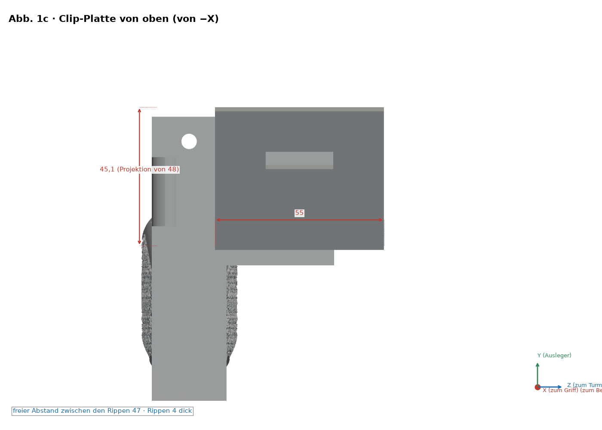
*Draufsicht der Clip-Platte: 55 × 48 × 4 mm bei 20°*

*Explosionsansicht und nummerierte Schritte ①–④ (Mutter von Z− einsetzen)*

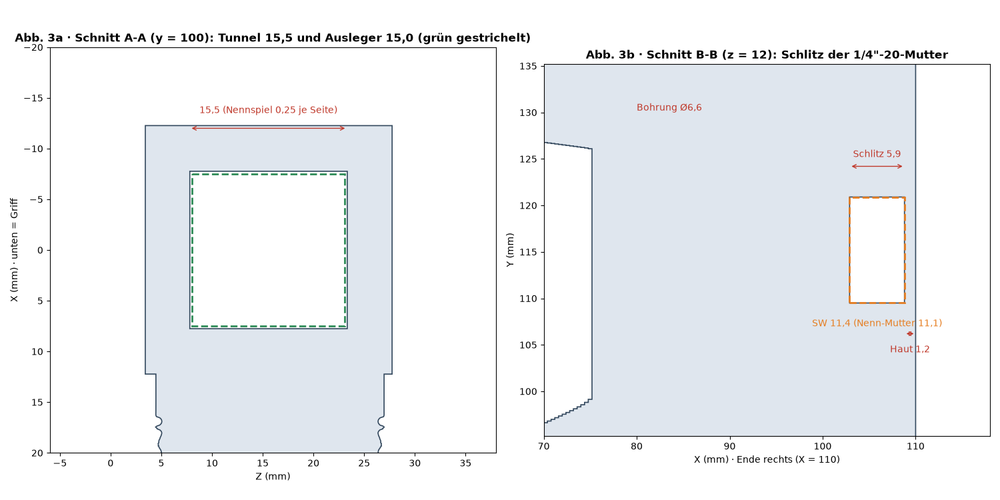
*Schnitte A-A (Tunnel) und B-B (Mutterntasche)*

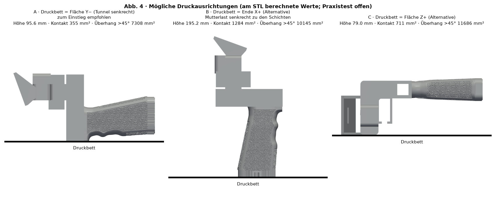
*Druckausrichtungen im Vergleich*

*Clip-Einschub (v3 von +V; v5 von −V)*

### Anytone generisch einstellbar (Basis bereits verstärkt; optionale Keile)

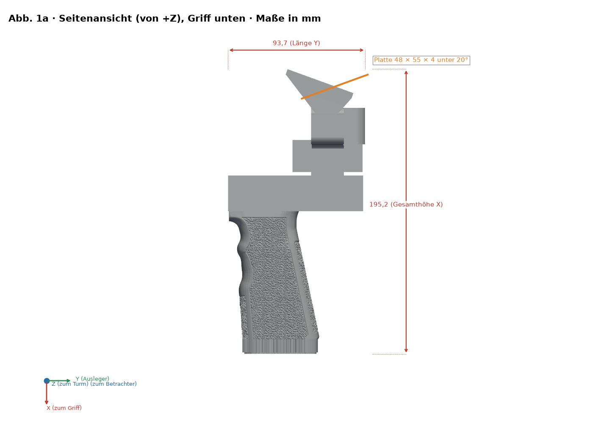
*Seitenansicht mit Maßen (X zeigt zum Griff)*

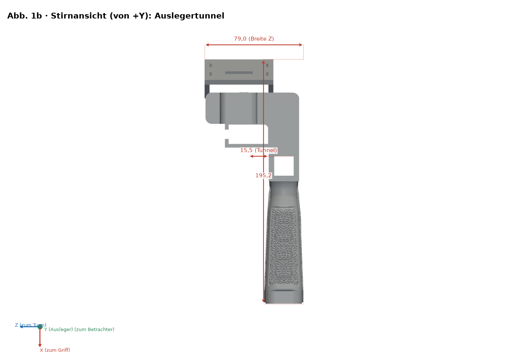
*Stirnansicht (Griffende)*

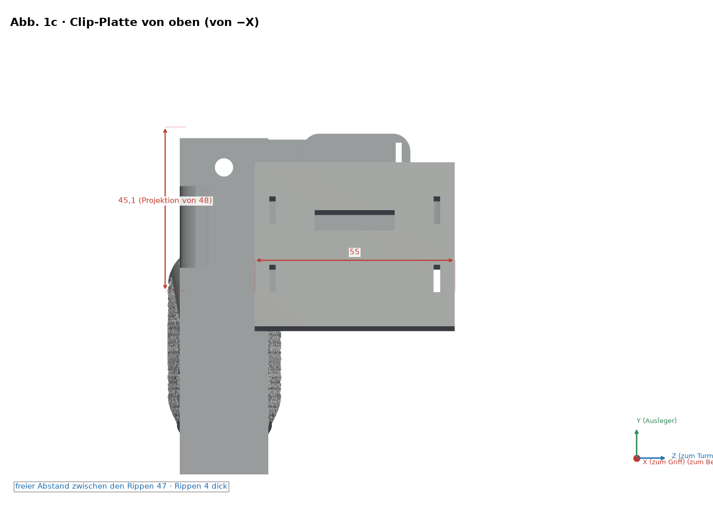
*Draufsicht der Clip-Platte: 55 × 48 × 4 mm bei 20°*

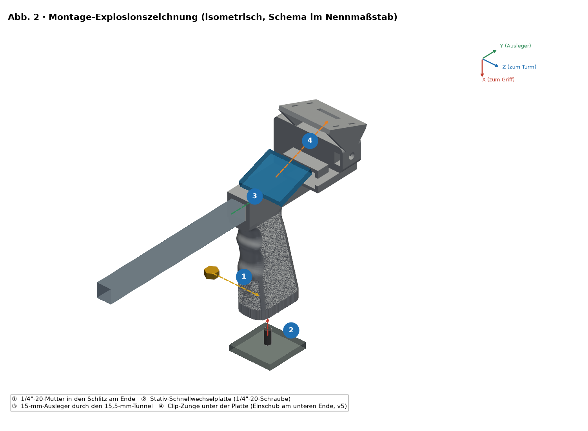
*Explosionsansicht und nummerierte Schritte ①–④ (Mutter von Z− einsetzen)*

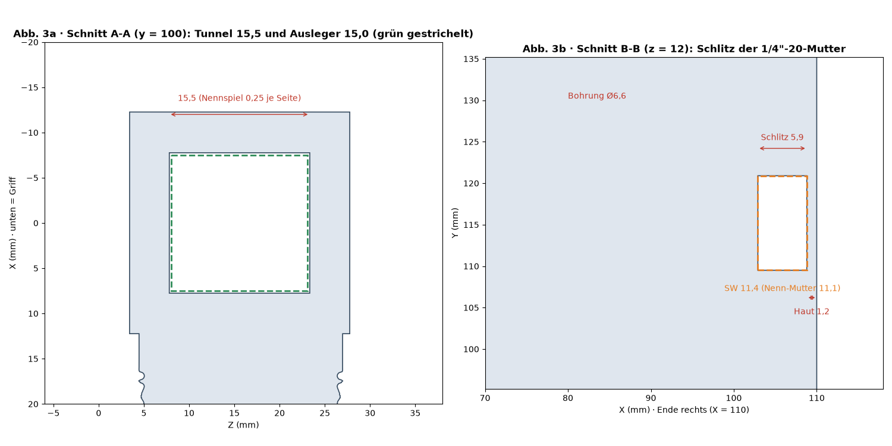
*Schnitte A-A (Tunnel) und B-B (Mutterntasche)*

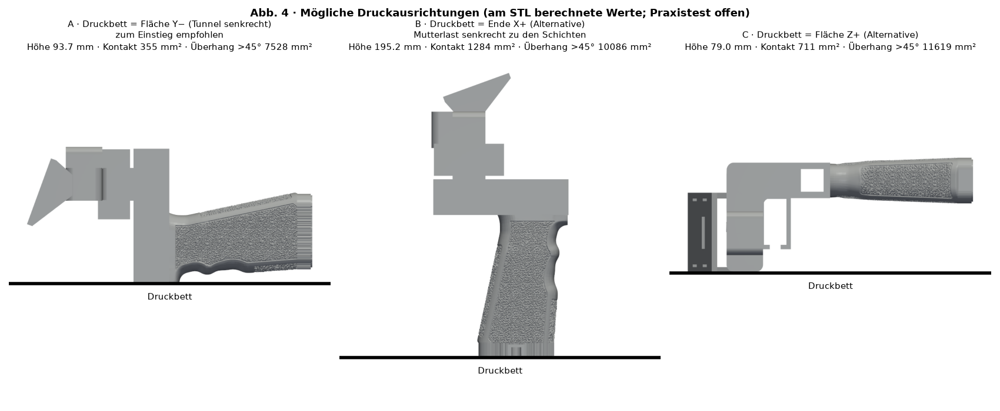
*Druckausrichtungen im Vergleich*

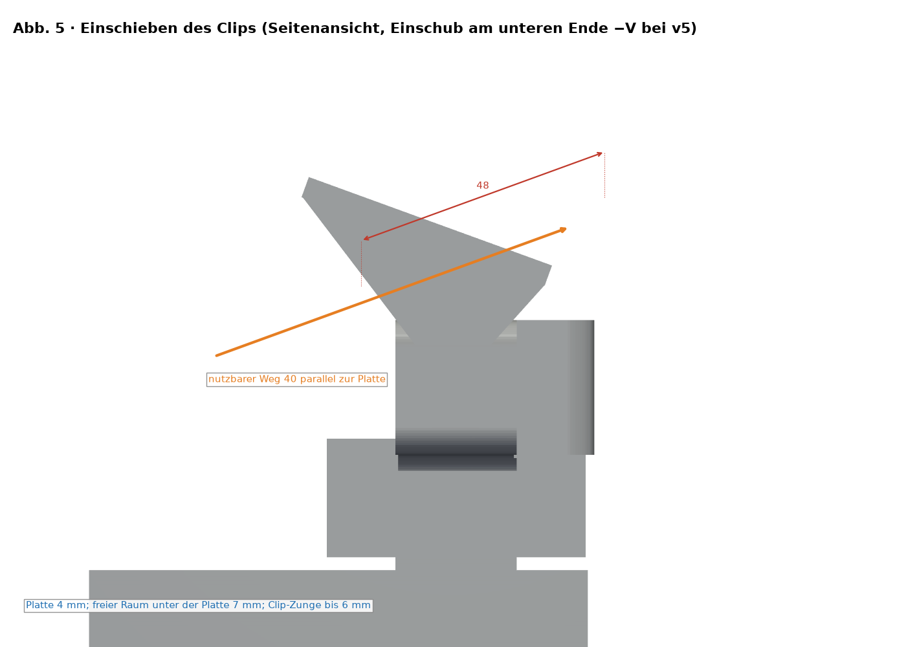
*Clip-Einschub (v3 von +V; v5 von −V)*

## Stückliste (BOM)

| Nr. | Menge | Teil | Maß / Spezifikation | Hinweis |
|---|---|---|---|---|
| 1 | 1 | Gedruckter Griff v5 (`stl/v5/*uvk5v3.stl`) | Hüllmaß 195.2 × 95.6 × 79.0 mm | PETG empfohlen |
| 2 | 1 | Sechskantmutter 1/4"-20 UNC | Schlüsselweite 11.1 mm, Dicke 5.6 mm | Tasche SW 11.4 × 5.9 mm |
| 3 | 1 | Ausleger (nicht enthalten) | Ø15 mm, Tunnel 15.5 × 15.5 mm (Nennspiel 0.25 mm je Seite) | Echten Ausleger messen |
| 4 | 0–1 | Stativ-Schnellwechselplatte/-schraube (optional) | 1/4"-20 | Nach Bedarf |
| 5 | 0–1 | Duplexer und EVA-Streifen (optional) | — | Je nach Funkgerät |

Dieses Design hat **keine Lager oder Wellen**; einziges Beschlagteil ist die 1/4"-20-Mutter.

## Montagereihenfolge

1. Teil prüfen: Grate in Tunnel und Sechskanttasche entfernen.
2. Mutter von der Z−-Seite in die Tasche einsetzen (1.2 mm Haut zum Griffende).
3. Ausleger Ø15 mm durch den 15.5 × 15.5-mm-Tunnel schieben.
4. Clip auf der Platte (55 × 48 × 4 bei 20°) montieren und Funkgerät sichern.

## Spiel messen und anpassen (mechanische Passung)

> ⚠ PHYSISCHE PRÜFUNG AUSSTEHEND

1. `stl/calibracion/prueba_holguras.stl` (124 × 92 × 8 mm) mit dem ENDGÜLTIGEN Profil und demselben Filament drucken.
2. Reihe 1: Vierkantlöcher 15.1–15.9 mm für den Ausleger. Reihe 2: Sechskanttaschen SW 11.1–11.9 mm. Reihe 3: Schlitze 6.0–8.0 mm. Punkte 1–5 kennzeichnen die Größe.
3. Mit Messschieber (0.02 mm) nach 24 h Abkühlen messen; mit echtem Ausleger und echter Mutter testen.
4. Das Loch wählen, das mit Fingerdruck ohne sichtbares Spiel gleitet (Startziel 0.2–0.3 mm je Seite, Test ausstehend).
5. Mit XY-Lochkompensation des Slicers (falls vorhanden) oder dem Modell korrigieren; nicht über den Fluss anpassen.

## Festigkeitsprüfung (vorsichtige Tests)

> ⚠ PHYSISCHE PRÜFUNG AUSSTEHEND

1. Funkgerät mit Zubehör wiegen: reale Masse M (vorab unbekannt).
2. Prüflast = 2 × M, in Stufen von 25 %, 50 % und 100 % dieser Last, je 60 s, Ballast über niedriger, geschützter Fläche.
3. Nach jeder Stufe prüfen; bei Rissen, Weißbruch oder Verformung > 0.3 mm abbrechen.
4. Praktisches Verfahren, keine Zertifizierung. Lasten durch M begründet; nie über Personen oder wertvollen Geräten.

## Lizenz und Namensnennung

CC-Lizenz des Repositories (`LICENSE`, Bricohams). Der Pastamatic-Umspuler behält seine ursprüngliche Urheberschaft; seine Lizenz ist nicht verifiziert und wird hier nicht veröffentlicht.
