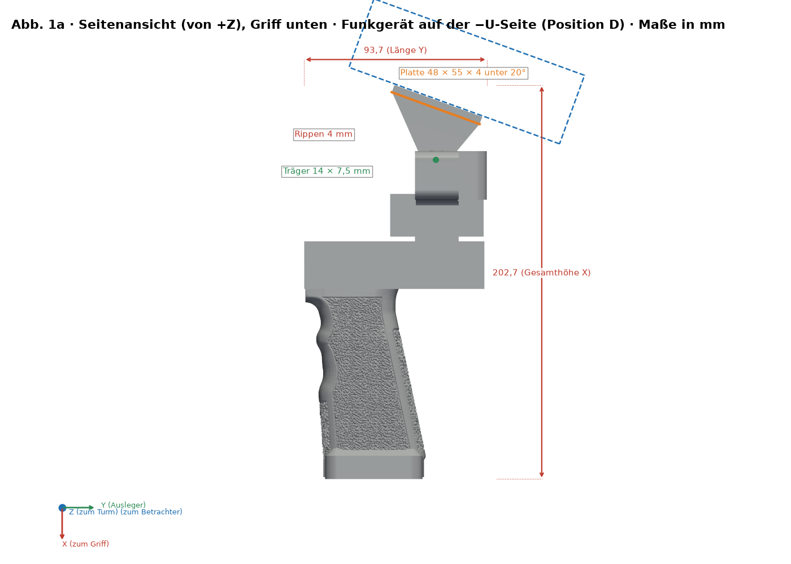
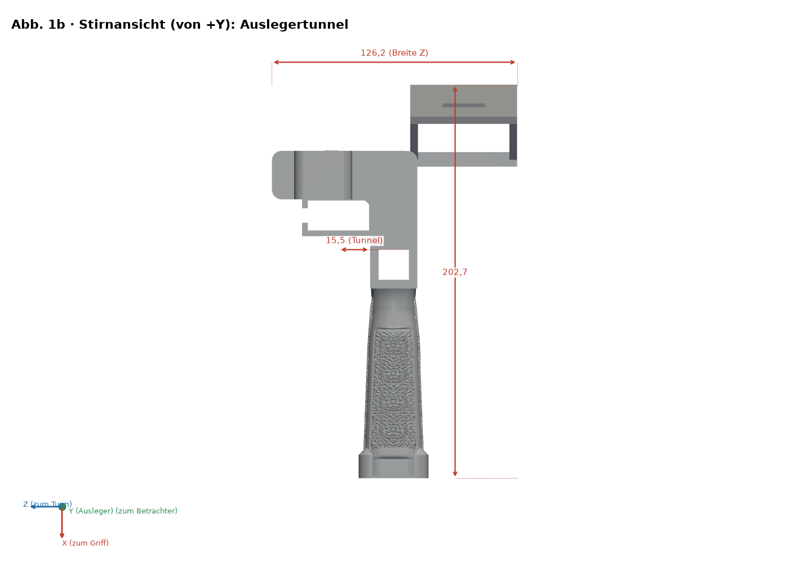
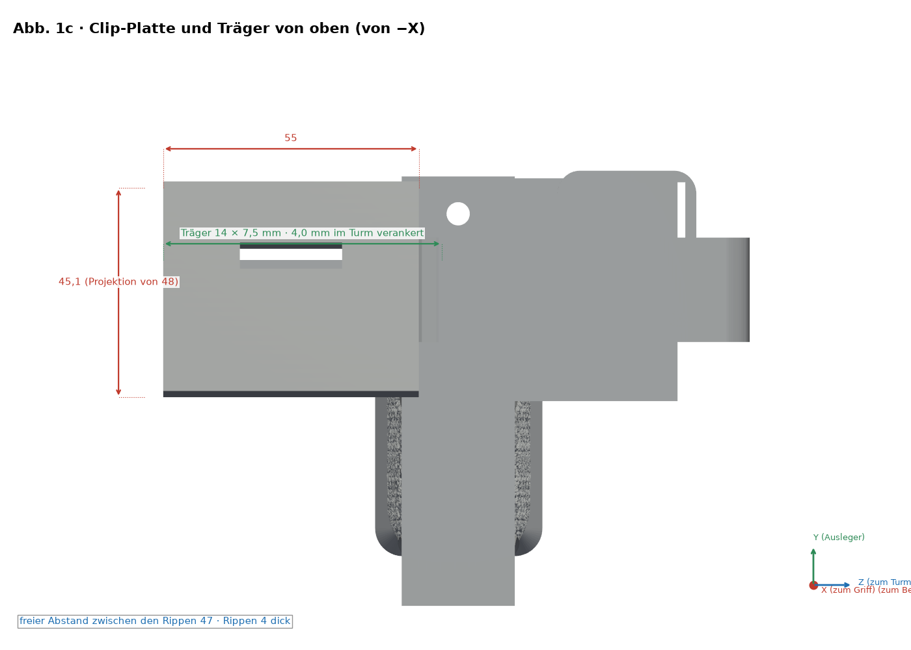
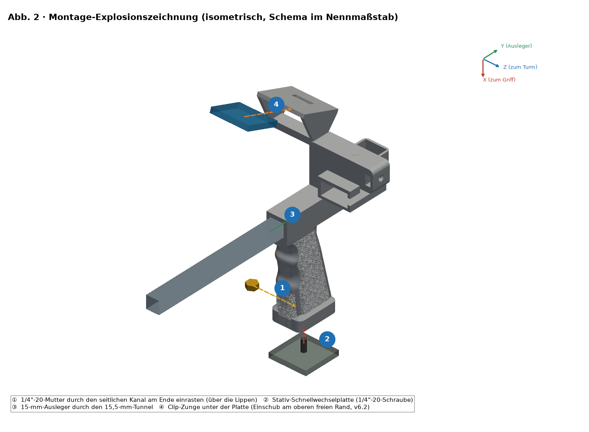
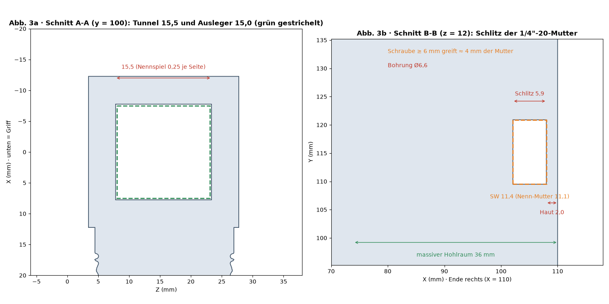
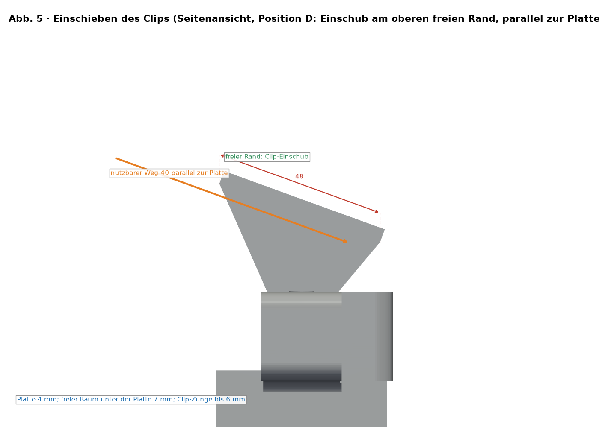

# SpaceQuad-Griff v6.2 — Bebilderte Montageanleitung

[Español](../es/README.md) · [English](../en/README.md) · **Deutsch** · [Français](../fr/README.md) · [Italiano](../it/README.md)

> Basiert auf der Geometrie v6.2 (Position D) in `stl/v6/`. Bei Geometrieänderung mit `src/render_guia.py` neu erzeugen. Nur CAD: Die Maße von Clip und Funkgerät sind geschätzt, nicht gemessen; es gibt keinen Belastungstest.

## Position D (v6.2)

- Mit dem Griff in der Hand sitzt das Funkgerät auf der dem Turm und dem Duplexer gegenüberliegenden Seite des Auslegers (−U-Seite) und ist um 20° zum Bediener geneigt (oberes Ende zu −V).
- Ein 14 × 7.5-mm-Träger verbindet die beiden Rippen der Platte mit dem Turm und ist in diesen eingelassen; er berührt weder den Auslegertunnel noch den Duplexer.
- Der Clip wird parallel zur Platte über deren oberen freien Rand eingeschoben und läuft zum Grund der Aussparung mit dem Haltefenster (nutzbarer Weg 40 mm).

## Varianten je Funkgerät

| Funkgerät | STL-Datei | Hüllmaß des Funkgeräts (geschätzt, mm) | Plattenhöhe PH0 (mm) |
|---|---|---|---|
| UV-K5 V3 | `stl/v6/mango_spacequad_v6_uvk5v3.stl` | 115 × 60 × 37.5 | 72.5 |
| RT-950 Pro | `stl/v6/mango_spacequad_v6_rt950pro.stl` | 162 × 66 × 48 | 88.5 |

## Verstärkte Stativmutter

- 2.0 mm Haut an der Endfläche (vorher 1.2 mm) und Wände von mindestens 3 mm um die Sechskanttasche.
- Die Mutter rastet ein: Sie wird durch den seitlichen Kanal eingeführt und sitzt, sobald sie die Haltelippen passiert hat (Öffnung 10.6 mm gegenüber 11.1 mm Mutter). Die Überdeckung ist theoretisch.
- Eine Stativschraube ab 6 mm greift etwa 4 mm der Mutter (nominal 5.6 mm).
- Griffhohlraum auf 36 mm gefüllt, mit konischem Übergang, und optionaler Flansch am Ende.

## Druckhinweise

- Stützen unter der Platte und unter dem Träger.
- Hohe Füllung (60–100 %) oder zusätzliche Wände im Träger und im Stativbereich.
- Vor dem Vertrauen in das Teil einen Belastungstest durchführen (siehe Abschnitt Festigkeitsprüfung).

## Grafiken

> Die Abbildungen zeigen die Variante UV-K5 V3; das RT-950 Pro hat dieselbe Geometrie bis auf die Plattenhöhe.

*Seitenansicht mit Maßen (X zeigt zum Griff; Funkgerät auf der −U-Seite)*

*Stirnansicht (Griffende)*

*Draufsicht der Clip-Platte und des Trägers: 55 × 48 × 4 mm bei 20°*

*Explosionsansicht und nummerierte Schritte ①–④ (Mutter rastet von Z− ein)*

*Schnitte A-A (Tunnel) und B-B (Mutterntasche, 2 mm Haut)*

*Druckausrichtungen im Vergleich*

*Clip-Einschub (Position D: am oberen freien Rand, parallel zur Platte)*

## Stückliste (BOM)

| Nr. | Menge | Teil | Maß / Spezifikation | Hinweis |
|---|---|---|---|---|
| 1 | 1 | Gedruckter Griff v6.2 (`stl/v6/*_v6_uvk5v3.stl` oder `*_v6_rt950pro.stl`) | Hüllmaß 202.7 × 93.7 × 126.2 mm (UV-K5 V3) | PETG empfohlen |
| 2 | 1 | Sechskantmutter 1/4"-20 UNC | Schlüsselweite 11.1 mm, Dicke 5.6 mm | Tasche SW 11.4 × 5.9 mm |
| 3 | 1 | Ausleger (nicht enthalten) | Ø15 mm, Tunnel 15.5 × 15.5 mm (Nennspiel 0.25 mm je Seite) | Echten Ausleger messen |
| 4 | 0–1 | Stativ-Schnellwechselplatte/-schraube (optional) | 1/4"-20 | Nach Bedarf |
| 5 | 0–1 | Duplexer und EVA-Streifen (optional) | — | Je nach Funkgerät |

Dieses Design hat **keine Lager oder Wellen**; einziges Beschlagteil ist die 1/4"-20-Mutter.

## Montagereihenfolge

1. Teil prüfen: Grate in Tunnel und Sechskanttasche entfernen.
2. Mutter von der Z−-Seite durch den seitlichen Kanal einrasten, über die Haltelippen (2.0 mm Haut zum Griffende; eine Schraube ab 6 mm greift etwa 4 mm).
3. Ausleger Ø15 mm durch den 15.5 × 15.5-mm-Tunnel schieben.
4. Clip-Zunge am oberen freien Rand der Platte (55 × 48 × 4 bei 20°) parallel zu ihr einschieben und das Funkgerät auf der −U-Seite sichern.

## Spiel messen und anpassen (mechanische Passung)

> ⚠ PHYSISCHE PRÜFUNG AUSSTEHEND

1. `stl/calibracion/prueba_holguras.stl` (124 × 92 × 8 mm) mit dem ENDGÜLTIGEN Profil und demselben Filament drucken.
2. Reihe 1: Vierkantlöcher 15.1–15.9 mm für den Ausleger. Reihe 2: Sechskanttaschen SW 11.1–11.9 mm. Reihe 3: Schlitze 6.0–8.0 mm. Punkte 1–5 kennzeichnen die Größe.
3. Mit Messschieber (0.02 mm) nach 24 h Abkühlen messen; mit echtem Ausleger und echter Mutter testen.
4. Das Loch wählen, das mit Fingerdruck ohne sichtbares Spiel gleitet (Startziel 0.2–0.3 mm je Seite, Test ausstehend).
5. Mit XY-Lochkompensation des Slicers (falls vorhanden) oder dem Modell korrigieren; nicht über den Fluss anpassen.

## Festigkeitsprüfung (vorsichtige Tests)

> ⚠ PHYSISCHE PRÜFUNG AUSSTEHEND

1. Funkgerät mit Zubehör wiegen: reale Masse M (vorab unbekannt).
2. Prüflast = 2 × M, in Stufen von 25 %, 50 % und 100 % dieser Last, je 60 s, Ballast über niedriger, geschützter Fläche.
3. Nach jeder Stufe prüfen; bei Rissen, Weißbruch oder Verformung > 0.3 mm abbrechen.
4. Praktisches Verfahren, keine Zertifizierung. Lasten durch M begründet; nie über Personen oder wertvollen Geräten.

## Frühere Versionen

Nur v1 (Eingabe), v3 (Basisgenerator und Anytone-Referenz) und das generische Anytone bleiben erhalten (Abbildungen in `docs/img/guia/anytone/`). v2, v4 und v5 wurden entfernt; sie lassen sich aus der Git-Historie wiederherstellen (Commit vor der Bereinigung).

| Variante | STL-Datei | Hüllmaß (mm) | Volumen (mm³) |
|---|---|---|---|
| Anytone generisch einstellbar (Basis bereits verstärkt; optionale Keile) | `stl/mango_spacequad_anytone_generico.stl + stl/anytone_calzos/*.stl` | 195.2 × 93.7 × 79.0 | 213099 |

## Lizenz und Namensnennung

CC-Lizenz des Repositories (`LICENSE`, Bricohams). Der Pastamatic-Umspuler behält seine ursprüngliche Urheberschaft; seine Lizenz ist nicht verifiziert und wird hier nicht veröffentlicht.
