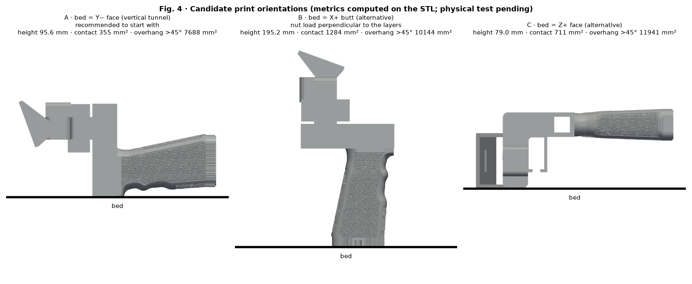

# Material and orientation — SpaceQuad v5

[Español](../es/README.md) · **English** · [Deutsch](../de/README.md) · [Français](../fr/README.md) · [Italiano](../it/README.md)

> ⚠ PENDING PHYSICAL TEST

## Material and orientation

| Option | When | Status |
|---|---|---|
| PETG (recommended) | General use, toughness; good layer adhesion | initial, pending test |
| ASA | Prolonged outdoor/UV; needs ventilation and enclosure | initial, pending test |
| PLA | Not recommended: creep/deformation with heat | — |

| Bed face | Height | Contact | Overhang >45° | Comment |
|---|---|---|---|---|
| Y− | 95.6 mm | 355 mm² | 7688 mm² | Recommended: vertical tunnel; layers as hoops around the boom; nut load in the layer plane; use brim |
| X+ | 195.2 mm | 1284 mm² | 10144 mm² | Vertical nut axis: tension perpendicular to layers (weak) |
| Z+ | 79.0 mm | 711 mm² | 11941 mm² | Alternative |

## Initial profiles

| Parameter | Initial value |
|---|---|
| Layer height | 0.20 mm |
| Perimeters | 4 |
| Infill | gyroid 40 % |
| Brim | 5 mm (option A) |
| Dimensional adjustment | 0 until the coupon is measured |

All are initial values **pending physical testing**; no universal parameters: use the temperature range printed on the spool.

- https://wiki.bambulab.com/en/filament/petg
