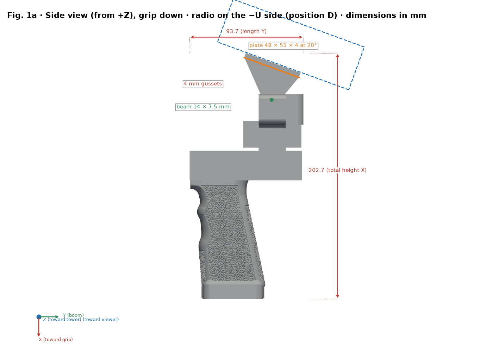
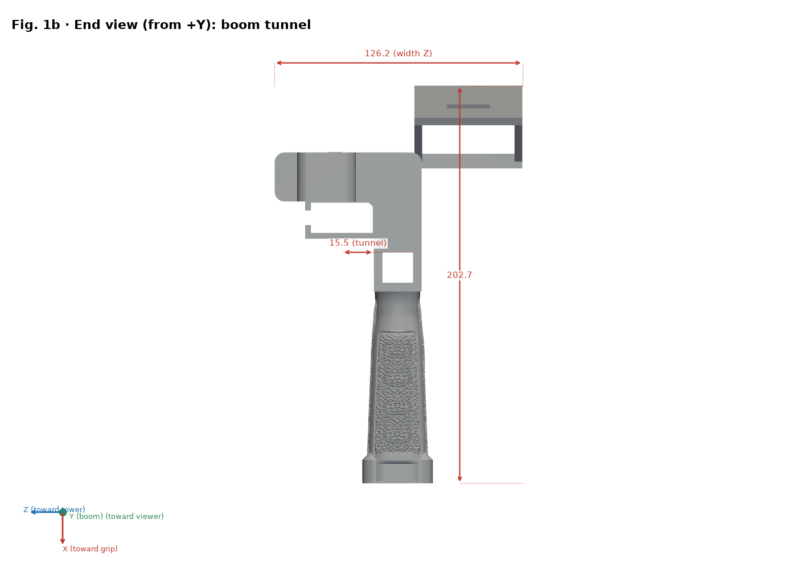
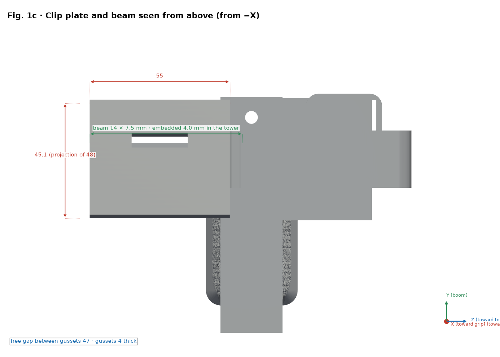
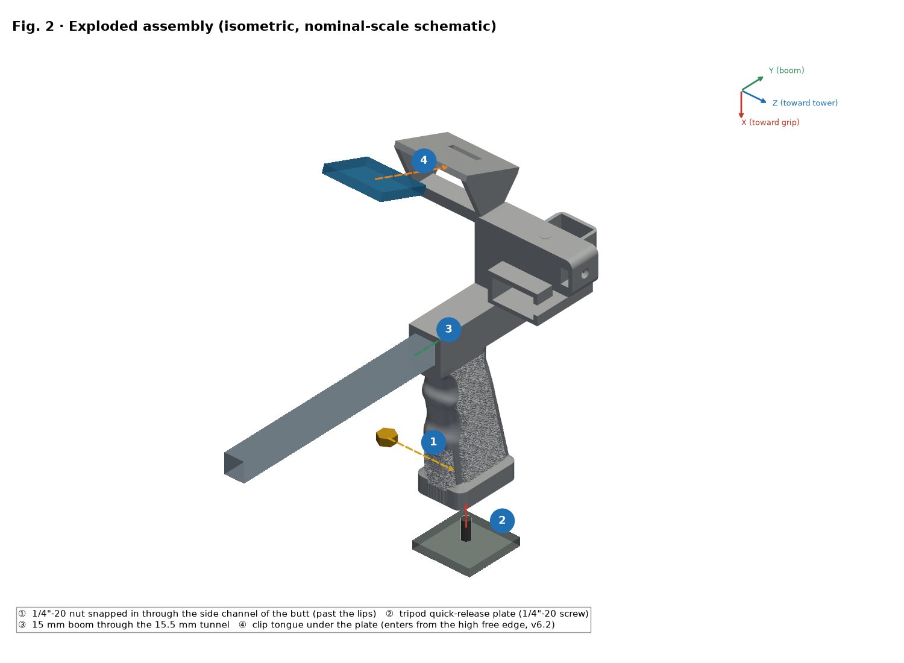
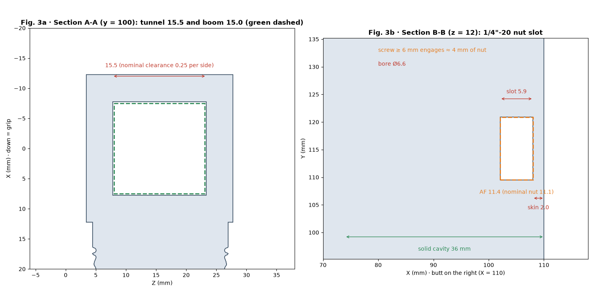
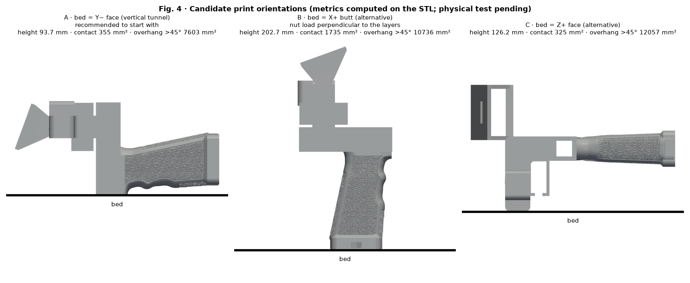
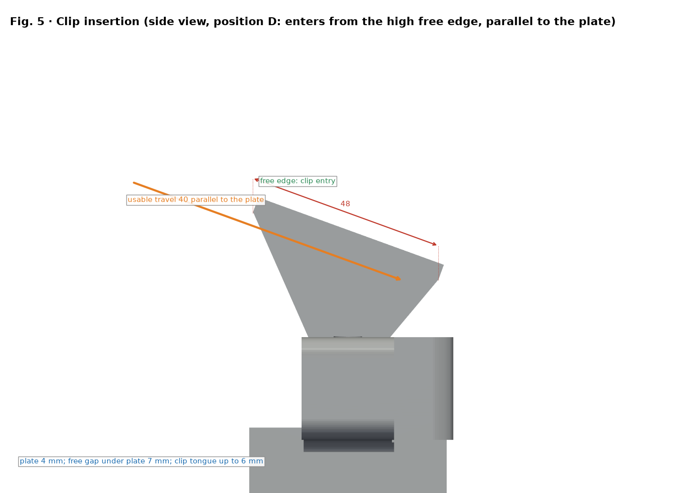

# SpaceQuad v6.2 handle — Illustrated assembly guide

[Español](../es/README.md) · **English** · [Deutsch](../de/README.md) · [Français](../fr/README.md) · [Italiano](../it/README.md)

> Based on the v6.2 geometry (position D) in `stl/v6/`. If geometry changes, regenerate with `src/render_guia.py`. CAD only: clip and radio dimensions are estimated, not measured, and there is no load test.

## Position D (v6.2)

- With the grip in hand, the radio sits on the side of the boom opposite the tower and the duplexer (−U side), leaning 20° toward the operator (upper end toward −V).
- A 14 × 7.5 mm beam joins the two plate gussets to the tower and is embedded in it; it touches neither the boom tunnel nor the duplexer.
- The clip enters parallel to the plate through its high free edge and advances toward the bottom of the gap, where the retention window is (usable travel 40 mm).

## Per-radio variants

| Radio | STL file | Radio envelope (estimated, mm) | Plate height PH0 (mm) |
|---|---|---|---|
| UV-K5 V3 | `stl/v6/mango_spacequad_v6_uvk5v3.stl` | 115 × 60 × 37.5 | 72.5 |
| RT-950 Pro | `stl/v6/mango_spacequad_v6_rt950pro.stl` | 162 × 66 × 48 | 88.5 |

## Reinforced tripod nut

- 2.0 mm skin on the butt face (was 1.2 mm) and walls of at least 3 mm around the hex pocket.
- The nut snaps in: insert it through the side channel and it seats once it passes the retention lips (10.6 mm opening versus the 11.1 mm nut). The interference is theoretical.
- A tripod screw of 6 mm or more engages about 4 mm of the nut (nominal 5.6 mm).
- Handle cavity filled 36 mm with a tapered transition, and an optional butt flange.

## Printing advice

- Supports under the plate and under the beam.
- High infill (60–100 %) or extra walls in the beam and the tripod zone.
- Run a load test before trusting the part (see the strength verification section).

## Graphics

> Figures show the UV-K5 V3 variant; the RT-950 Pro shares the geometry except for the plate height.

*Side view with dimensions (X points to the grip; radio on the −U side)*

*End view (butt face)*

*Clip plate and beam plan: 55 × 48 × 4 mm at 20°*

*Exploded view and numbered steps ①–④ (nut snaps in from Z−)*

*Sections A-A (tunnel) and B-B (nut slot, 2 mm skin)*

*Print orientations compared*

*Clip insertion (position D: from the high free edge, parallel to the plate)*

## Bill of materials (BOM)

| No. | Qty | Item | Size / specification | Note |
|---|---|---|---|---|
| 1 | 1 | Printed handle v6.2 (`stl/v6/*_v6_uvk5v3.stl` or `*_v6_rt950pro.stl`) | Envelope 202.7 × 93.7 × 126.2 mm (UV-K5 V3) | PETG recommended |
| 2 | 1 | Hex nut 1/4"-20 UNC | Across flats 11.1 mm, thickness 5.6 mm | Pocket AF 11.4 × 5.9 mm |
| 3 | 1 | Boom (not included) | Ø15 mm, tunnel 15.5 × 15.5 mm (nominal clearance 0.25 mm per side) | Measure the real boom |
| 4 | 0–1 | Tripod quick-release plate/screw (optional) | 1/4"-20 | As needed |
| 5 | 0–1 | Duplexer and EVA strip (optional) | — | Per radio |

This design has **no bearings or shafts**; the only hardware is the 1/4"-20 nut.

## Assembly order

1. Check the part: remove burrs from the tunnel and hex pocket.
2. Snap the nut in through the side channel on the Z− side, past the retention lips (2.0 mm skin toward the butt face; a screw of 6 mm or more engages about 4 mm).
3. Slide the Ø15 mm boom through the 15.5 × 15.5 mm tunnel.
4. Insert the clip tongue through the high free edge of the plate (55 × 48 × 4 at 20°), parallel to it, and secure the radio on the −U side.

## Measure and adjust clearances (mechanical fit)

> ⚠ PENDING PHYSICAL TEST

1. Print `stl/calibracion/prueba_holguras.stl` (124 × 92 × 8 mm) with the FINAL profile and same filament.
2. Row 1: square holes 15.1–15.9 mm for the boom. Row 2: hex pockets AF 11.1–11.9 mm. Row 3: slots 6.0–8.0 mm. Dimples 1–5 mark the size.
3. Measure with calipers (0.02 mm) after 24 h cooling; test with the real boom and nut.
4. Pick the hole that slides with finger pressure and no visible play (initial target 0.2–0.3 mm per side, pending test).
5. Correct with the slicer's XY hole compensation (if available) or the model; do not use flow to tune fit.

## Strength verification (prudent tests)

> ⚠ PENDING PHYSICAL TEST

1. Weigh the radio with accessories: real mass M (not known a priori).
2. Proof load = 2 × M, applied in steps of 25 %, 50 % and 100 % of that load, 60 s each, ballast over a low, protected surface.
3. Inspect after each step; stop on cracks, whitening or deformation > 0.3 mm.
4. A practical procedure, not a certification. Loads justified by M; never over a person or valuable equipment.

## Earlier versions

Only v1 (input), v3 (base generator and Anytone baseline) and the generic Anytone remain (figures in `docs/img/guia/anytone/`). v2, v4 and v5 were removed; recover them from git history (the commit before the cleanup).

| Variant | STL file | Envelope (mm) | Volume (mm³) |
|---|---|---|---|
| Adjustable generic Anytone (base already reinforced; optional shims) | `stl/mango_spacequad_anytone_generico.stl + stl/anytone_calzos/*.stl` | 195.2 × 93.7 × 79.0 | 213099 |

## License and attribution

Repository CC license (`LICENSE`, Bricohams). The Pastamatic rewinder keeps its original authorship; its license is unverified and it is not published here.
