# SpaceQuad v5 handle — Illustrated assembly guide

[Español](../es/README.md) · **English** · [Deutsch](../de/README.md) · [Français](../fr/README.md) · [Italiano](../it/README.md)

> Based on the final geometry on main (v5, v5+reinforcement and Anytone). If geometry changes, regenerate with `src/render_guia.py`. Clip dimensions are estimated, not measured.

## Variants (final geometry)

| Variant | STL file | Envelope (mm) | Volume (mm³) |
|---|---|---|---|
| v5 (UV-K5 V3 / RT-950 Pro, identical) | `stl/v5/*uvk5v3.stl, *rt950pro.stl` | 195.2 × 95.6 × 79.0 | 191951 |
| v5 + reinforced base (UV-K5 V3 / RT-950 Pro) | `stl/refuerzo/*_v5_*_refuerzo.stl` | 195.2 × 95.6 × 79.0 | 205173 |
| Adjustable generic Anytone (base already reinforced; optional shims) | `stl/mango_spacequad_anytone_generico.stl + stl/anytone_calzos/*.stl` | 195.2 × 93.7 × 79.0 | 213099 |

## Graphics

### v5 (UV-K5 V3 / RT-950 Pro, identical)

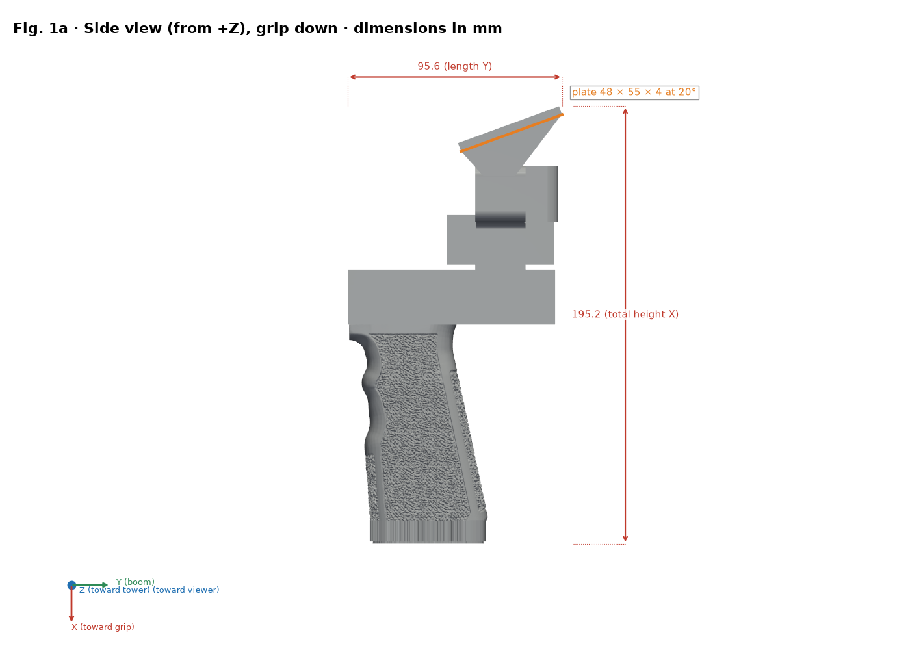
*Side view with dimensions (X points to the grip)*

*End view (butt face)*

*Clip plate plan: 55 × 48 × 4 mm at 20°*

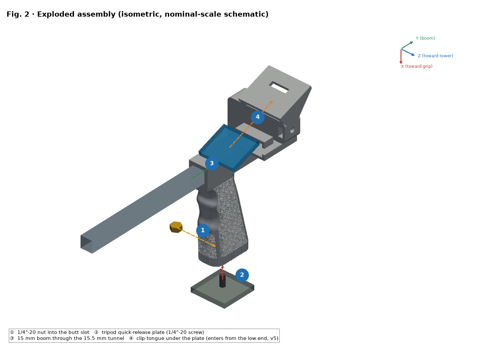
*Exploded view and numbered steps ①–④ (nut enters from Z−)*

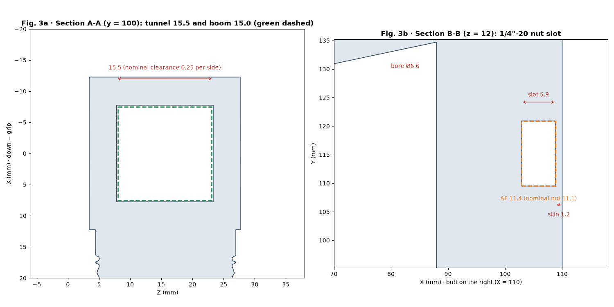
*Sections A-A (tunnel) and B-B (nut slot)*

*Print orientations compared*

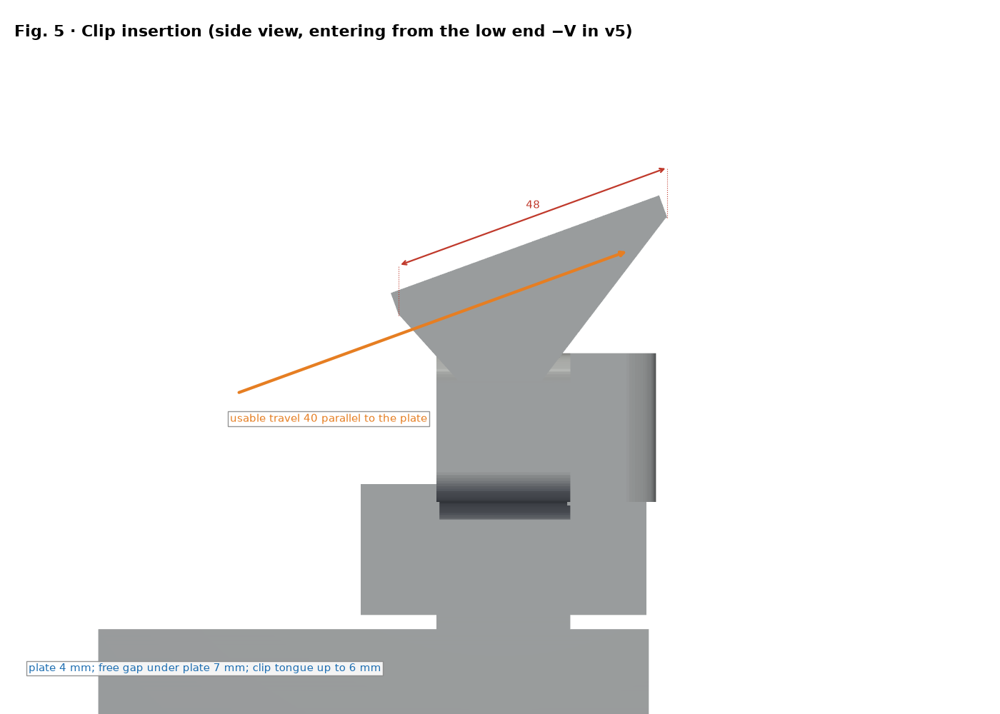
*Clip insertion (v3 enters from +V; v5 from −V)*

### v5 + reinforced base (UV-K5 V3 / RT-950 Pro)

*Side view with dimensions (X points to the grip)*

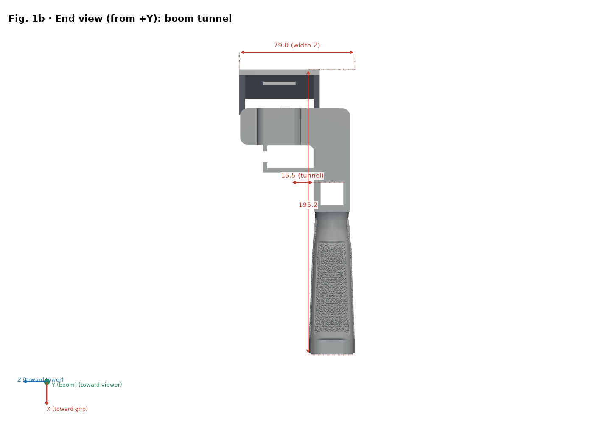
*End view (butt face)*

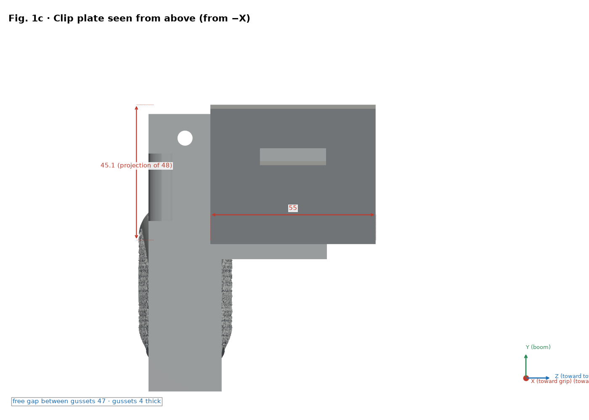
*Clip plate plan: 55 × 48 × 4 mm at 20°*

*Exploded view and numbered steps ①–④ (nut enters from Z−)*

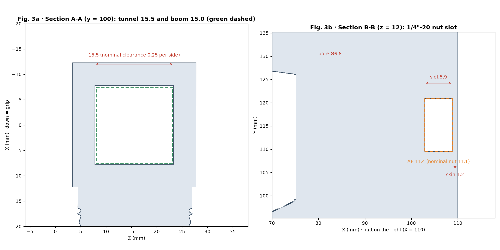
*Sections A-A (tunnel) and B-B (nut slot)*

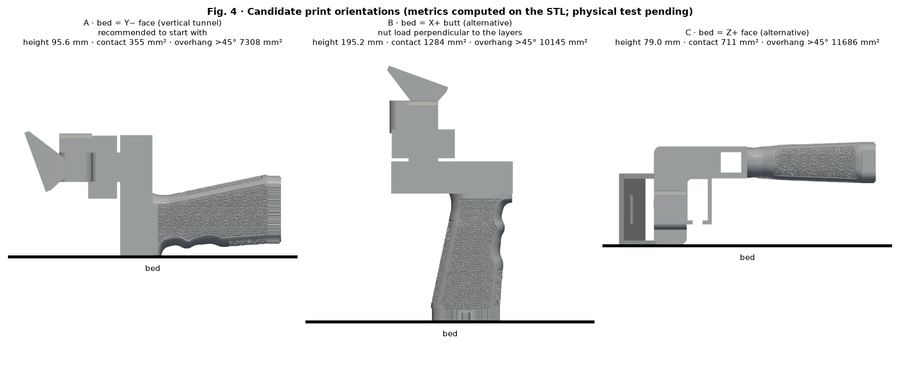
*Print orientations compared*

*Clip insertion (v3 enters from +V; v5 from −V)*

### Adjustable generic Anytone (base already reinforced; optional shims)

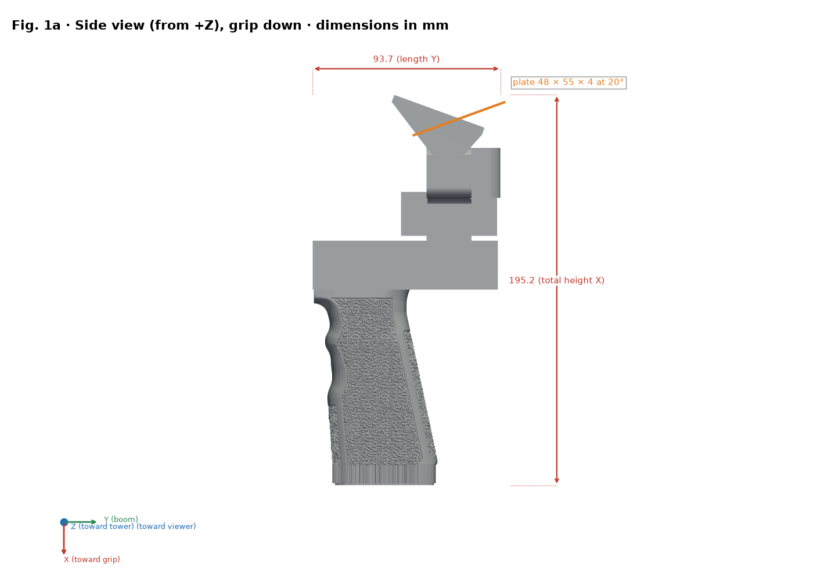
*Side view with dimensions (X points to the grip)*

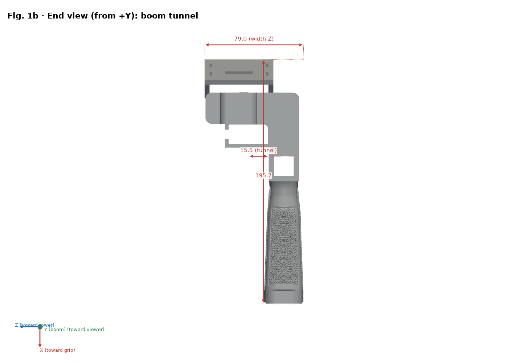
*End view (butt face)*

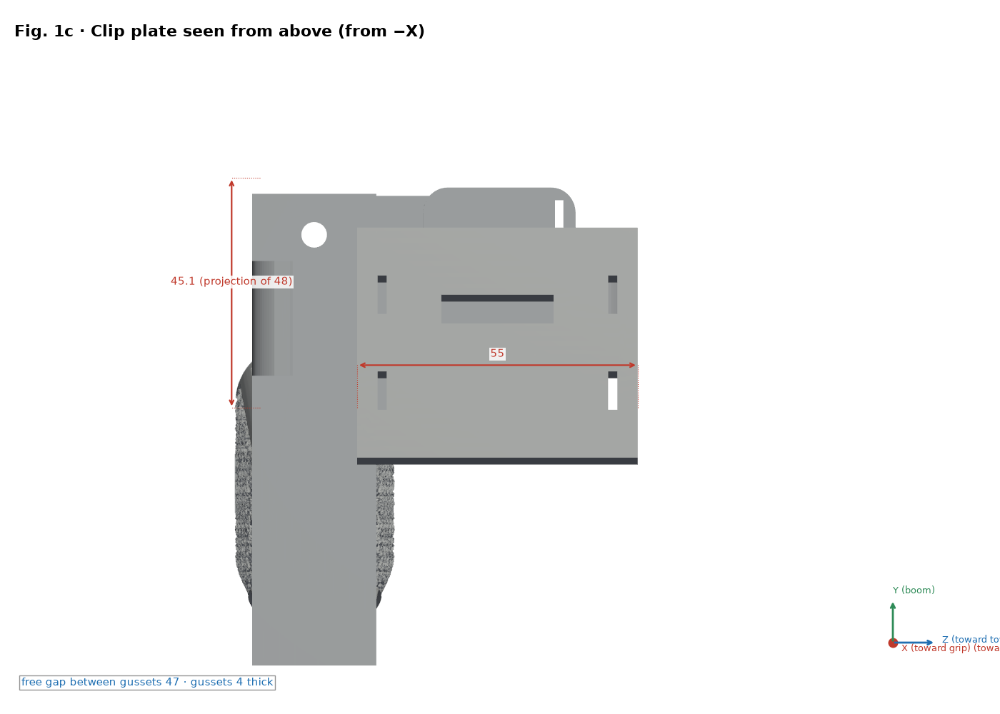
*Clip plate plan: 55 × 48 × 4 mm at 20°*

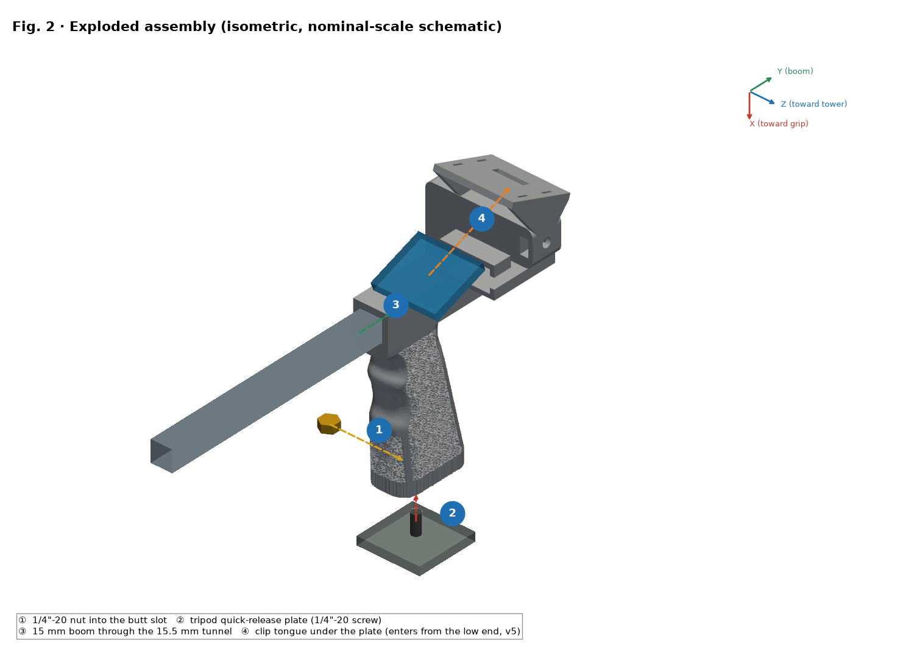
*Exploded view and numbered steps ①–④ (nut enters from Z−)*

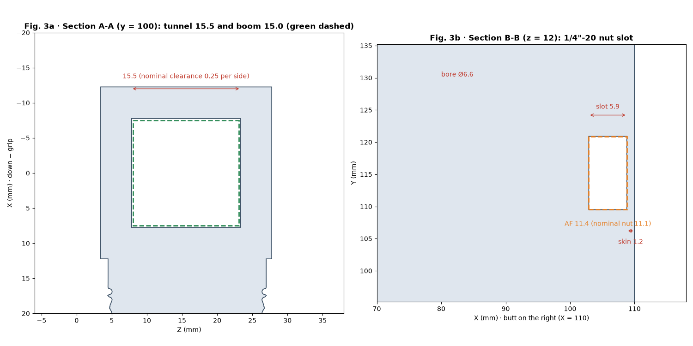
*Sections A-A (tunnel) and B-B (nut slot)*

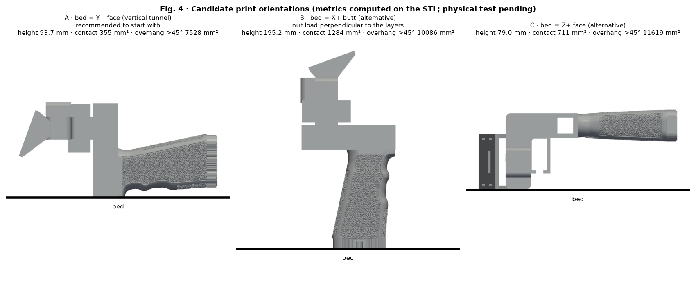
*Print orientations compared*

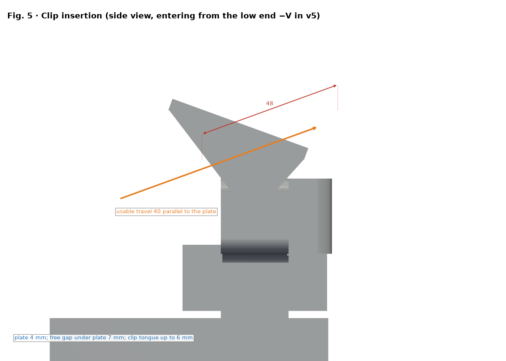
*Clip insertion (v3 enters from +V; v5 from −V)*

## Bill of materials (BOM)

| No. | Qty | Item | Size / specification | Note |
|---|---|---|---|---|
| 1 | 1 | Printed handle v5 (`stl/v5/*uvk5v3.stl`) | Envelope 195.2 × 95.6 × 79.0 mm | PETG recommended |
| 2 | 1 | Hex nut 1/4"-20 UNC | Across flats 11.1 mm, thickness 5.6 mm | Pocket AF 11.4 × 5.9 mm |
| 3 | 1 | Boom (not included) | Ø15 mm, tunnel 15.5 × 15.5 mm (nominal clearance 0.25 mm per side) | Measure the real boom |
| 4 | 0–1 | Tripod quick-release plate/screw (optional) | 1/4"-20 | As needed |
| 5 | 0–1 | Duplexer and EVA strip (optional) | — | Per radio |

This design has **no bearings or shafts**; the only hardware is the 1/4"-20 nut.

## Assembly order

1. Check the part: remove burrs from the tunnel and hex pocket.
2. Insert the nut from the Z− side into the pocket (1.2 mm skin toward the butt face).
3. Slide the Ø15 mm boom through the 15.5 × 15.5 mm tunnel.
4. Mount the clip on the plate (55 × 48 × 4 at 20°) and secure the radio.

## Measure and adjust clearances (mechanical fit)

> ⚠ PENDING PHYSICAL TEST

1. Print `stl/calibracion/prueba_holguras.stl` (124 × 92 × 8 mm) with the FINAL profile and same filament.
2. Row 1: square holes 15.1–15.9 mm for the boom. Row 2: hex pockets AF 11.1–11.9 mm. Row 3: slots 6.0–8.0 mm. Dimples 1–5 mark the size.
3. Measure with calipers (0.02 mm) after 24 h cooling; test with the real boom and nut.
4. Pick the hole that slides with finger pressure and no visible play (initial target 0.2–0.3 mm per side, pending test).
5. Correct with the slicer's XY hole compensation (if available) or the model; do not use flow to tune fit.

## Strength verification (prudent tests)

> ⚠ PENDING PHYSICAL TEST

1. Weigh the radio with accessories: real mass M (not known a priori).
2. Proof load = 2 × M, applied in steps of 25 %, 50 % and 100 % of that load, 60 s each, ballast over a low, protected surface.
3. Inspect after each step; stop on cracks, whitening or deformation > 0.3 mm.
4. A practical procedure, not a certification. Loads justified by M; never over a person or valuable equipment.

## License and attribution

Repository CC license (`LICENSE`, Bricohams). The Pastamatic rewinder keeps its original authorship; its license is unverified and it is not published here.
