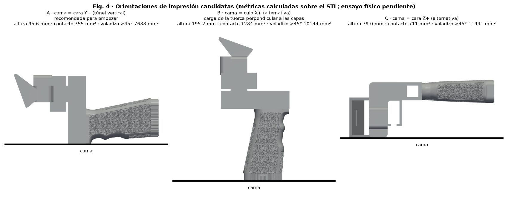

# Material y orientación — SpaceQuad v5

**Español** · [English](../en/README.md) · [Deutsch](../de/README.md) · [Français](../fr/README.md) · [Italiano](../it/README.md)

> ⚠ PENDIENTE DE PRUEBA FÍSICA

## Material y orientación

| Opción | Cuándo | Estado |
|---|---|---|
| PETG (recomendado) | Uso general, tenacidad; muy buena capa-capa | inicial, pendiente de prueba |
| ASA | Exterior prolongado/UV; requiere ventilación y cerramiento | inicial, pendiente de prueba |
| PLA | No recomendado: fluencia/deformación con calor | — |

| Cara en cama | Altura | Contacto | Voladizo >45° | Comentario |
|---|---|---|---|---|
| Y− | 95.6 mm | 355 mm² | 7688 mm² | Recomendada: túnel vertical; capas en aros alrededor de la pluma; carga de tuerca en el plano de capa; usar brim |
| X+ | 195.2 mm | 1284 mm² | 10144 mm² | Eje de tuerca vertical: tracción perpendicular a capas (débil) |
| Z+ | 79.0 mm | 711 mm² | 11941 mm² | Alternativa |

## Perfiles iniciales

| Parámetro | Valor inicial |
|---|---|
| Altura de capa | 0.20 mm |
| Perímetros | 4 |
| Relleno | gyroid 40 % |
| Brim | 5 mm (opción A) |
| Ajuste dimensional | 0 hasta medir el cupón |

Todos son valores iniciales **pendientes de prueba física**; sin parámetros universales: usar el rango de temperatura impreso en la bobina.

- https://wiki.bambulab.com/en/filament/petg
