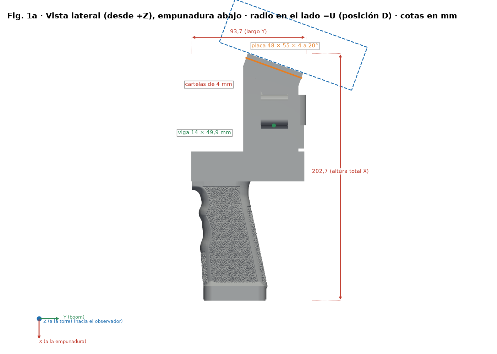
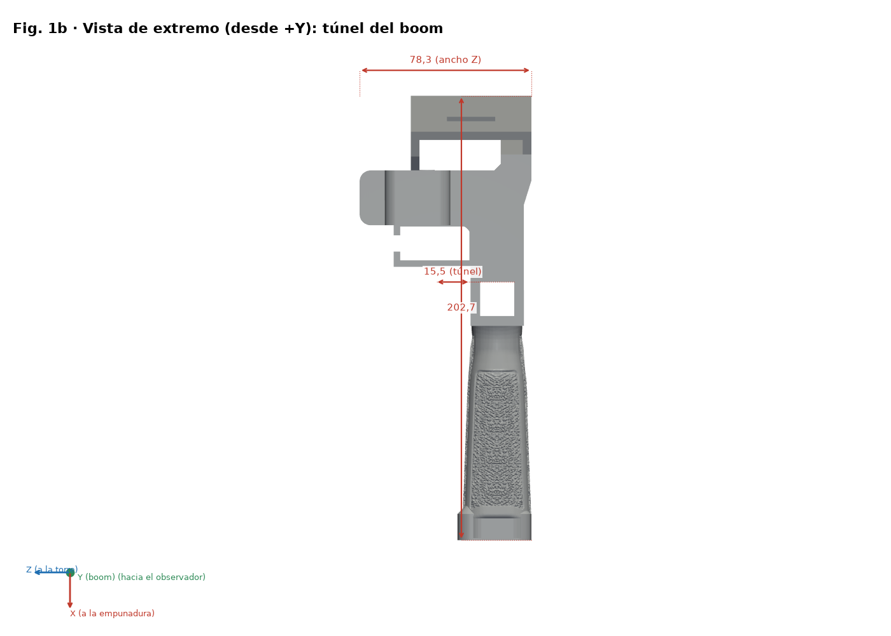
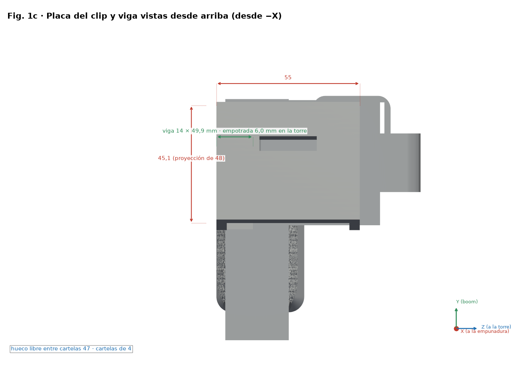
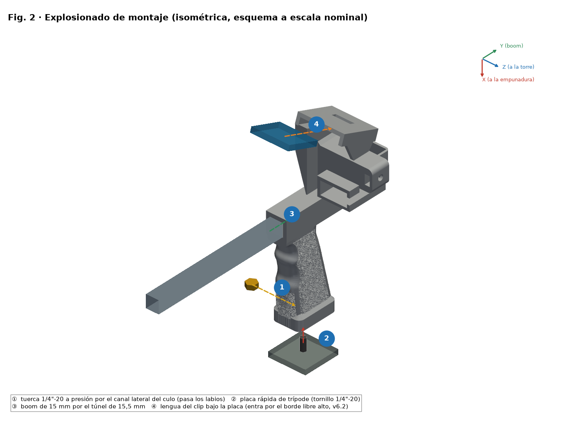
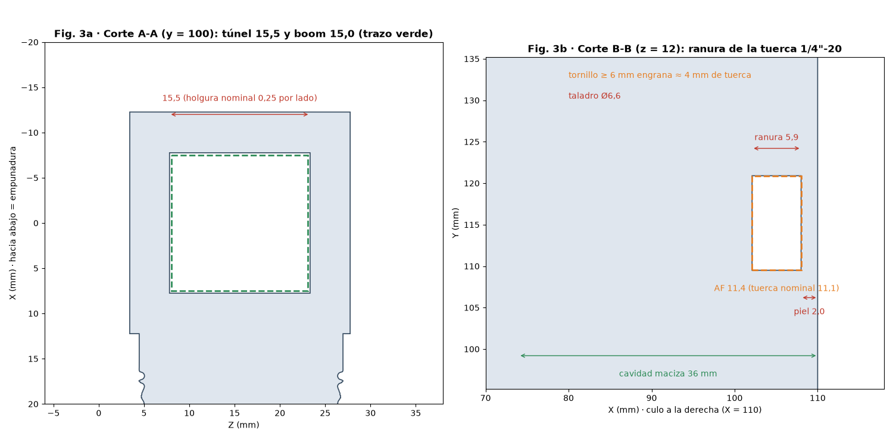
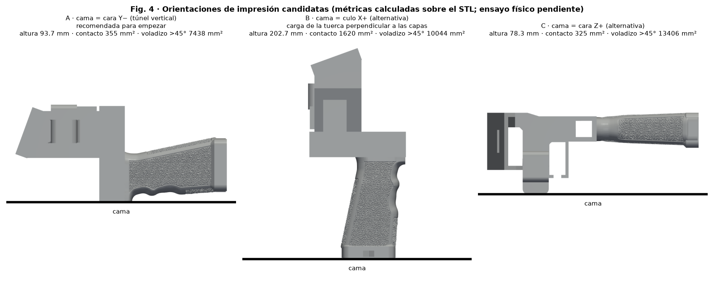
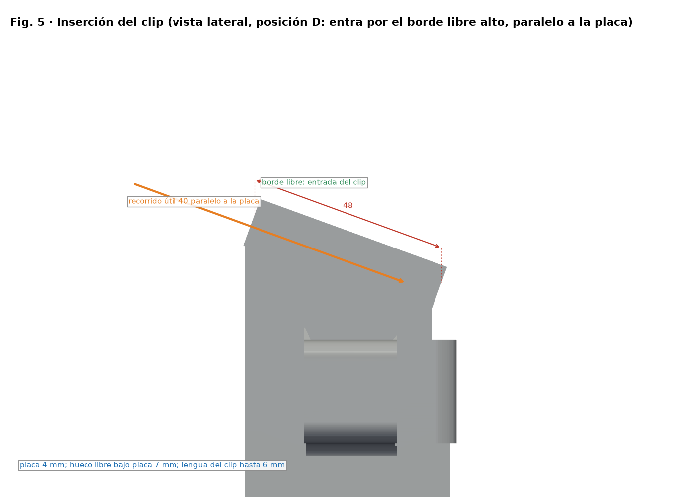

# Mango SpaceQuad v6.2 — Guía de montaje ilustrada

**Español** · [English](../en/README.md) · [Deutsch](../de/README.md) · [Français](../fr/README.md) · [Italiano](../it/README.md)

> Basado en la geometría v6.2 (posición D) de `stl/v6/`. Si cambia la geometría, regenerar con `src/render_guia.py`. Solo CAD: las dimensiones del clip y de cada radio son estimadas, no medidas, y no hay prueba de carga.

## Posición D (v6.2)

- Con la empuñadura en la mano, la radio queda en el lado del boom opuesto a la torre y al duplexor (lado −U) e inclinada 20° hacia el operador (extremo superior hacia −V).
- Una viga de 14 × 7.5 mm une las dos cartelas de la placa con la torre y se empotra en ella; no toca el túnel del boom ni el duplexor.
- El clip entra paralelo a la placa por su borde libre alto y avanza hacia el fondo del hueco, donde está la ventana de retención (recorrido útil 40 mm).

## Variantes por radio

| Radio | Archivo STL | Envolvente de la radio (estimada, mm) | Altura de la placa PH0 (mm) |
|---|---|---|---|
| UV-K5 V3 | `stl/v6/mango_spacequad_v6_uvk5v3.stl` | 115 × 60 × 37.5 | 72.5 |
| RT-950 Pro | `stl/v6/mango_spacequad_v6_rt950pro.stl` | 162 × 66 × 48 | 88.5 |

## Tuerca de trípode reforzada

- Piel de la cara del culo de 2.0 mm (antes 1.2 mm) y paredes de al menos 3 mm alrededor del alojamiento hexagonal.
- La tuerca entra a presión: se introduce por el canal lateral y encaja al pasar los labios de retención (apertura 10.6 mm frente a 11.1 mm de la tuerca). La interferencia es teórica.
- Un tornillo de trípode de 6 mm o más engrana unos 4 mm de la tuerca (nominal 5.6 mm).
- Cavidad del mango rellena 36 mm con transición cónica y brida opcional en el culo.

## Consejos de impresión

- Soportes bajo la placa y bajo la viga.
- Relleno alto (60–100 %) o paredes extra en la viga y en la zona del trípode.
- Hacer una prueba de carga antes de fiarse de la pieza (ver la sección de verificación de resistencia).

## Gráficos

> Figuras de la variante UV-K5 V3; la RT-950 Pro comparte la misma geometría salvo la altura de la placa.

*Vista lateral con cotas (X apunta al agarre; radio en el lado −U)*

*Vista de extremo (culata)*

*Planta de la placa del clip y de la viga: 55 × 48 × 4 mm a 20°*

*Explosionado y pasos numerados ①–④ (la tuerca entra a presión desde Z−)*

*Cortes A-A (túnel) y B-B (alojamiento de tuerca, piel de 2 mm)*

*Orientaciones de impresión comparadas*

*Inserción del clip (posición D: por el borde libre alto, paralelo a la placa)*

## Lista de materiales (BOM)

| Nº | Cant. | Elemento | Medida / especificación | Nota |
|---|---|---|---|---|
| 1 | 1 | Mango impreso v6.2 (`stl/v6/*_v6_uvk5v3.stl` o `*_v6_rt950pro.stl`) | Envolvente 202.7 × 93.7 × 78.3 mm (UV-K5 V3) | PETG recomendado |
| 2 | 1 | Tuerca hexagonal 1/4"-20 UNC | Entre caras 11.1 mm, espesor 5.6 mm | Alojamiento AF 11.4 × 5.9 mm |
| 3 | 1 | Pluma / boom (no incluida) | Ø15 mm, túnel 15.5 × 15.5 mm (juego nominal 0.25 mm por lado) | Medir la pluma real |
| 4 | 0–1 | Placa/tornillo de zapata de trípode (opcional) | 1/4"-20 | Según uso |
| 5 | 0–1 | Duplexor y tira EVA (opcionales) | — | Según radio |

Este diseño **no lleva rodamientos ni ejes**; la única tornillería es la tuerca 1/4"-20.

## Orden de montaje

1. Verificar la pieza: limpiar rebabas del túnel y del alojamiento hexagonal.
2. Insertar la tuerca a presión por el canal lateral del lado Z−, pasando los labios de retención (piel de 2.0 mm hacia la culata; un tornillo de 6 mm o más engrana unos 4 mm).
3. Deslizar la pluma Ø15 mm por el túnel de 15.5 × 15.5 mm.
4. Introducir la lengua del clip por el borde libre alto de la placa (55 × 48 × 4 a 20°), paralela a ella, y fijar la radio en el lado −U.

## Medir y ajustar holguras (ajuste mecánico)

> ⚠ PENDIENTE DE PRUEBA FÍSICA

1. Imprimir `stl/calibracion/prueba_holguras.stl` (124 × 92 × 8 mm) con el perfil FINAL y el mismo filamento.
2. Fila 1: agujeros cuadrados 15.1–15.9 mm para la pluma. Fila 2: hexágonos AF 11.1–11.9 mm. Fila 3: ranuras 6.0–8.0 mm. Los hoyuelos 1–5 indican el tamaño.
3. Medir con calibre (0.02 mm) tras enfriar 24 h; probar la pluma y la tuerca reales.
4. Elegir el agujero que desliza con presión de dedo y sin juego visible (objetivo inicial 0.2–0.3 mm por lado, pendiente de prueba).
5. Corregir con la compensación XY de agujeros del slicer (si existe) o con el modelo; no tocar el flujo para ajustar encaje.

## Verificación de resistencia (pruebas prudentes)

> ⚠ PENDIENTE DE PRUEBA FÍSICA

1. Pesar la radio con accesorios montados: masa real M (no se conoce a priori).
2. Carga de prueba = 2 × M, aplicada en escalones del 25 %, 50 % y 100 % de esa carga, 60 s cada uno, con lastre sobre superficie baja y protegido.
3. Inspeccionar tras cada escalón; detener si hay grietas, blanqueo o deformación > 0.3 mm.
4. Es un procedimiento práctico, no una certificación. Con cargas justificadas por M, nunca con la radio sobre una persona o equipo valioso.

## Versiones anteriores

Solo siguen v1 (entrada), v3 (generador base y referencia del Anytone) y el Anytone genérico (figuras en `docs/img/guia/anytone/`). v2, v4 y v5 se eliminaron; se recuperan desde el historial de git (commit anterior a la limpieza).

| Variante | Archivo STL | Envolvente (mm) | Volumen (mm³) |
|---|---|---|---|
| Anytone genérico ajustable (base ya reforzada; calzos opcionales) | `stl/mango_spacequad_anytone_generico.stl + stl/anytone_calzos/*.stl` | 195.2 × 93.7 × 79.0 | 213099 |

## Licencia y atribución

Licencia CC del repositorio (`LICENSE`, Bricohams). La rebobinadora Pastamatic mantiene su autoría original; su licencia no está verificada y no se publica aquí.
