# Mango SpaceQuad v5 — Guía de montaje ilustrada

**Español** · [English](../en/README.md) · [Deutsch](../de/README.md) · [Français](../fr/README.md) · [Italiano](../it/README.md)

> Basado en la geometría final de main (v5, v5+refuerzo y Anytone). Si cambia la geometría, regenerar con `src/render_guia.py`. Las dimensiones del clip son estimadas, no medidas.

## Variantes (geometría final)

| Variante | Archivo STL | Envolvente (mm) | Volumen (mm³) |
|---|---|---|---|
| v5 (UV-K5 V3 / RT-950 Pro, idénticos) | `stl/v5/*uvk5v3.stl, *rt950pro.stl` | 195.2 × 95.6 × 79.0 | 191951 |
| v5 + base reforzada (UV-K5 V3 / RT-950 Pro) | `stl/refuerzo/*_v5_*_refuerzo.stl` | 195.2 × 95.6 × 79.0 | 205173 |
| Anytone genérico ajustable (base ya reforzada; calzos opcionales) | `stl/mango_spacequad_anytone_generico.stl + stl/anytone_calzos/*.stl` | 195.2 × 93.7 × 79.0 | 213099 |

## Gráficos

### v5 (UV-K5 V3 / RT-950 Pro, idénticos)

*Vista lateral con cotas (X apunta al agarre)*

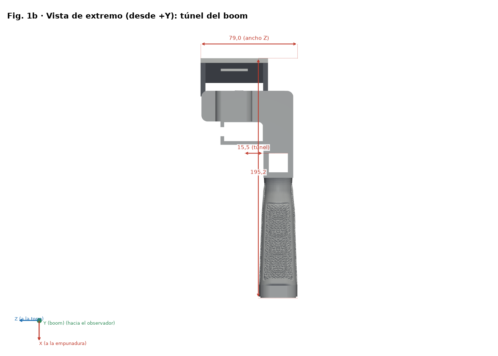
*Vista de extremo (culata)*

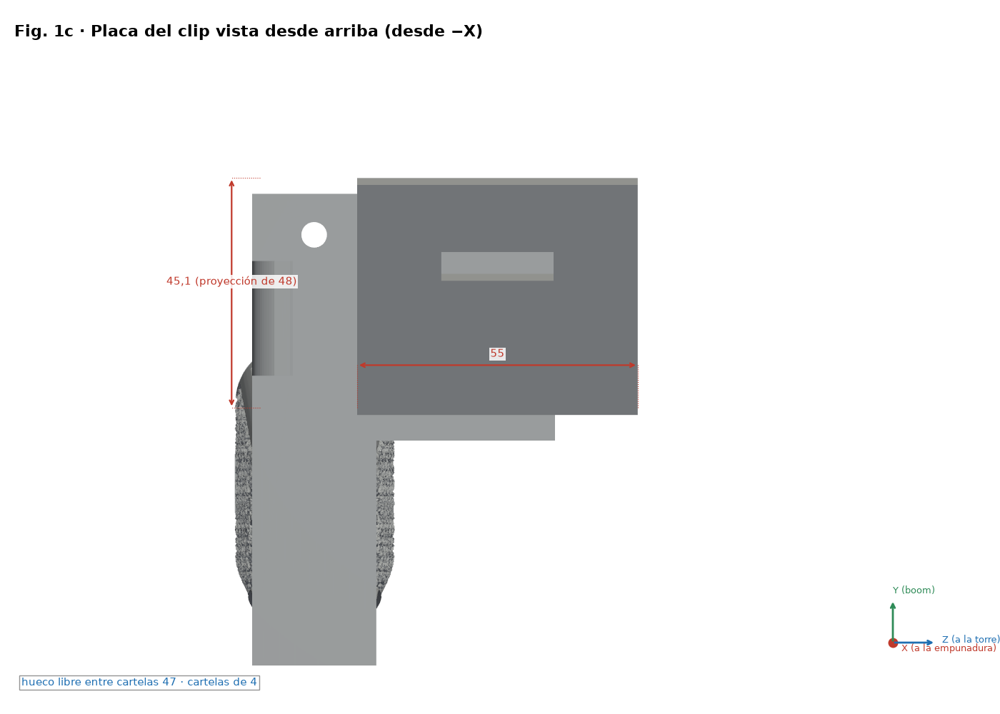
*Planta de la placa del clip: 55 × 48 × 4 mm a 20°*

*Explosionado y pasos numerados ①–④ (la tuerca entra desde Z−)*

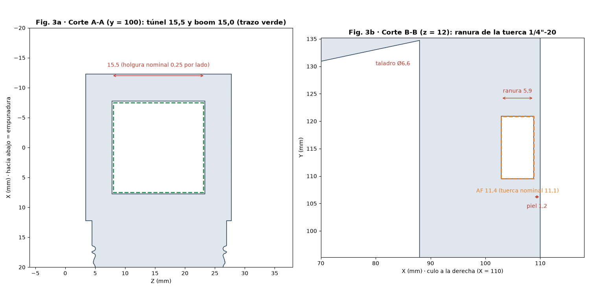
*Cortes A-A (túnel) y B-B (alojamiento de tuerca)*

*Orientaciones de impresión comparadas*

*Inserción del clip (v3 entra por +V; v5 por −V)*

### v5 + base reforzada (UV-K5 V3 / RT-950 Pro)

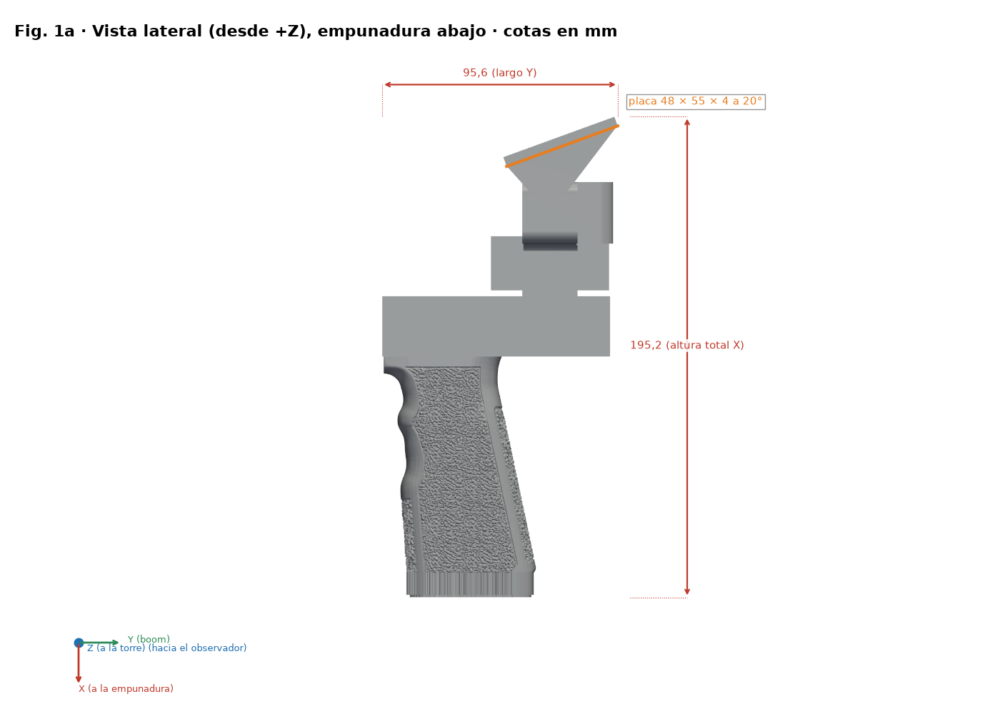
*Vista lateral con cotas (X apunta al agarre)*

*Vista de extremo (culata)*

*Planta de la placa del clip: 55 × 48 × 4 mm a 20°*

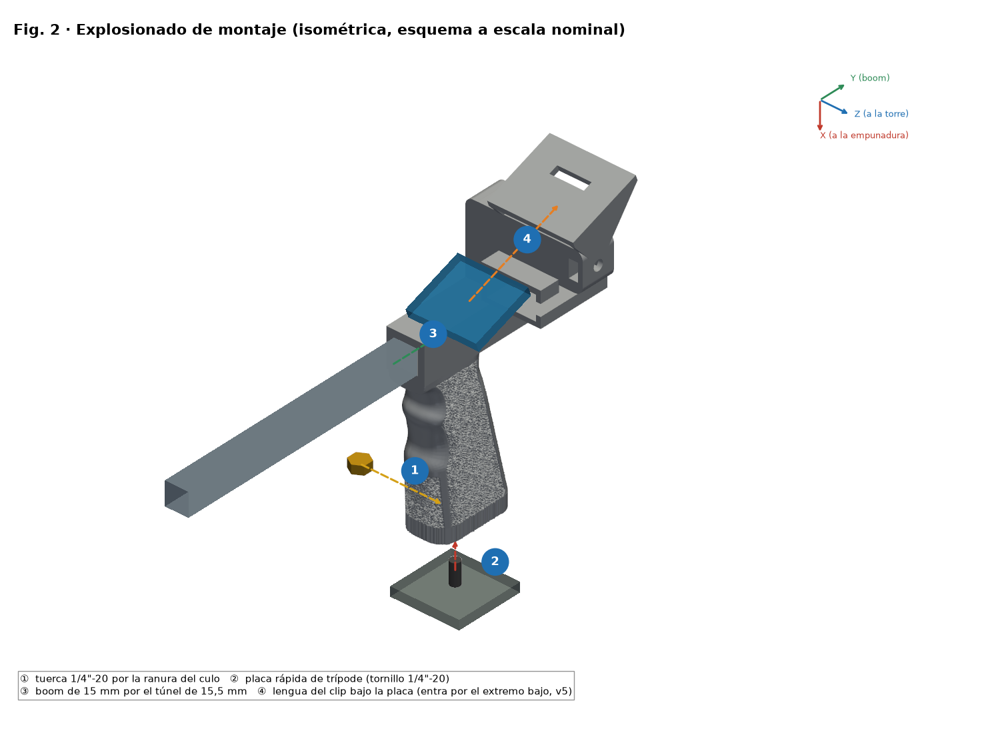
*Explosionado y pasos numerados ①–④ (la tuerca entra desde Z−)*

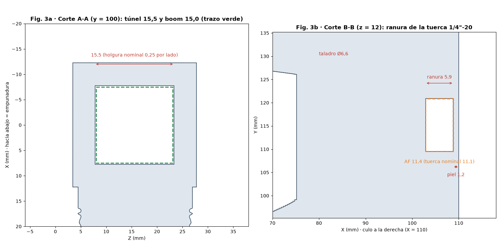
*Cortes A-A (túnel) y B-B (alojamiento de tuerca)*

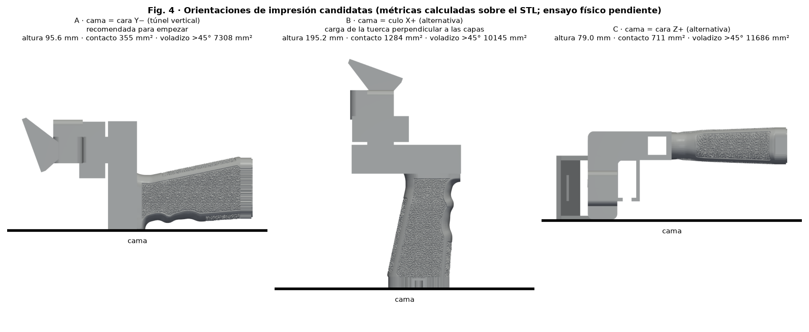
*Orientaciones de impresión comparadas*

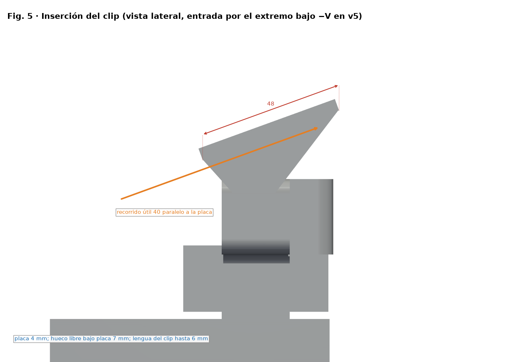
*Inserción del clip (v3 entra por +V; v5 por −V)*

### Anytone genérico ajustable (base ya reforzada; calzos opcionales)

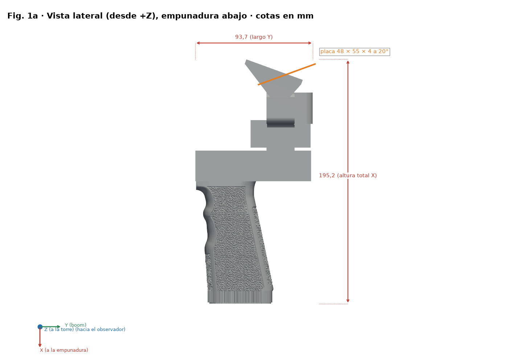
*Vista lateral con cotas (X apunta al agarre)*

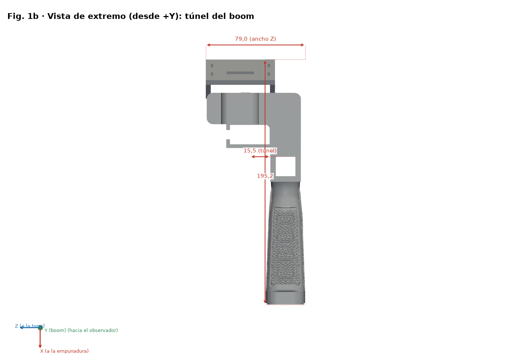
*Vista de extremo (culata)*

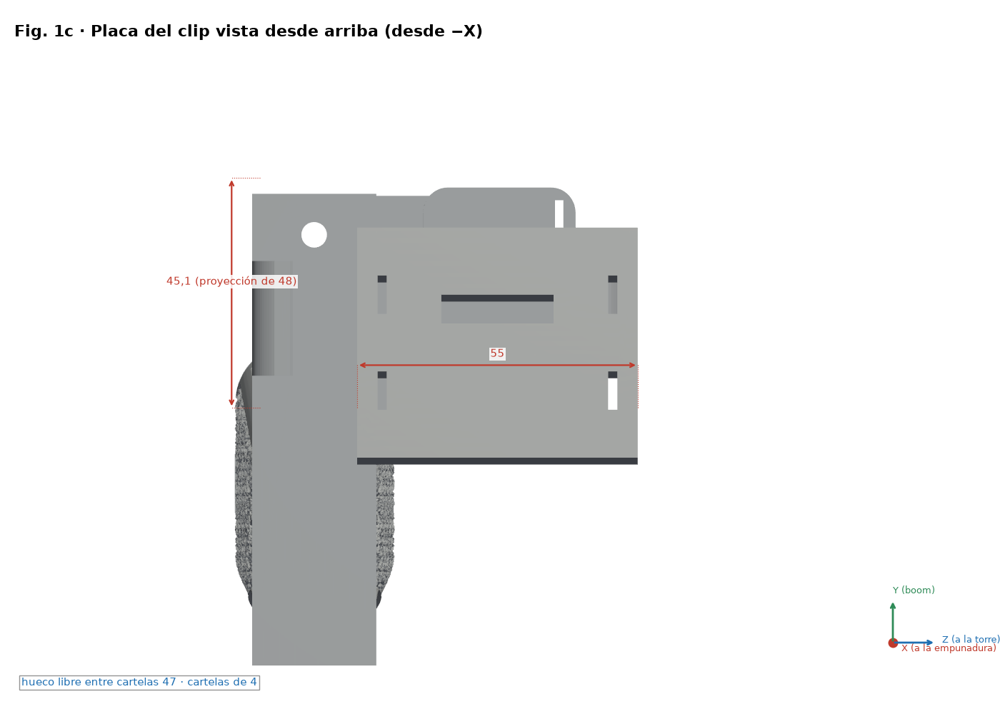
*Planta de la placa del clip: 55 × 48 × 4 mm a 20°*

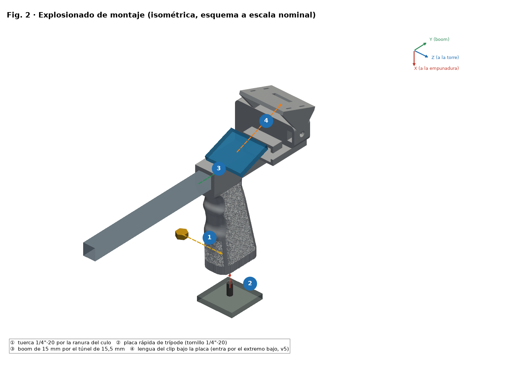
*Explosionado y pasos numerados ①–④ (la tuerca entra desde Z−)*

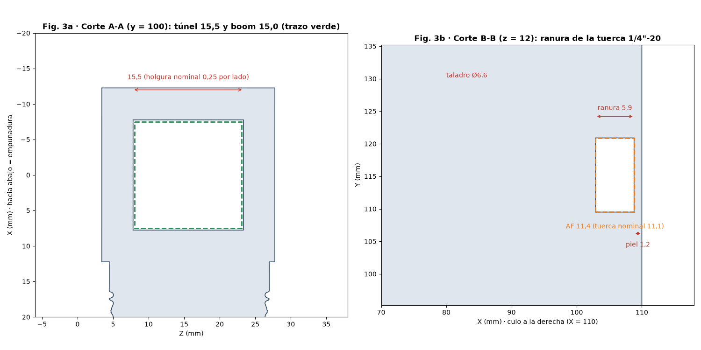
*Cortes A-A (túnel) y B-B (alojamiento de tuerca)*

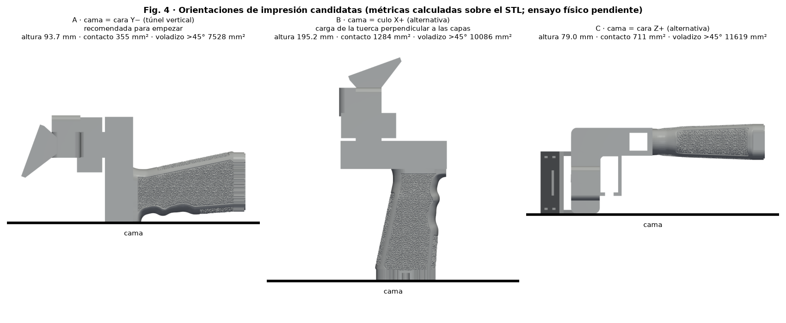
*Orientaciones de impresión comparadas*

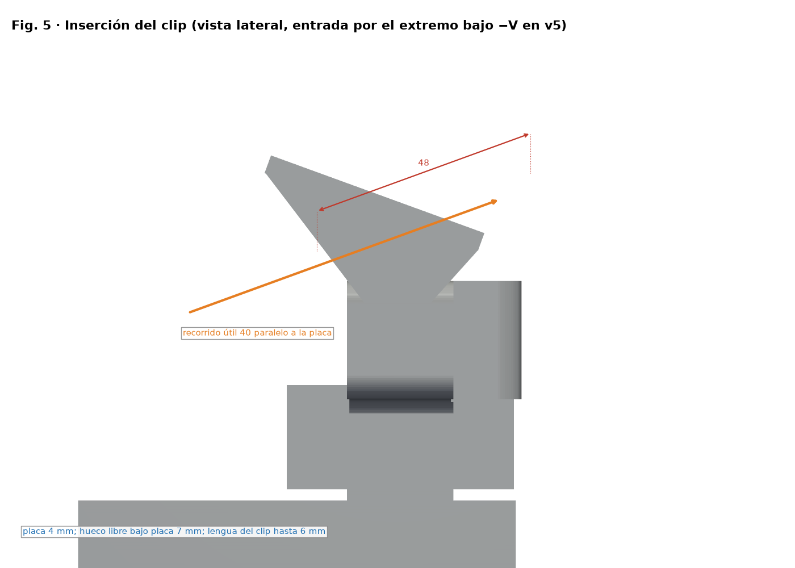
*Inserción del clip (v3 entra por +V; v5 por −V)*

## Lista de materiales (BOM)

| Nº | Cant. | Elemento | Medida / especificación | Nota |
|---|---|---|---|---|
| 1 | 1 | Mango impreso v5 (`stl/v5/*uvk5v3.stl`) | Envolvente 195.2 × 95.6 × 79.0 mm | PETG recomendado |
| 2 | 1 | Tuerca hexagonal 1/4"-20 UNC | Entre caras 11.1 mm, espesor 5.6 mm | Alojamiento AF 11.4 × 5.9 mm |
| 3 | 1 | Pluma / boom (no incluida) | Ø15 mm, túnel 15.5 × 15.5 mm (juego nominal 0.25 mm por lado) | Medir la pluma real |
| 4 | 0–1 | Placa/tornillo de zapata de trípode (opcional) | 1/4"-20 | Según uso |
| 5 | 0–1 | Duplexor y tira EVA (opcionales) | — | Según radio |

Este diseño **no lleva rodamientos ni ejes**; la única tornillería es la tuerca 1/4"-20.

## Orden de montaje

1. Verificar la pieza: limpiar rebabas del túnel y del alojamiento hexagonal.
2. Insertar la tuerca por el lado Z− en el alojamiento (piel de 1.2 mm hacia la culata).
3. Deslizar la pluma Ø15 mm por el túnel de 15.5 × 15.5 mm.
4. Montar el clip en la placa (55 × 48 × 4 a 20°) y fijar la radio.

## Medir y ajustar holguras (ajuste mecánico)

> ⚠ PENDIENTE DE PRUEBA FÍSICA

1. Imprimir `stl/calibracion/prueba_holguras.stl` (124 × 92 × 8 mm) con el perfil FINAL y el mismo filamento.
2. Fila 1: agujeros cuadrados 15.1–15.9 mm para la pluma. Fila 2: hexágonos AF 11.1–11.9 mm. Fila 3: ranuras 6.0–8.0 mm. Los hoyuelos 1–5 indican el tamaño.
3. Medir con calibre (0.02 mm) tras enfriar 24 h; probar la pluma y la tuerca reales.
4. Elegir el agujero que desliza con presión de dedo y sin juego visible (objetivo inicial 0.2–0.3 mm por lado, pendiente de prueba).
5. Corregir con la compensación XY de agujeros del slicer (si existe) o con el modelo; no tocar el flujo para ajustar encaje.

## Verificación de resistencia (pruebas prudentes)

> ⚠ PENDIENTE DE PRUEBA FÍSICA

1. Pesar la radio con accesorios montados: masa real M (no se conoce a priori).
2. Carga de prueba = 2 × M, aplicada en escalones del 25 %, 50 % y 100 % de esa carga, 60 s cada uno, con lastre sobre superficie baja y protegido.
3. Inspeccionar tras cada escalón; detener si hay grietas, blanqueo o deformación > 0.3 mm.
4. Es un procedimiento práctico, no una certificación. Con cargas justificadas por M, nunca con la radio sobre una persona o equipo valioso.

## Licencia y atribución

Licencia CC del repositorio (`LICENSE`, Bricohams). La rebobinadora Pastamatic mantiene su autoría original; su licencia no está verificada y no se publica aquí.
