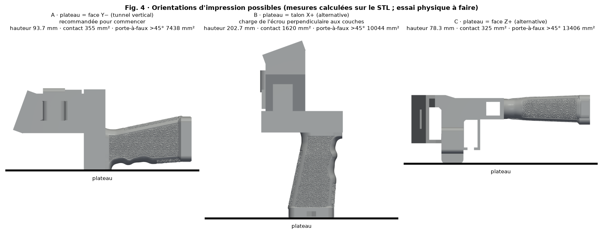

# Matériau et orientation — SpaceQuad v6.2

[Español](../es/README.md) · [English](../en/README.md) · [Deutsch](../de/README.md) · **Français** · [Italiano](../it/README.md)

> ⚠ ESSAI PHYSIQUE EN ATTENTE

## Matériau et orientation

| Option | Quand | Statut |
|---|---|---|
| PETG (recommandé) | Usage général, ténacité ; bonne adhérence entre couches | initial, essai en attente |
| ASA | Extérieur prolongé/UV ; ventilation et caisson requis | initial, essai en attente |
| PLA | Non recommandé : fluage/déformation à la chaleur | — |

| Face sur le plateau | Hauteur | Contact | Surplomb >45° | Commentaire |
|---|---|---|---|---|
| Y− | 93.7 mm | 355 mm² | 7438 mm² | Recommandée : tunnel vertical ; couches en cerceaux autour du mât ; charge de l'écrou dans le plan des couches ; utiliser un brim |
| X+ | 202.7 mm | 1620 mm² | 10044 mm² | Axe d'écrou vertical : traction perpendiculaire aux couches (faible) |
| Z+ | 78.3 mm | 325 mm² | 13406 mm² | Alternative |

## Profils initiaux

| Paramètre | Valeur initiale |
|---|---|
| Hauteur de couche | 0.20 mm |
| Périmètres | 4 |
| Remplissage | gyroïde 40 % (60–100 % ou parois supplémentaires dans la poutre et la zone du trépied) |
| Brim | 5 mm (option A) |
| Supports | sous la plaque et la poutre |
| Ajustement dimensionnel | 0 jusqu'à mesure de l'éprouvette |

Toutes sont des valeurs initiales **en attente d'essai physique** ; pas de paramètres universels : utiliser la plage de température imprimée sur la bobine.

## Conseils d'impression

- Supports sous la plaque et sous la poutre.
- Remplissage élevé (60–100 %) ou parois supplémentaires dans la poutre et la zone du trépied.
- Faire un essai de charge avant de se fier à la pièce (voir la section de vérification de résistance).

- https://wiki.bambulab.com/en/filament/petg
