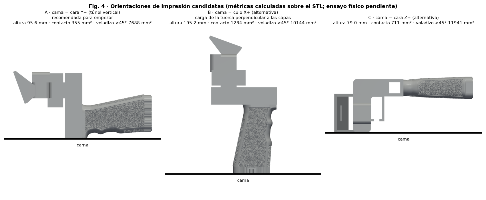

# Matériau et orientation — SpaceQuad v5

[Español](../es/README.md) · [English](../en/README.md) · [Deutsch](../de/README.md) · **Français** · [Italiano](../it/README.md)

> ⚠ ESSAI PHYSIQUE EN ATTENTE

## Matériau et orientation

| Option | Quand | Statut |
|---|---|---|
| PETG (recommandé) | Usage général, ténacité ; bonne adhérence entre couches | initial, essai en attente |
| ASA | Extérieur prolongé/UV ; ventilation et caisson requis | initial, essai en attente |
| PLA | Non recommandé : fluage/déformation à la chaleur | — |

| Face sur le plateau | Hauteur | Contact | Surplomb >45° | Commentaire |
|---|---|---|---|---|
| Y− | 95.6 mm | 355 mm² | 7688 mm² | Recommandée : tunnel vertical ; couches en cerceaux autour du mât ; charge de l'écrou dans le plan des couches ; utiliser un brim |
| X+ | 195.2 mm | 1284 mm² | 10144 mm² | Axe d'écrou vertical : traction perpendiculaire aux couches (faible) |
| Z+ | 79.0 mm | 711 mm² | 11941 mm² | Alternative |

## Profils initiaux

| Paramètre | Valeur initiale |
|---|---|
| Hauteur de couche | 0.20 mm |
| Périmètres | 4 |
| Remplissage | gyroïde 40 % |
| Brim | 5 mm (option A) |
| Ajustement dimensionnel | 0 jusqu'à mesure de l'éprouvette |

Toutes sont des valeurs initiales **en attente d'essai physique** ; pas de paramètres universels : utiliser la plage de température imprimée sur la bobine.

- https://wiki.bambulab.com/en/filament/petg
