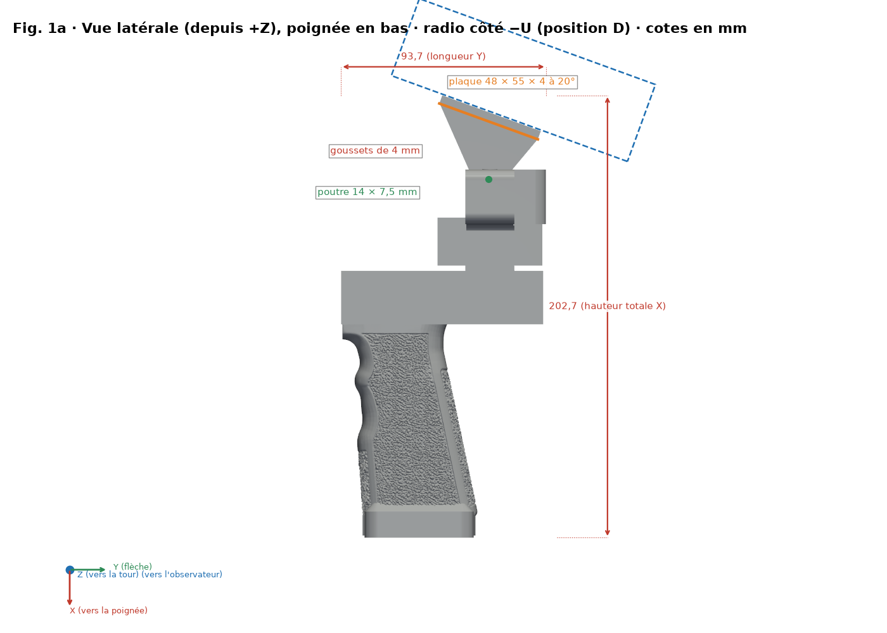
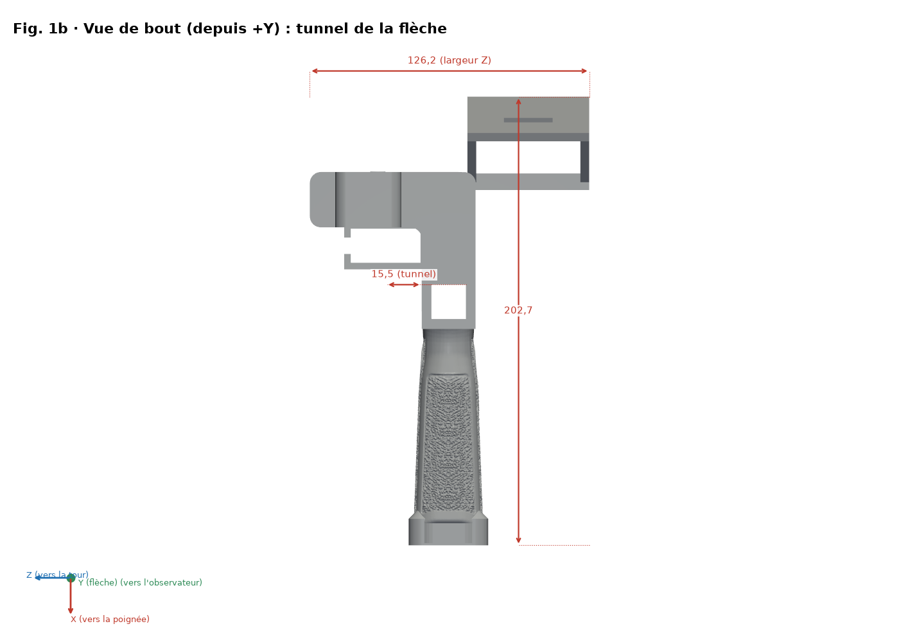
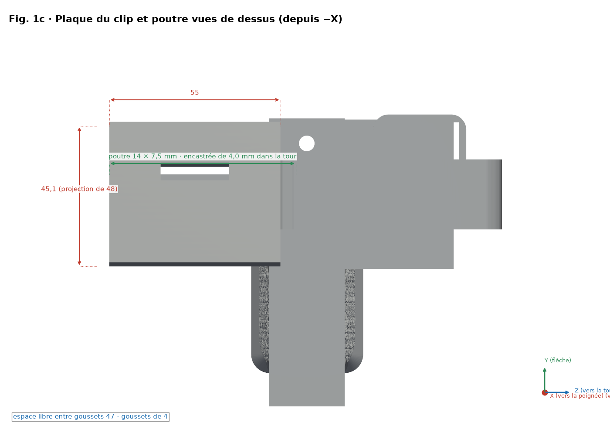
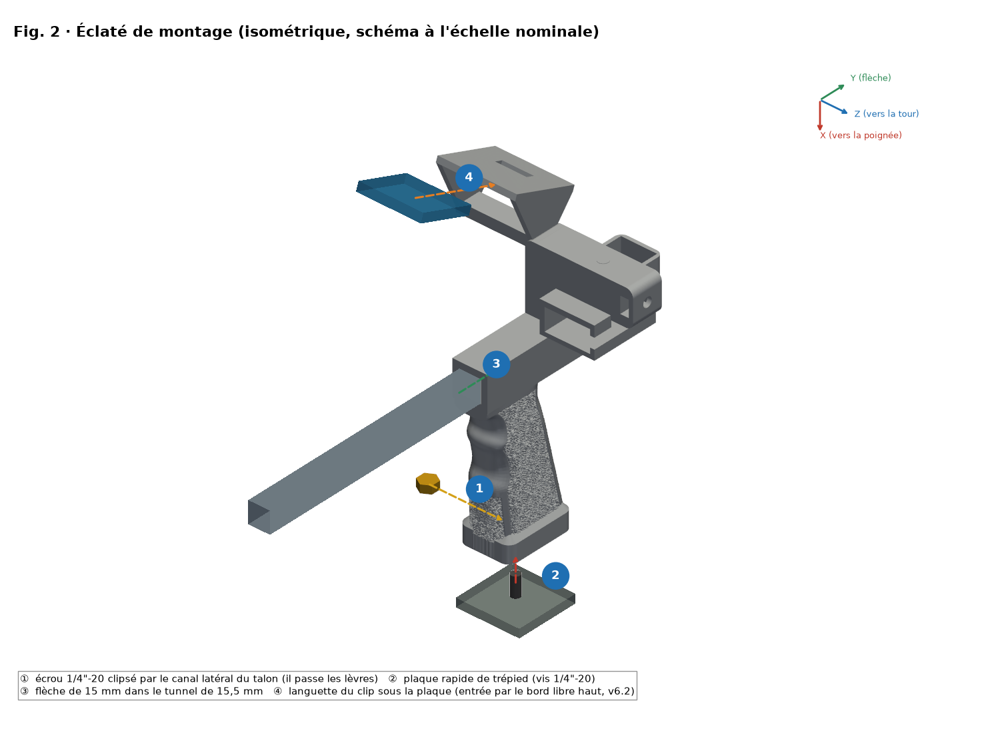
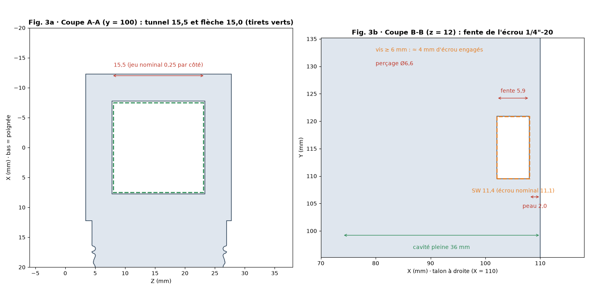
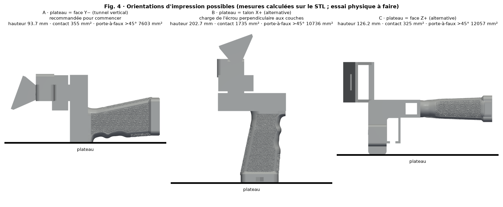
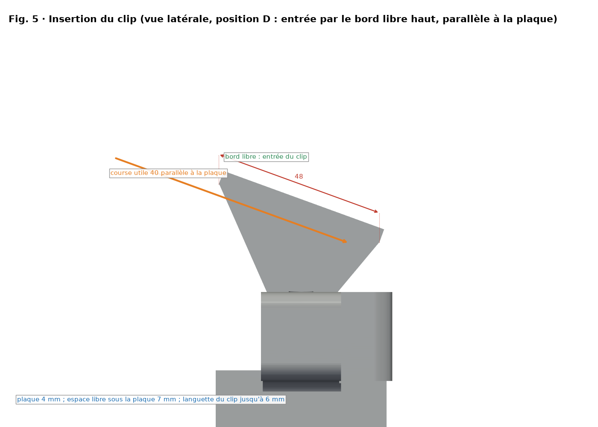

# Poignée SpaceQuad v6.2 — Guide de montage illustré

[Español](../es/README.md) · [English](../en/README.md) · [Deutsch](../de/README.md) · **Français** · [Italiano](../it/README.md)

> Basé sur la géométrie v6.2 (position D) de `stl/v6/`. Si la géométrie change, régénérer avec `src/render_guia.py`. CAO uniquement : les dimensions du clip et de chaque radio sont estimées, non mesurées, et il n'y a pas d'essai de charge.

## Position D (v6.2)

- Poignée en main, la radio se trouve du côté de la flèche opposé à la tour et au duplexeur (côté −U), inclinée de 20° vers l'opérateur (extrémité haute vers −V).
- Une poutre de 14 × 7.5 mm relie les deux goussets de la plaque à la tour et y est encastrée ; elle ne touche ni le tunnel de la flèche ni le duplexeur.
- Le clip entre parallèlement à la plaque par son bord libre haut et avance vers le fond du logement, où se trouve la fenêtre de retenue (course utile 40 mm).

## Variantes par radio

| Radio | Fichier STL | Encombrement de la radio (estimé, mm) | Hauteur de plaque PH0 (mm) |
|---|---|---|---|
| UV-K5 V3 | `stl/v6/mango_spacequad_v6_uvk5v3.stl` | 115 × 60 × 37.5 | 72.5 |
| RT-950 Pro | `stl/v6/mango_spacequad_v6_rt950pro.stl` | 162 × 66 × 48 | 88.5 |

## Écrou de trépied renforcé

- Peau de 2.0 mm sur la face du talon (auparavant 1.2 mm) et parois d'au moins 3 mm autour du logement hexagonal.
- L'écrou se clipse : on l'introduit par le canal latéral et il s'engage en passant les lèvres de retenue (ouverture 10.6 mm pour un écrou de 11.1 mm). L'interférence est théorique.
- Une vis de trépied de 6 mm ou plus engage environ 4 mm de l'écrou (nominal 5.6 mm).
- Cavité de la poignée remplie sur 36 mm avec transition conique, et bride optionnelle au talon.

## Conseils d'impression

- Supports sous la plaque et sous la poutre.
- Remplissage élevé (60–100 %) ou parois supplémentaires dans la poutre et la zone du trépied.
- Faire un essai de charge avant de se fier à la pièce (voir la section de vérification de résistance).

## Graphiques

> Les figures montrent la variante UV-K5 V3 ; la RT-950 Pro partage la même géométrie, sauf la hauteur de la plaque.

*Vue latérale cotée (X pointe vers la prise ; radio côté −U)*

*Vue de bout (culasse)*

*Plan de la plaque du clip et de la poutre : 55 × 48 × 4 mm à 20°*

*Vue éclatée et étapes numérotées ①–④ (l'écrou se clipse par Z−)*

*Coupes A-A (tunnel) et B-B (logement d'écrou, peau de 2 mm)*

*Orientations d'impression comparées*

*Insertion du clip (position D : par le bord libre haut, parallèle à la plaque)*

## Nomenclature (BOM)

| N° | Qté | Élément | Dimension / spécification | Remarque |
|---|---|---|---|---|
| 1 | 1 | Poignée imprimée v6.2 (`stl/v6/*_v6_uvk5v3.stl` ou `*_v6_rt950pro.stl`) | Encombrement 202.7 × 93.7 × 126.2 mm (UV-K5 V3) | PETG recommandé |
| 2 | 1 | Écrou hexagonal 1/4"-20 UNC | Sur plats 11.1 mm, épaisseur 5.6 mm | Logement SP 11.4 × 5.9 mm |
| 3 | 1 | Mât / boom (non inclus) | Ø15 mm, tunnel 15.5 × 15.5 mm (jeu nominal 0.25 mm par côté) | Mesurer le mât réel |
| 4 | 0–1 | Plaque/vis de déclenchement rapide trépied (option) | 1/4"-20 | Selon usage |
| 5 | 0–1 | Duplexeur et bande EVA (options) | — | Selon la radio |

Cette conception **n'a ni roulements ni arbres** ; la seule visserie est l'écrou 1/4"-20.

## Ordre de montage

1. Vérifier la pièce : ébavurer le tunnel et le logement hexagonal.
2. Clipser l'écrou par le canal latéral du côté Z−, en passant les lèvres de retenue (peau de 2.0 mm vers la culasse ; une vis de 6 mm ou plus engage environ 4 mm).
3. Faire glisser le mât Ø15 mm dans le tunnel de 15.5 × 15.5 mm.
4. Introduire la languette du clip par le bord libre haut de la plaque (55 × 48 × 4 à 20°), parallèlement à elle, et fixer la radio côté −U.

## Mesurer et ajuster les jeux (ajustement mécanique)

> ⚠ ESSAI PHYSIQUE EN ATTENTE

1. Imprimer `stl/calibracion/prueba_holguras.stl` (124 × 92 × 8 mm) avec le profil FINAL et le même filament.
2. Rangée 1 : trous carrés 15.1–15.9 mm pour le mât. Rangée 2 : logements hexagonaux SP 11.1–11.9 mm. Rangée 3 : fentes 6.0–8.0 mm. Les alvéoles 1–5 indiquent la taille.
3. Mesurer au pied à coulisse (0.02 mm) après 24 h de refroidissement ; essayer avec le vrai mât et le vrai écrou.
4. Choisir le trou qui glisse à la pression du doigt sans jeu visible (objectif initial 0.2–0.3 mm par côté, à valider).
5. Corriger via la compensation XY des trous du slicer (si disponible) ou le modèle ; ne pas régler l'ajustement avec le débit.

## Vérification de résistance (essais prudents)

> ⚠ ESSAI PHYSIQUE EN ATTENTE

1. Peser la radio avec accessoires : masse réelle M (inconnue a priori).
2. Charge d'épreuve = 2 × M, appliquée par paliers de 25 %, 50 % et 100 % de cette charge, 60 s chacun, lest au-dessus d'une surface basse et protégée.
3. Inspecter après chaque palier ; arrêter en cas de fissures, blanchiment ou déformation > 0.3 mm.
4. Procédure pratique, pas une certification. Charges justifiées par M ; jamais au-dessus d'une personne ou d'un matériel de valeur.

## Versions antérieures

Seuls restent v1 (entrée), v3 (générateur de base et référence Anytone) et l'Anytone générique (figures dans `docs/img/guia/anytone/`). v2, v4 et v5 ont été supprimées ; elles se récupèrent depuis l'historique git (commit précédant le nettoyage).

| Variante | Fichier STL | Encombrement (mm) | Volume (mm³) |
|---|---|---|---|
| Anytone générique réglable (base déjà renforcée ; cales optionnelles) | `stl/mango_spacequad_anytone_generico.stl + stl/anytone_calzos/*.stl` | 195.2 × 93.7 × 79.0 | 213099 |

## Licence et attribution

Licence CC du dépôt (`LICENSE`, Bricohams). Le rebobineur Pastamatic conserve sa paternité d'origine ; sa licence n'est pas vérifiée et il n'est pas publié ici.
