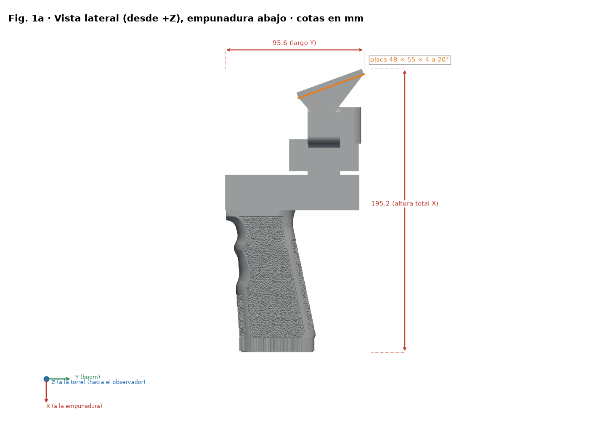
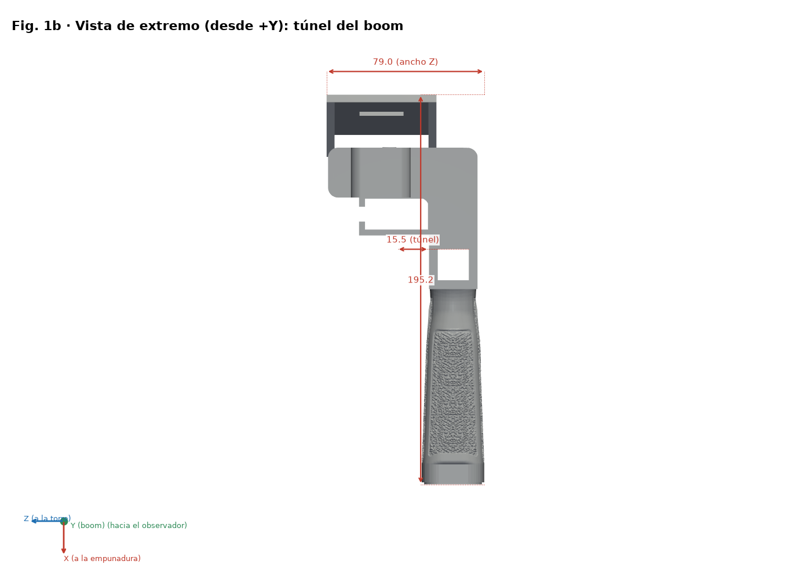
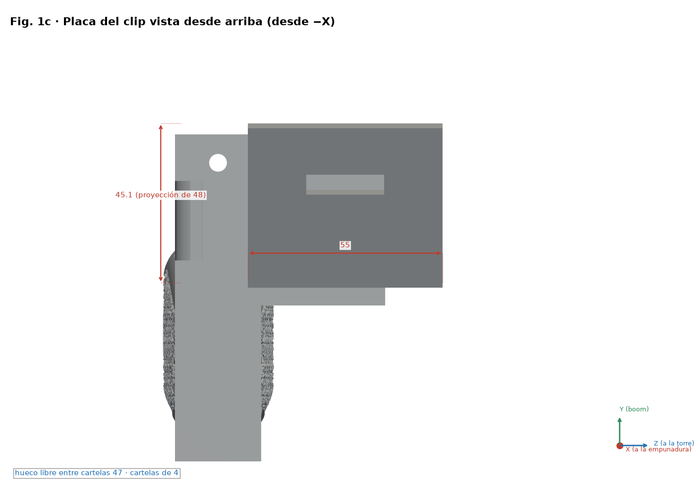
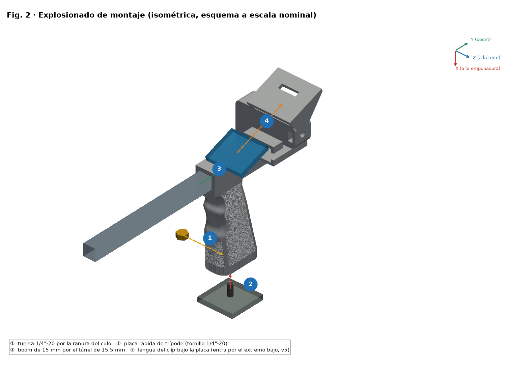
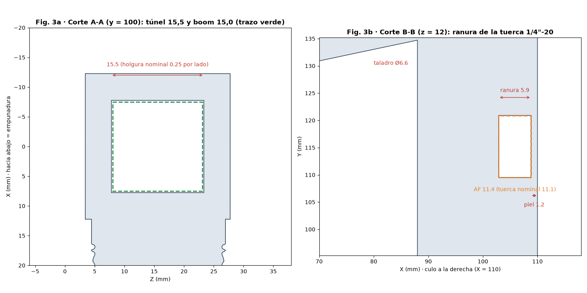
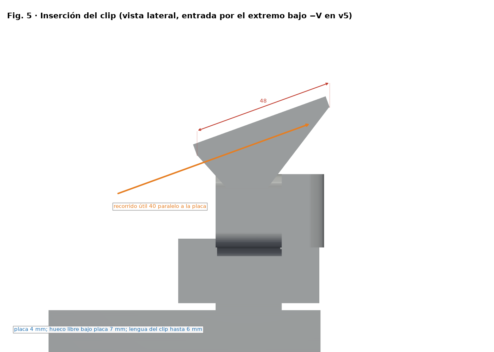

# Poignée SpaceQuad v5 — Guide de montage illustré

[Español](../es/README.md) · [English](../en/README.md) · [Deutsch](../de/README.md) · **Français** · [Italiano](../it/README.md)

> Basé sur la géométrie de `feat/v5-radio-180` (2497ad7). Si la géométrie change, régénérer avec `src/render_guia.py`. Les dimensions du clip sont estimées, non mesurées.

## Graphiques

*Vue latérale cotée (X pointe vers la prise)*

*Vue de bout (culasse)*

*Plan de la plaque du clip : 55 × 48 × 4 mm à 20°*

*Vue éclatée et étapes numérotées ①–④ (l'écrou entre par Z−)*

*Coupes A-A (tunnel) et B-B (logement d'écrou)*

*Orientations d'impression comparées*

*Insertion du clip (v3 par +V ; v5 par −V)*

## Nomenclature (BOM)

| N° | Qté | Élément | Dimension / spécification | Remarque |
|---|---|---|---|---|
| 1 | 1 | Poignée imprimée v5 (`stl/v5/*uvk5v3.stl`) | Encombrement 195.2 × 95.6 × 79.0 mm | PETG recommandé |
| 2 | 1 | Écrou hexagonal 1/4"-20 UNC | Sur plats 11.1 mm, épaisseur 5.6 mm | Logement SP 11.4 × 5.9 mm |
| 3 | 1 | Mât / boom (non inclus) | Ø15 mm, tunnel 15.5 × 15.5 mm (jeu nominal 0.25 mm par côté) | Mesurer le mât réel |
| 4 | 0–1 | Plaque/vis de déclenchement rapide trépied (option) | 1/4"-20 | Selon usage |
| 5 | 0–1 | Duplexeur et bande EVA (options) | — | Selon la radio |

Cette conception **n'a ni roulements ni arbres** ; la seule visserie est l'écrou 1/4"-20.

## Ordre de montage

1. Vérifier la pièce : ébavurer le tunnel et le logement hexagonal.
2. Insérer l'écrou côté Z− dans le logement (peau de 1.2 mm vers la culasse).
3. Faire glisser le mât Ø15 mm dans le tunnel de 15.5 × 15.5 mm.
4. Monter le clip sur la plaque (55 × 48 × 4 à 20°) et fixer la radio.

## Mesurer et ajuster les jeux (ajustement mécanique)

> ⚠ ESSAI PHYSIQUE EN ATTENTE

1. Imprimer `stl/calibracion/prueba_holguras.stl` (124 × 92 × 8 mm) avec le profil FINAL et le même filament.
2. Rangée 1 : trous carrés 15.1–15.9 mm pour le mât. Rangée 2 : logements hexagonaux SP 11.1–11.9 mm. Rangée 3 : fentes 6.0–8.0 mm. Les alvéoles 1–5 indiquent la taille.
3. Mesurer au pied à coulisse (0.02 mm) après 24 h de refroidissement ; essayer avec le vrai mât et le vrai écrou.
4. Choisir le trou qui glisse à la pression du doigt sans jeu visible (objectif initial 0.2–0.3 mm par côté, à valider).
5. Corriger via la compensation XY des trous du slicer (si disponible) ou le modèle ; ne pas régler l'ajustement avec le débit.

## Vérification de résistance (essais prudents)

> ⚠ ESSAI PHYSIQUE EN ATTENTE

1. Peser la radio avec accessoires : masse réelle M (inconnue a priori).
2. Charge d'épreuve = 2 × M, appliquée par paliers de 25 %, 50 % et 100 % de cette charge, 60 s chacun, lest au-dessus d'une surface basse et protégée.
3. Inspecter après chaque palier ; arrêter en cas de fissures, blanchiment ou déformation > 0.3 mm.
4. Procédure pratique, pas une certification. Charges justifiées par M ; jamais au-dessus d'une personne ou d'un matériel de valeur.

## Licence et attribution

Licence CC du dépôt (`LICENSE`, Bricohams). Le rebobineur Pastamatic conserve sa paternité d'origine ; sa licence n'est pas vérifiée et il n'est pas publié ici.
