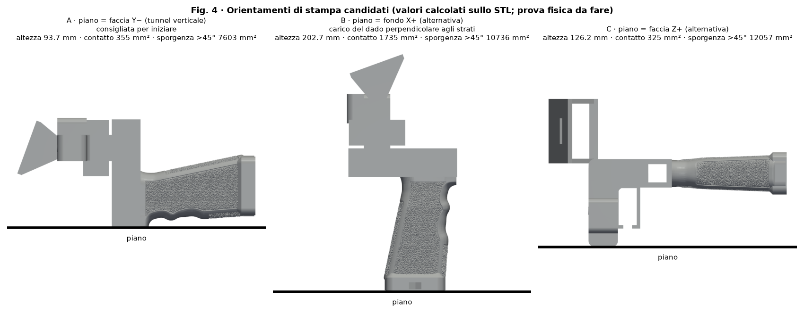

# Materiale e orientamento — SpaceQuad v6.2

[Español](../es/README.md) · [English](../en/README.md) · [Deutsch](../de/README.md) · [Français](../fr/README.md) · **Italiano**

> ⚠ PROVA FISICA IN SOSPESO

## Materiale e orientamento

| Opzione | Quando | Stato |
|---|---|---|
| PETG (consigliato) | Uso generale, tenacità; buona adesione tra strati | iniziale, prova in sospeso |
| ASA | Esterno prolungato/UV; servono ventilazione e camera chiusa | iniziale, prova in sospeso |
| PLA | Sconsigliato: scorrimento/deformazione col calore | — |

| Faccia sul piatto | Altezza | Contatto | Sporgenza >45° | Commento |
|---|---|---|---|---|
| Y− | 93.7 mm | 355 mm² | 7603 mm² | Consigliata: tunnel verticale; strati ad anello attorno all'asta; carico del dado nel piano degli strati; usare brim |
| X+ | 202.7 mm | 1735 mm² | 10736 mm² | Asse del dado verticale: trazione perpendicolare agli strati (debole) |
| Z+ | 126.2 mm | 325 mm² | 12057 mm² | Alternativa |

## Profili iniziali

| Parametro | Valore iniziale |
|---|---|
| Altezza strato | 0.20 mm |
| Perimetri | 4 |
| Riempimento | gyroid 40 % (60–100 % o pareti extra nella trave e nella zona del treppiede) |
| Brim | 5 mm (opzione A) |
| Supporti | sotto la piastra e la trave |
| Correzione dimensionale | 0 fino alla misura del provino |

Sono tutti valori iniziali **in attesa di prova fisica**; nessun parametro universale: usare l'intervallo di temperatura stampato sulla bobina.

## Consigli di stampa

- Supporti sotto la piastra e sotto la trave.
- Riempimento alto (60–100 %) o pareti extra nella trave e nella zona del treppiede.
- Eseguire una prova di carico prima di fidarsi del pezzo (vedere la sezione sulla verifica di resistenza).

- https://wiki.bambulab.com/en/filament/petg
