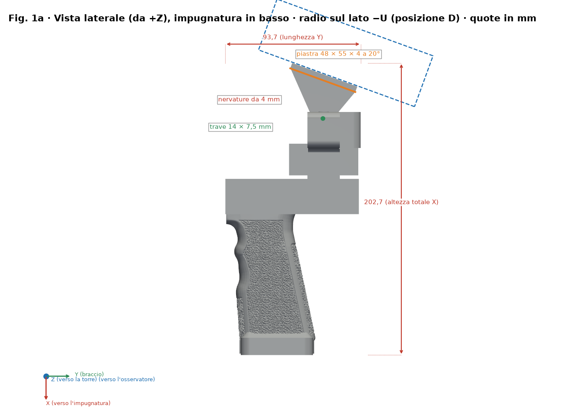
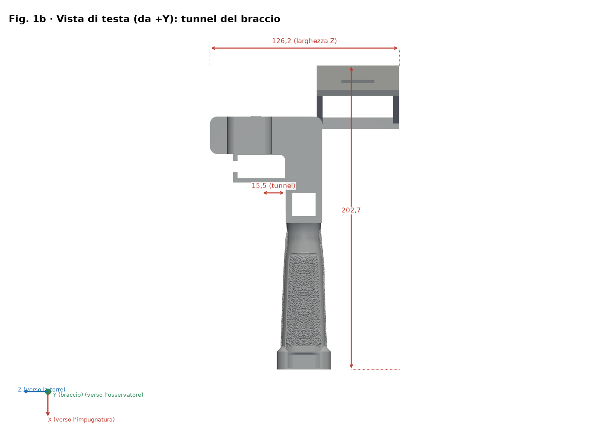
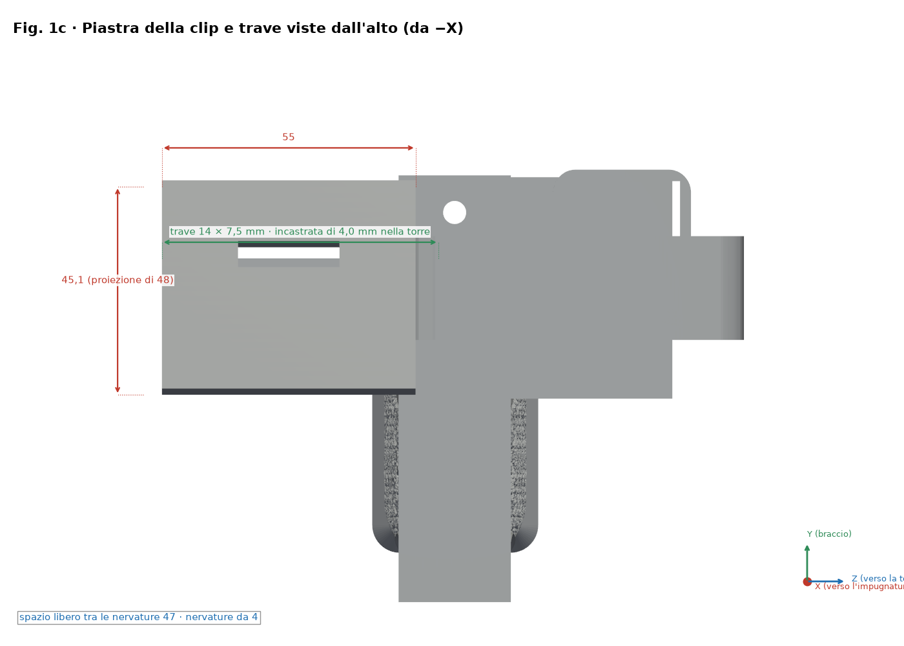
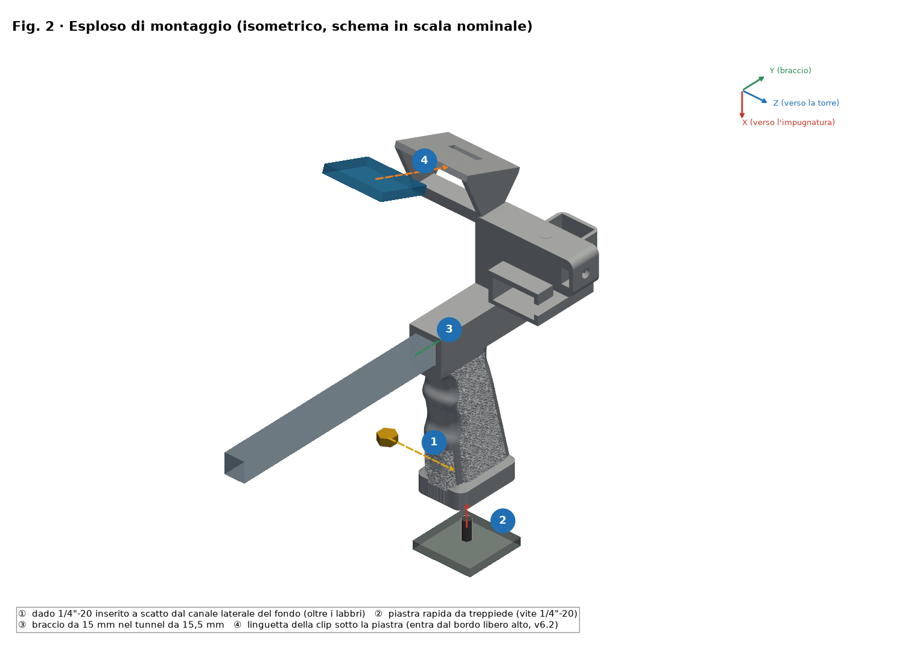
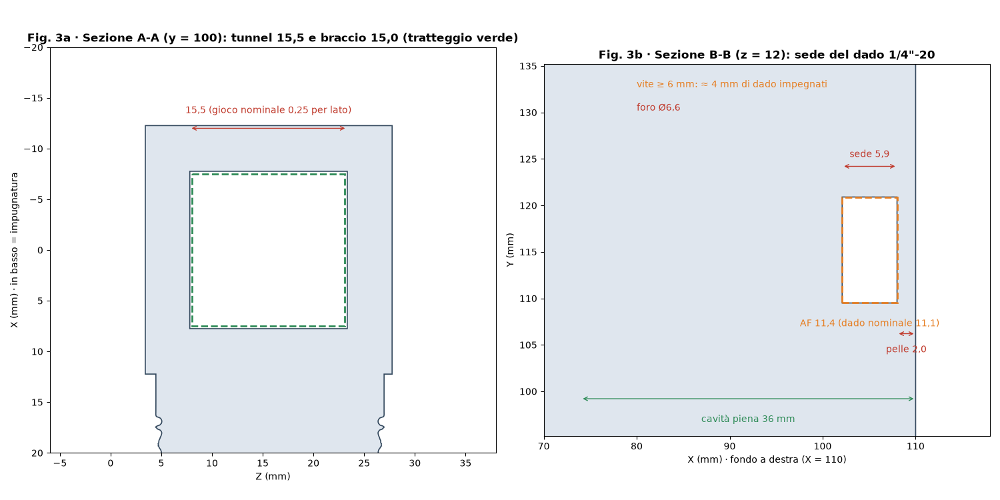
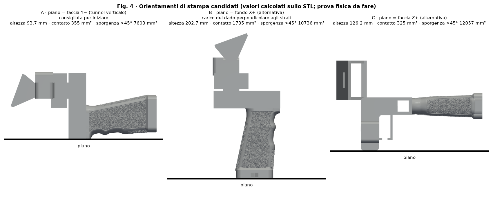
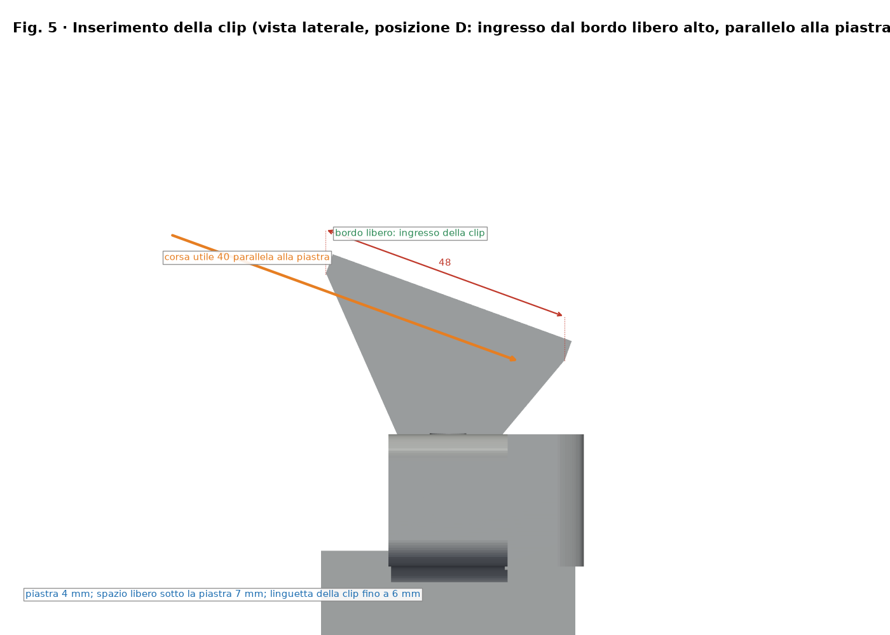

# Impugnatura SpaceQuad v6.2 — Guida di montaggio illustrata

[Español](../es/README.md) · [English](../en/README.md) · [Deutsch](../de/README.md) · [Français](../fr/README.md) · **Italiano**

> Basato sulla geometria v6.2 (posizione D) in `stl/v6/`. Se la geometria cambia, rigenerare con `src/render_guia.py`. Solo CAD: le dimensioni della clip e di ogni radio sono stimate, non misurate, e non c'è prova di carico.

## Posizione D (v6.2)

- Con l'impugnatura in mano, la radio si trova sul lato del braccio opposto alla torre e al duplexer (lato −U), inclinata di 20° verso l'operatore (estremità superiore verso −V).
- Una trave da 14 × 7.5 mm collega le due nervature della piastra alla torre e vi è incastrata; non tocca né il tunnel del braccio né il duplexer.
- La clip entra parallela alla piastra dal suo bordo libero alto e avanza verso il fondo dell'alloggiamento, dove si trova la finestra di ritenzione (corsa utile 40 mm).

## Varianti per radio

| Radio | File STL | Ingombro della radio (stimato, mm) | Altezza piastra PH0 (mm) |
|---|---|---|---|
| UV-K5 V3 | `stl/v6/mango_spacequad_v6_uvk5v3.stl` | 115 × 60 × 37.5 | 72.5 |
| RT-950 Pro | `stl/v6/mango_spacequad_v6_rt950pro.stl` | 162 × 66 × 48 | 88.5 |

## Dado da treppiede rinforzato

- Pelle di 2.0 mm sulla faccia del fondo (prima 1.2 mm) e pareti di almeno 3 mm attorno alla sede esagonale.
- Il dado si inserisce a scatto: lo si introduce dal canale laterale e si assesta superando i labbri di ritenzione (apertura 10.6 mm contro 11.1 mm del dado). L'interferenza è teorica.
- Una vite da treppiede da 6 mm o più impegna circa 4 mm del dado (nominale 5.6 mm).
- Cavità dell'impugnatura riempita per 36 mm con transizione conica e flangia opzionale sul fondo.

## Consigli di stampa

- Supporti sotto la piastra e sotto la trave.
- Riempimento alto (60–100 %) o pareti extra nella trave e nella zona del treppiede.
- Eseguire una prova di carico prima di fidarsi del pezzo (vedere la sezione sulla verifica di resistenza).

## Grafici

> Le figure mostrano la variante UV-K5 V3; la RT-950 Pro condivide la stessa geometria tranne l'altezza della piastra.

*Vista laterale quotata (X punta verso l'impugnatura; radio sul lato −U)*

*Vista di testa (culatta)*

*Pianta della piastra della clip e della trave: 55 × 48 × 4 mm a 20°*

*Vista esplosa e passi numerati ①–④ (il dado si inserisce a scatto da Z−)*

*Sezioni A-A (tunnel) e B-B (sede del dado, pelle da 2 mm)*

*Orientamenti di stampa a confronto*

*Inserimento della clip (posizione D: dal bordo libero alto, parallelo alla piastra)*

## Distinta base (BOM)

| N. | Q.tà | Elemento | Misura / specifica | Nota |
|---|---|---|---|---|
| 1 | 1 | Impugnatura stampata v6.2 (`stl/v6/*_v6_uvk5v3.stl` o `*_v6_rt950pro.stl`) | Ingombro 202.7 × 93.7 × 126.2 mm (UV-K5 V3) | PETG consigliato |
| 2 | 1 | Dado esagonale 1/4"-20 UNC | Chiave 11.1 mm, spessore 5.6 mm | Sede CH 11.4 × 5.9 mm |
| 3 | 1 | Asta / boom (non inclusa) | Ø15 mm, tunnel 15.5 × 15.5 mm (gioco nominale 0.25 mm per lato) | Misurare l'asta reale |
| 4 | 0–1 | Piastra/vite a sgancio rapido per treppiede (opzionale) | 1/4"-20 | Secondo l'uso |
| 5 | 0–1 | Duplexer e striscia EVA (opzionali) | — | Secondo la radio |

Questo progetto **non ha cuscinetti né alberi**; l'unica minuteria è il dado 1/4"-20.

## Ordine di montaggio

1. Controllare il pezzo: sbavare tunnel e sede esagonale.
2. Inserire a scatto il dado dal canale laterale del lato Z−, oltre i labbri di ritenzione (pelle di 2.0 mm verso la culatta; una vite da 6 mm o più impegna circa 4 mm).
3. Far scorrere l'asta Ø15 mm nel tunnel di 15.5 × 15.5 mm.
4. Introdurre la linguetta della clip dal bordo libero alto della piastra (55 × 48 × 4 a 20°), parallelamente ad essa, e fissare la radio sul lato −U.

## Misurare e regolare i giochi (accoppiamento meccanico)

> ⚠ PROVA FISICA IN SOSPESO

1. Stampare `stl/calibracion/prueba_holguras.stl` (124 × 92 × 8 mm) con il profilo FINALE e lo stesso filamento.
2. Fila 1: fori quadrati 15.1–15.9 mm per l'asta. Fila 2: sedi esagonali CH 11.1–11.9 mm. Fila 3: asole 6.0–8.0 mm. Le fossette 1–5 indicano la misura.
3. Misurare con calibro (0.02 mm) dopo 24 h di raffreddamento; provare con asta e dado reali.
4. Scegliere il foro che scorre con pressione delle dita senza gioco visibile (obiettivo iniziale 0.2–0.3 mm per lato, da verificare).
5. Correggere con la compensazione XY dei fori dello slicer (se presente) o col modello; non regolare l'accoppiamento col flusso.

## Verifica di resistenza (prove prudenti)

> ⚠ PROVA FISICA IN SOSPESO

1. Pesare la radio con accessori: massa reale M (non nota a priori).
2. Carico di prova = 2 × M, applicato a gradini del 25 %, 50 % e 100 % di tale carico, 60 s ciascuno, zavorra su superficie bassa e protetta.
3. Ispezionare dopo ogni gradino; fermarsi con crepe, sbiancamento o deformazione > 0.3 mm.
4. Procedura pratica, non una certificazione. Carichi giustificati da M; mai sopra persone o apparecchi di valore.

## Versioni precedenti

Restano solo v1 (input), v3 (generatore di base e riferimento Anytone) e l'Anytone generico (figure in `docs/img/guia/anytone/`). v2, v4 e v5 sono state rimosse; si recuperano dalla cronologia git (commit precedente alla pulizia).

| Variante | File STL | Ingombro (mm) | Volume (mm³) |
|---|---|---|---|
| Anytone generico regolabile (base già rinforzata; spessori opzionali) | `stl/mango_spacequad_anytone_generico.stl + stl/anytone_calzos/*.stl` | 195.2 × 93.7 × 79.0 | 213099 |

## Licenza e attribuzione

Licenza CC del repository (`LICENSE`, Bricohams). Il riavvolgitore Pastamatic mantiene la paternità originale; la sua licenza non è verificata e non è pubblicato qui.
