# Impugnatura SpaceQuad v5 — Guida di montaggio illustrata

[Español](../es/README.md) · [English](../en/README.md) · [Deutsch](../de/README.md) · [Français](../fr/README.md) · **Italiano**

> Basato sulla geometria finale di main (v5, v5+rinforzo e Anytone). Se la geometria cambia, rigenerare con `src/render_guia.py`. Le dimensioni della clip sono stimate, non misurate.

## Varianti (geometria finale)

| Variante | File STL | Ingombro (mm) | Volume (mm³) |
|---|---|---|---|
| v5 (UV-K5 V3 / RT-950 Pro, identici) | `stl/v5/*uvk5v3.stl, *rt950pro.stl` | 195.2 × 95.6 × 79.0 | 191951 |
| v5 + base rinforzata (UV-K5 V3 / RT-950 Pro) | `stl/refuerzo/*_v5_*_refuerzo.stl` | 195.2 × 95.6 × 79.0 | 205173 |
| Anytone generico regolabile (base già rinforzata; spessori opzionali) | `stl/mango_spacequad_anytone_generico.stl + stl/anytone_calzos/*.stl` | 195.2 × 93.7 × 79.0 | 213099 |

## Grafici

### v5 (UV-K5 V3 / RT-950 Pro, identici)

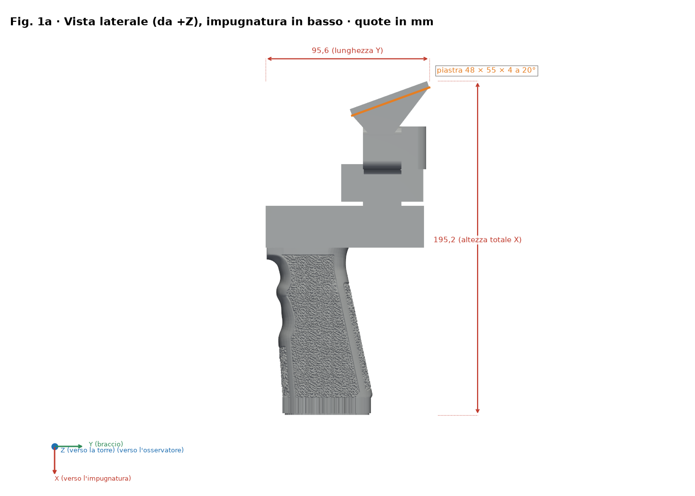
*Vista laterale quotata (X punta verso l'impugnatura)*

*Vista di testa (culatta)*

*Pianta della piastra della clip: 55 × 48 × 4 mm a 20°*

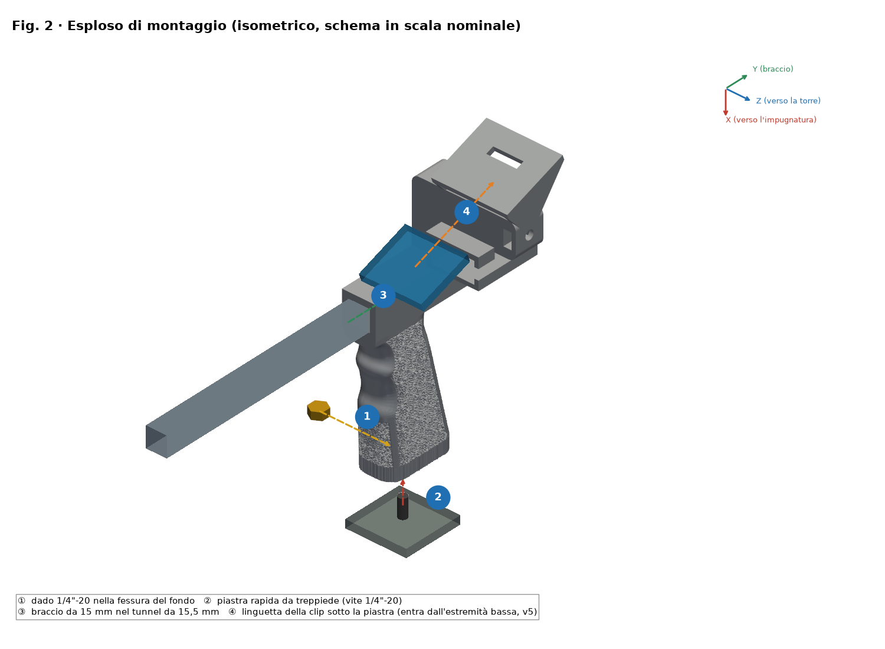
*Vista esplosa e passi numerati ①–④ (il dado entra da Z−)*

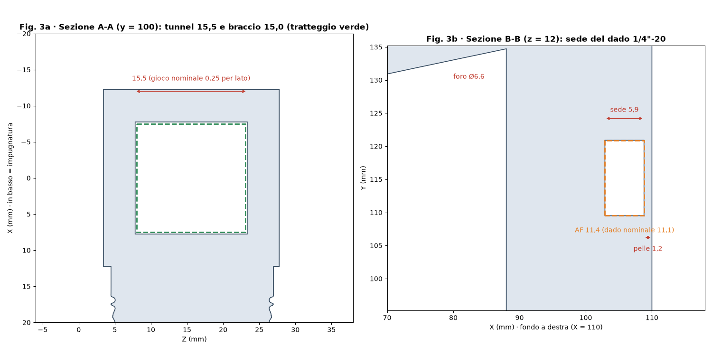
*Sezioni A-A (tunnel) e B-B (sede del dado)*

*Orientamenti di stampa a confronto*

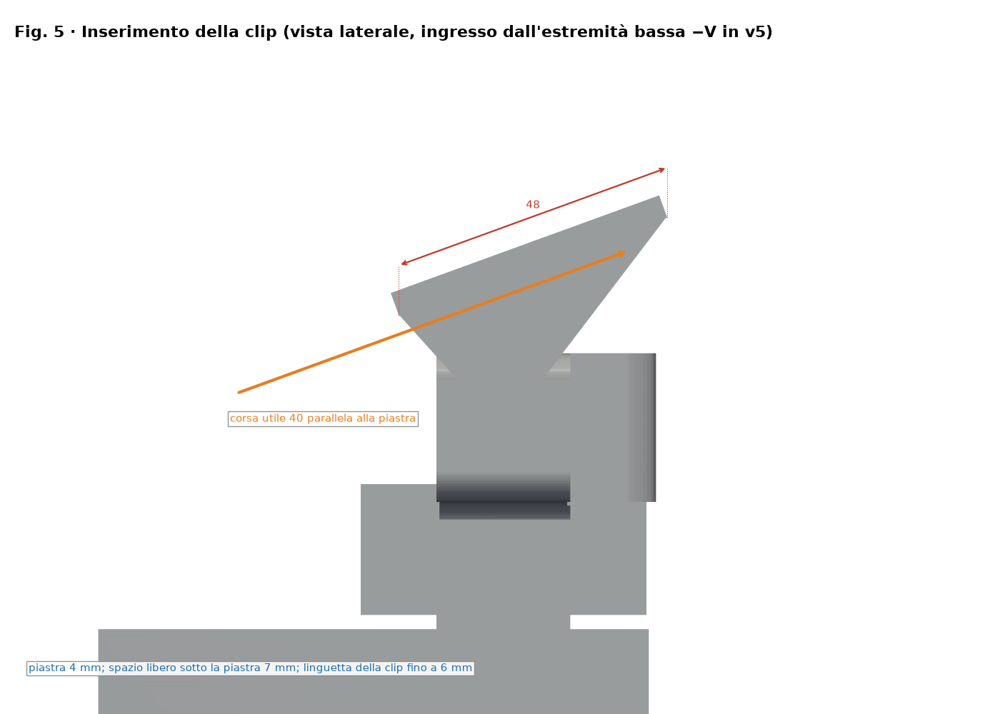
*Inserimento della clip (v3 da +V; v5 da −V)*

### v5 + base rinforzata (UV-K5 V3 / RT-950 Pro)

*Vista laterale quotata (X punta verso l'impugnatura)*

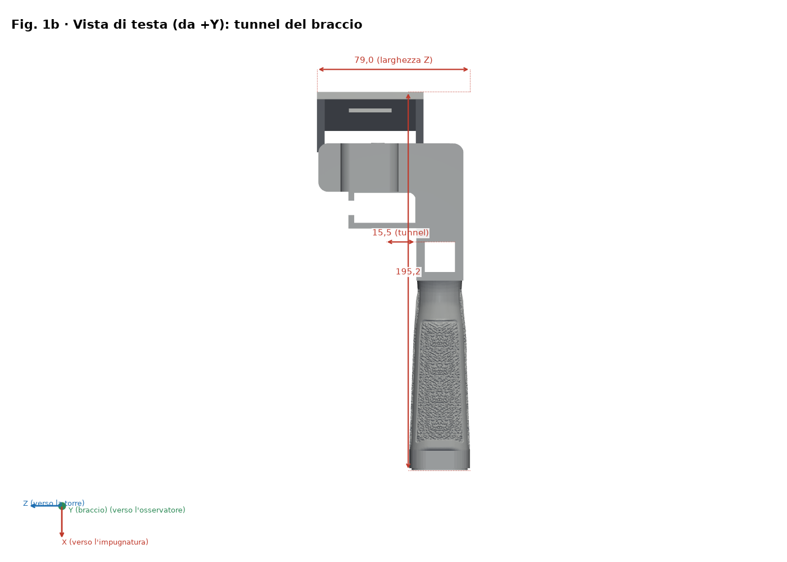
*Vista di testa (culatta)*

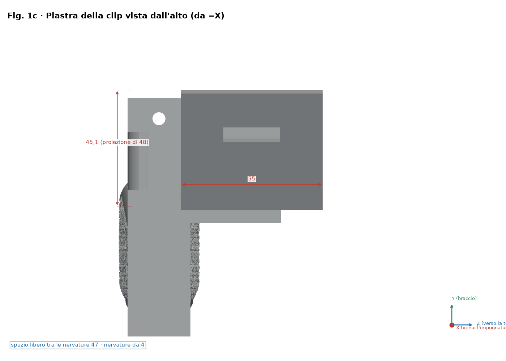
*Pianta della piastra della clip: 55 × 48 × 4 mm a 20°*

*Vista esplosa e passi numerati ①–④ (il dado entra da Z−)*

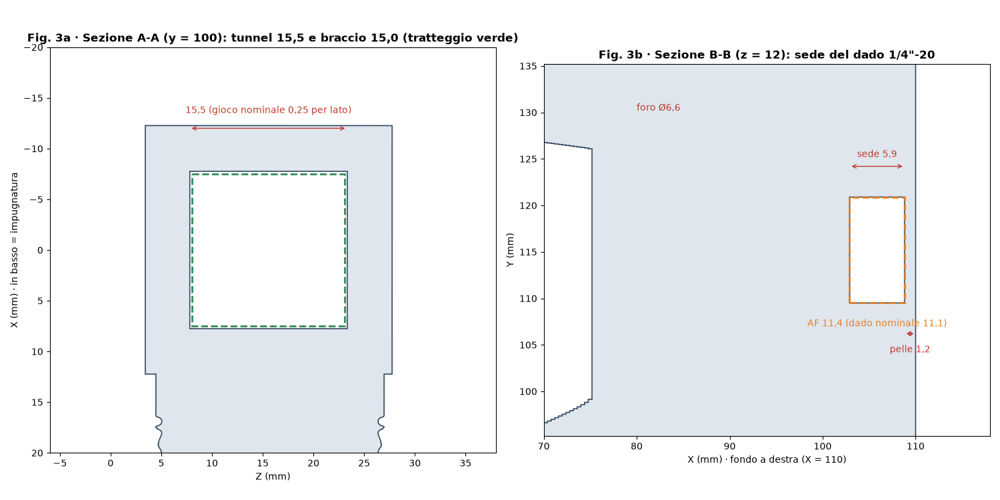
*Sezioni A-A (tunnel) e B-B (sede del dado)*

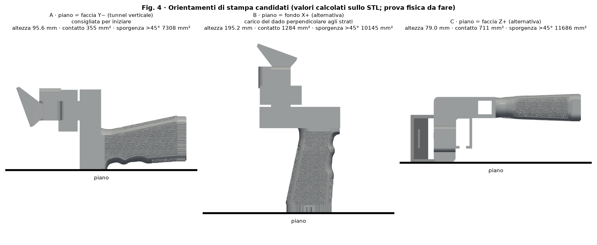
*Orientamenti di stampa a confronto*

*Inserimento della clip (v3 da +V; v5 da −V)*

### Anytone generico regolabile (base già rinforzata; spessori opzionali)

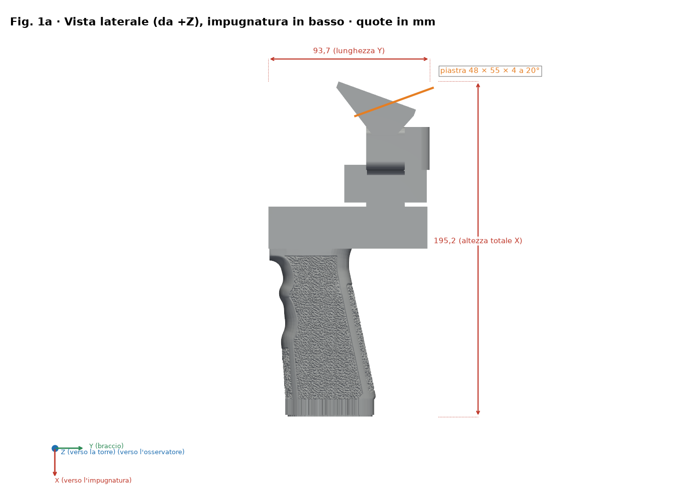
*Vista laterale quotata (X punta verso l'impugnatura)*

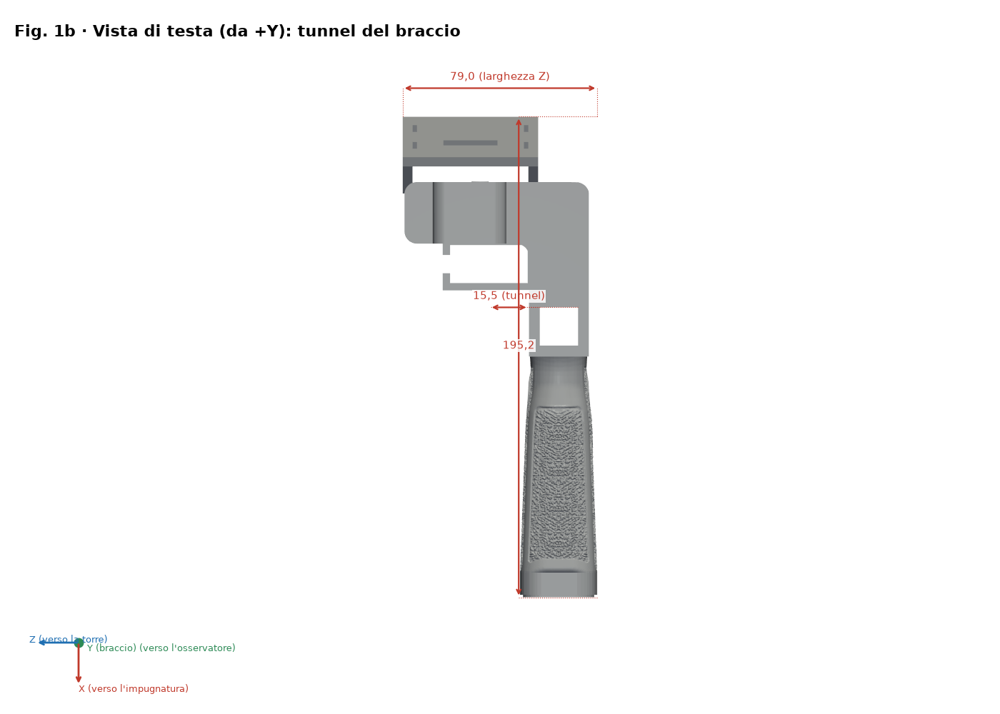
*Vista di testa (culatta)*

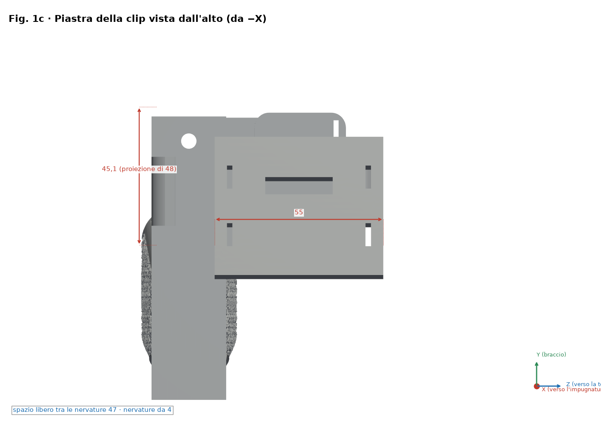
*Pianta della piastra della clip: 55 × 48 × 4 mm a 20°*

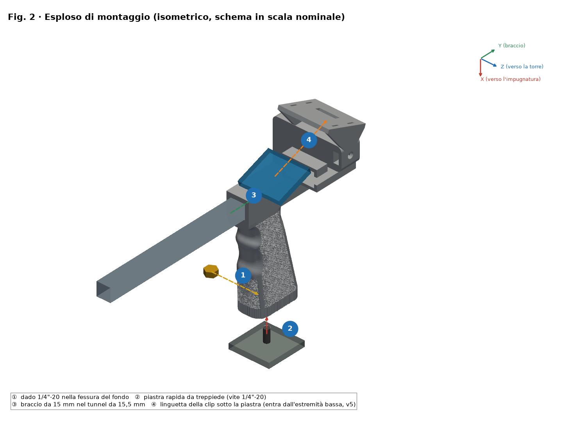
*Vista esplosa e passi numerati ①–④ (il dado entra da Z−)*

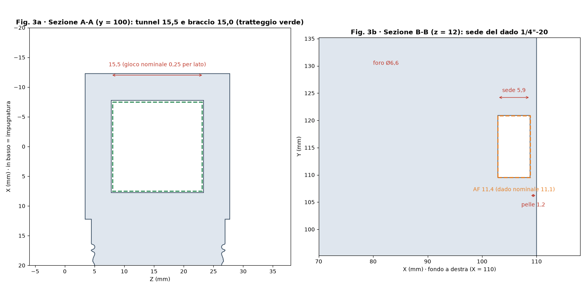
*Sezioni A-A (tunnel) e B-B (sede del dado)*

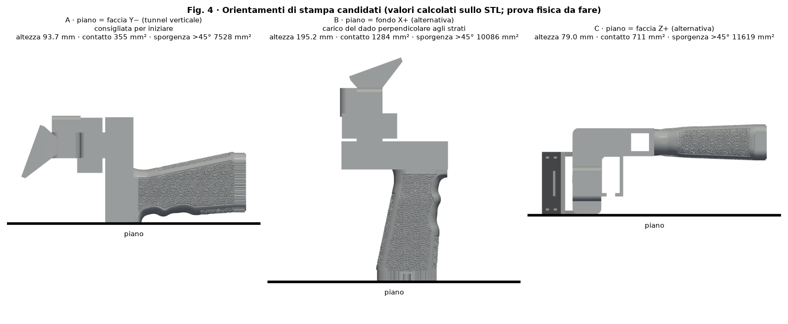
*Orientamenti di stampa a confronto*

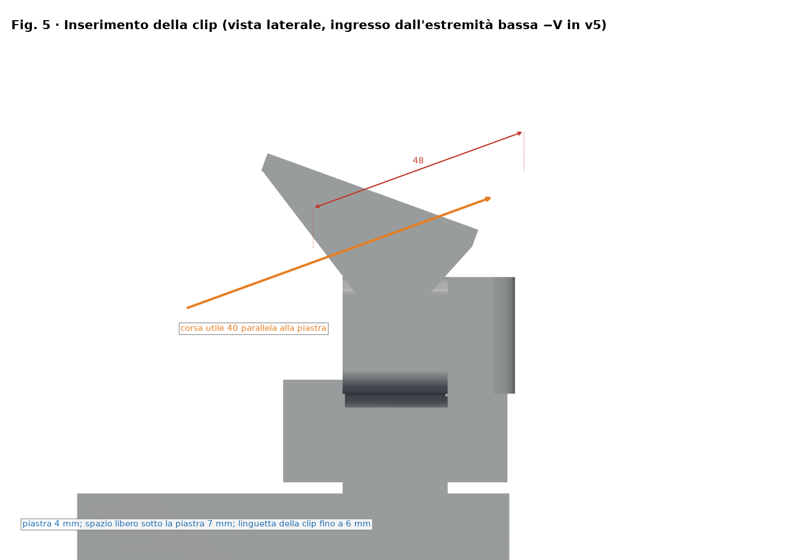
*Inserimento della clip (v3 da +V; v5 da −V)*

## Distinta base (BOM)

| N. | Q.tà | Elemento | Misura / specifica | Nota |
|---|---|---|---|---|
| 1 | 1 | Impugnatura stampata v5 (`stl/v5/*uvk5v3.stl`) | Ingombro 195.2 × 95.6 × 79.0 mm | PETG consigliato |
| 2 | 1 | Dado esagonale 1/4"-20 UNC | Chiave 11.1 mm, spessore 5.6 mm | Sede CH 11.4 × 5.9 mm |
| 3 | 1 | Asta / boom (non inclusa) | Ø15 mm, tunnel 15.5 × 15.5 mm (gioco nominale 0.25 mm per lato) | Misurare l'asta reale |
| 4 | 0–1 | Piastra/vite a sgancio rapido per treppiede (opzionale) | 1/4"-20 | Secondo l'uso |
| 5 | 0–1 | Duplexer e striscia EVA (opzionali) | — | Secondo la radio |

Questo progetto **non ha cuscinetti né alberi**; l'unica minuteria è il dado 1/4"-20.

## Ordine di montaggio

1. Controllare il pezzo: sbavare tunnel e sede esagonale.
2. Inserire il dado dal lato Z− nella sede (pelle di 1.2 mm verso la culatta).
3. Far scorrere l'asta Ø15 mm nel tunnel di 15.5 × 15.5 mm.
4. Montare la clip sulla piastra (55 × 48 × 4 a 20°) e fissare la radio.

## Misurare e regolare i giochi (accoppiamento meccanico)

> ⚠ PROVA FISICA IN SOSPESO

1. Stampare `stl/calibracion/prueba_holguras.stl` (124 × 92 × 8 mm) con il profilo FINALE e lo stesso filamento.
2. Fila 1: fori quadrati 15.1–15.9 mm per l'asta. Fila 2: sedi esagonali CH 11.1–11.9 mm. Fila 3: asole 6.0–8.0 mm. Le fossette 1–5 indicano la misura.
3. Misurare con calibro (0.02 mm) dopo 24 h di raffreddamento; provare con asta e dado reali.
4. Scegliere il foro che scorre con pressione delle dita senza gioco visibile (obiettivo iniziale 0.2–0.3 mm per lato, da verificare).
5. Correggere con la compensazione XY dei fori dello slicer (se presente) o col modello; non regolare l'accoppiamento col flusso.

## Verifica di resistenza (prove prudenti)

> ⚠ PROVA FISICA IN SOSPESO

1. Pesare la radio con accessori: massa reale M (non nota a priori).
2. Carico di prova = 2 × M, applicato a gradini del 25 %, 50 % e 100 % di tale carico, 60 s ciascuno, zavorra su superficie bassa e protetta.
3. Ispezionare dopo ogni gradino; fermarsi con crepe, sbiancamento o deformazione > 0.3 mm.
4. Procedura pratica, non una certificazione. Carichi giustificati da M; mai sopra persone o apparecchi di valore.

## Licenza e attribuzione

Licenza CC del repository (`LICENSE`, Bricohams). Il riavvolgitore Pastamatic mantiene la paternità originale; la sua licenza non è verificata e non è pubblicato qui.
